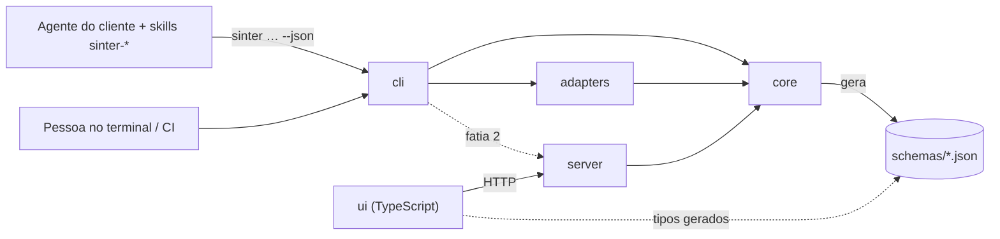
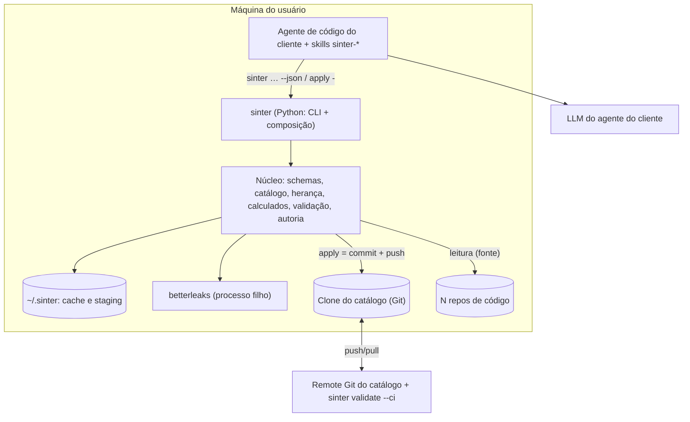
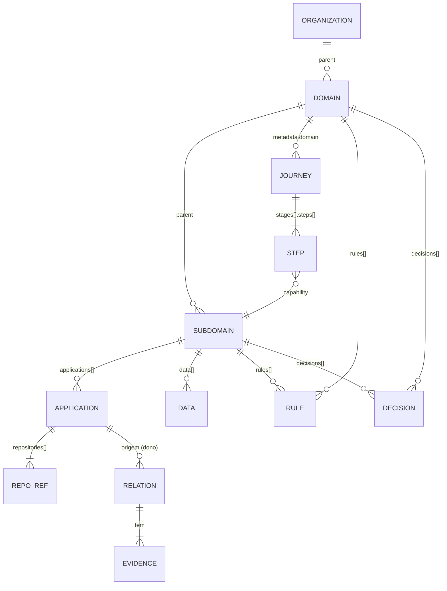

# Architecture Spine — Sinter

## Design Paradigm

**Hexagonal (ports and adapters).** O núcleo contém o modelo do catálogo e os casos de uso, e conhece o mundo externo só por **portas**. **Adaptadores** implementam as portas. A **CLI** é uma porta de entrada e a raiz de composição. As **skills do Sinter** rodam no agente de código do cliente e usam a porta da CLI: a skill conversa e julga; a CLI valida, grava e calcula. **Back-end em Python, front em TypeScript**; o contrato entre eles é JSON Schema gerado do núcleo.

| Camada | Onde | Pode depender de | Fatia |
| --- | --- | --- | --- |
| Núcleo (schemas, catálogo, herança, calculados, validação, autoria, grafo, scoring) | `src/sinter/core` (Python) | nada do projeto | 1 |
| Adaptadores (YAML em disco, Git, scanner de segredos, importadores) | `src/sinter/adapters` (Python) | `core` | 1 |
| CLI e composição | `src/sinter/cli` (Python) | `core`, `adapters`, `server` | 1 |
| Contrato publicado | `schemas/*.json` (gerado) | — | 1 |
| Skills do Sinter (SKILL.md) | `skills/sinter-*` | só a CLI (`sinter … --json`) | 1 |
| Servidor local (HTTP) | `src/sinter/server` (Python) | `core` | 2 |
| App visual (SPA) | `ui/` (TypeScript) | só `schemas/*.json` e o servidor | 2 |



## Invariants & Rules

### AD-1 — Direção de dependência do hexágono [ADOPTED]

- **Binds:** all
- **Prevents:** núcleo acoplado a Git, disco, formato de skill ou provedor de LLM; troca de adaptador exigindo mexer no domínio.
- **Rule:** `core` (no código da fatia 1: `domain` + `application` + `ports`, ver espinha `architecture-sinter-codigo-2026-10-20`, AD-25) não importa `adapters`, `cli` nem `server`, não faz I/O e **não lê o relógio**: arquivos, Git e instantes entram por portas ou parâmetros. Todo acesso externo passa por uma porta definida em `core/ports`. Só `cli` (e `server`, na fatia 2) instancia adaptadores.

### AD-2 — O catálogo em Git é a fonte única da verdade

- **Binds:** FR-1..FR-4, FR-14..FR-16, FR-21..FR-24, NFR-4, NFR-7, catálogo
- **Prevents:** conhecimento preso a um repo por domínio; cópias divergentes entre banco e arquivos.
- **Rule:** o conhecimento aprovado existe **só** como arquivos num **repo Git de catálogo** (um por organização ou área), com cada domínio em `domains/<id-domínio em minúsculas>/`. Os **N repos de código** são fontes, registrados em `repositories.yaml` e citados pelas aplicações; nunca guardam conhecimento oficial (o `.sinter/` é projeção, AD-6). Cache e staging locais (`~/.sinter`) são apagáveis e reconstruíveis. O catálogo tem `schemaVersion` em `organization.yaml`; a CLI recusa escrever num catálogo de versão maior que a suportada e migra os menores por `sinter migrate`.

### AD-3 — Caminho único de escrita: rascunho → `apply` → commit

- **Binds:** FR-2, FR-4, FR-9, FR-12, FR-14..FR-16, FR-19, FR-23, FR-37, PRD-catálogo FR-17, FR-18
- **Prevents:** importação, skills, agentes, edição manual ou a própria CLI gravando conhecimento por caminhos diferentes; importação sobrescrevendo curadoria humana.
- **Rule:** toda escrita no catálogo passa por **um** caso de uso, `core/authoring.apply`, exposto como `sinter apply <arquivo|-> [--dry-run]`. Ele recebe um ou mais manifestos (rascunho escrito por pessoa, por `sinter new`, pela skill ou por um importador), valida (AD-4, AD-18), calcula a diferença contra o catálogo, devolve um **resumo legível** e, sem `--dry-run`, grava cada manifesto no seu caminho canônico e faz **um commit** (AD-15). Edição manual de um arquivo do catálogo só vira oficial ao passar por `apply` (ou pelo `validate --ci`, AD-23). Nenhum outro módulo grava no catálogo, exceto `catalog init` (esqueleto em pasta vazia) e `fmt` (só formato, sem mudar dados), conforme AD-36 da espinha de código; nenhuma skill grava arquivos do catálogo. Quando vier de importação ou grafo (passos seguintes), o rascunho entra como Proposta em staging e só um `apply` humano o promove; campos de posse humana (`status`, aprovação, evidência `extraction: human`) nunca são alterados por importação.

### AD-4 — YAML é a estrutura, Markdown é a narrativa

- **Binds:** FR-1..FR-3, FR-10, FR-14, FR-15, PRD-catálogo FR-1..FR-19 e Apêndice A
- **Prevents:** estrutura escondida em texto livre; dois formatos dizendo a mesma coisa; cada módulo lendo um YAML de um jeito.
- **Rule:** cada arquivo do catálogo é **um manifesto YAML** (`apiVersion: sinter.dev/v1`, `kind`, `metadata`, `spec`) e segue exatamente o **Apêndice A do PRD do Catálogo**, materializado como modelos Pydantic em `core/schemas`, validados na leitura e na escrita. Kinds: `Organization`, `RepositoryList`, `Regulation`, `Standard`, `Domain`, `Subdomain`, `Journey`, `Relation`. **Aplicações** e **dados** são listas dentro do `Subdomain`; **regras** (`rules[]`) e **decisões/ADRs** (`decisions[]`) são listas dentro do `Domain` ou do `Subdomain`; **docs** são listas `docs[]` dentro de cada nível (com `path` para um `.md` em `docs/` do domínio **ou** `url`), nunca arquivos próprios. Markdown só existe em `docs/` e pode citar IDs, mas **nunca declara estrutura**. Campos marcados `(calc)` no Apêndice A nunca são gravados.

### AD-5 — Evidência estruturada

- **Binds:** FR-3, FR-10, FR-12, FR-15, FR-37, NFR-7
- **Prevents:** evidência como texto livre; rejeição reabrindo a cada commit do repo de origem.
- **Rule:** cada entrada de `evidence` é `{ source, locator, version, contentHash, extraction }`. `source` é um id de repo, de doc ou de item do catálogo, ou `conversation/<id>`; `locator` segue o tipo (`path#L10-L24`, `doc.md#ancora`, `file#page=3`, `#msg`); `version` é o commit ou a data; `contentHash` é o hash do trecho; `extraction` ∈ `extracted|inferred|human`. Evidência de fonte só local é aceita sem resolução, desde que tenha `contentHash`. Item sem evidência só é gravado com `extraction: human`.

### AD-6 — Projeções determinísticas

- **Binds:** FR-24..FR-29, FR-36, NFR-3, NFR-4, NFR-5, PRD-catálogo NFR-2
- **Prevents:** saídas diferentes por máquina, por dia ou por execução.
- **Rule:** respostas de `sinter get`, `.sinter/`, exports de ferramenta, skills instaladas, site estático e `schemas/*.json` são **funções puras** de (commit do catálogo, entrada do comando, versão do gerador). Usam só o grafo `official` (AD-13) e o instante `asOf` = data do commit do catálogo. A saída é ordenada e estável byte a byte. Doc com `classification` `confidential` ou `restricted` não entra em projeção, a não ser que a organização libere. Todo arquivo gerado leva o cabeçalho "gerado pelo Sinter" com hash.

### AD-7 — `.sinter/` é o modelo canônico do repo [ADOPTED]

- **Binds:** FR-25..FR-30, NFR-4
- **Prevents:** exportadores lendo arquivos de outra ferramenta; layout mudando sem migração.
- **Rule:** o layout do `.sinter/` e o `sinter.yaml` têm `schemaVersion`. Exportadores leem **só** o `.sinter/`. Mudar o layout exige subir `schemaVersion` e migrar em `sinter sync`.

### AD-8 — Portas e formas normalizadas

- **Binds:** FR-5..FR-11, FR-17..FR-20, FR-37, catálogo
- **Prevents:** formatos de Graphify, de saída de skills ou de bibliotecas vazando para o núcleo.
- **Rule:** as portas são `CatalogStore` (ler/gravar manifestos, preservando comentários; no código da fatia 1 = `CatalogFiles` + `ManifestCodec`, AD-28 da espinha de código), `VersionControl` (commit, fetch, push), `SourceConnector`, `DiscoveryImporter`, `GraphEngine`, `SecretScanner`, `Exporter` e (fatia 2) `LlmProvider`. Cada porta troca **só** modelos de `core/schemas`. O primeiro `DiscoveryImporter` lê a saída da `sinter-documentar` e a converte em rascunhos AD-4 `[ASSUMPTION: até a skill emitir manifestos diretamente]`. `GraphEngine` devolve fatos com alvo podendo ser `unresolved`; o adaptador do Graphify roda como processo filho.

### AD-9 — Na fatia 1, a IA é a do cliente

- **Binds:** FR-2, FR-15, FR-17..FR-20, FR-22, FR-37, NFR-2, NFR-8
- **Prevents:** saída de modelo virando conhecimento oficial; o Sinter carregando chave e provedor antes de precisar; conteúdo de fonte agindo como instrução.
- **Rule:** na fatia 1 o Sinter **não chama LLM**. Todo trabalho de IA (entrevistar, ler fontes, rascunhar manifestos, explicar) é feito pelo agente do cliente, guiado pelas skills, e só chega ao catálogo por `apply` (AD-3). Conteúdo de fonte devolvido pela CLI vem sempre num campo de dados marcado (`content`, com `source` e `locator`) e as skills o tratam como dado, nunca como instrução. Na fatia 2, chamadas de modelo feitas pelo Sinter passam por `LlmProvider`, com prompts versionados e saída só como rascunho.

### AD-10 — Segredos nunca persistem [ADOPTED]

- **Binds:** FR-8, NFR-8
- **Prevents:** credenciais no catálogo, `.sinter/`, exports, cache ou prompts.
- **Rule:** a partir do passo de importação (no passo 1 do catálogo só existe a porta), o `SecretScanner` (betterleaks) roda sobre todo conteúdo lido, importado ou recebido por `apply` **antes** de ser guardado, devolvido por `--json` ou projetado. O achado é guardado só como localização, nunca o valor.

### AD-11 — Processo local, curto, só em loopback

- **Binds:** FR-30, NFR-1, NFR-6
- **Prevents:** serviços em rede expostos; estado dividido entre processos.
- **Rule:** cada `sinter <comando>` é um processo Python que executa e termina. Na fatia 1 não existe servidor; `sinter open` abre o site estático gerado. Na fatia 2, `sinter ui` sobe o servidor HTTP em `127.0.0.1` (porta padrão 4317). Graphify e betterleaks são processos filhos. Nada escuta fora de loopback.

### AD-12 — Front e back só se falam por contrato gerado

- **Binds:** FR-10..FR-37 (lado app, fatia 2), AD-17
- **Prevents:** UI lendo Git ou disco; tipos divergindo entre Python, skills e TypeScript.
- **Rule:** os modelos Pydantic de `core/schemas` geram `schemas/*.json` (JSON Schema), versionados junto com o código e publicados no pacote. A UI (TypeScript) gera seus tipos a partir desses arquivos e acessa dados **só** pelo servidor HTTP; as saídas `--json` da CLI seguem os mesmos schemas. Ninguém escreve à mão um tipo que já existe no schema. Erros seguem o envelope da convenção.

### AD-13 — Um único grafo, em dois modos

- **Binds:** FR-10, FR-11, FR-13, FR-34..FR-36, catálogo
- **Prevents:** consultas, impacto, site e visões mostrando dados diferentes; rascunhos locais entrando em artefato compartilhado.
- **Rule:** `core/catalog.load(commit)` monta **um** modelo do catálogo em memória (hierarquia, aplicações, dados, jornadas, relações), e `core/graph` deriva dele um multigrafo dirigido. Modo `official` (padrão): só `approved`. Modo `working`: soma rascunhos do staging local, marcados `candidate`, e declara isso na saída. Projeções usam só `official`. Relações inversas são derivadas, nunca gravadas. A cor e o agrupamento do mapa vêm do **Subdomínio**. O modelo e o grafo são estado derivado, nunca persistido como fonte.

### AD-14 — Projeto = manifesto + receita + camadas

- **Binds:** FR-21..FR-24, NFR-3
- **Prevents:** pacote montado "na mão" pela IA; orçamento contado de formas diferentes.
- **Rule:** tarefa ou projeto = `projects/<id>/` no catálogo com `project.yaml` (camadas com dono e status), `context.yaml` (receita: `primary`, `changes[]`, `traversal`, `include[]`, `budget`, `catalogCommit`) e um Markdown por camada. A skill só propõe a receita; `sinter task new` grava via `apply`; `sinter task build` monta o pacote a partir de `catalogCommit` no grafo `official`, ordenando por relevância (AD-20) e cortando no orçamento; o que fica de fora vira ponteiro. Tokens contados só por `core/context.count_tokens`. Números de tarefa e de ADR vêm de `nextTaskNumber` e `nextAdrNumber` do `domain.yaml`, incrementados pelo autor no mesmo rascunho que cria o item (o `apply` avisa se não foi, e nunca altera o rascunho).

### AD-15 — Identidade e papéis no MVP

- **Binds:** FR-16, FR-23, FR-32
- **Prevents:** gravações sem autor verificável; dois registros de dono divergindo.
- **Rule:** o autor é o `git user.name`/`user.email` local. `people.yaml` (raiz do catálogo) é a única fonte de papéis por pessoa e por domínio; o `CODEOWNERS` do catálogo é gerado dele. Todo commit feito por `apply` leva os trailers `Sinter-Action`, `Sinter-Items` e `Sinter-Version`; `Sinter-Role` e `people.yaml` entram no passo 8 (multiusuário). Não há login próprio.

### AD-16 — Conteúdo bruto fica local; só saídas aprovadas sobem

- **Binds:** FR-17..FR-20, FR-37
- **Prevents:** transcrições, anexos e conversas brutas (com dado pessoal) indo para o catálogo.
- **Rule:** conversas, anexos brutos e staging ficam em `~/.sinter/workspaces/<catálogo>`, referenciados por hash. Para o catálogo vão só manifestos e Markdown gravados por `apply`. Ata entra como doc `type: ata` apontando para um `.md` minimizado (decisões, propostas, dúvidas; sem atribuição pessoal); a decisão relevante é promovida a ADR (item de `decisions[]` do nível) com evidência na ata.

### AD-17 — Skills são a interface, a CLI é a regra

- **Binds:** FR-24..FR-30, PRD-catálogo FR-15..FR-18
- **Prevents:** regra do Sinter vivendo em prompt; cada skill gravando arquivos do seu jeito.
- **Rule:** as skills `sinter-<verbo>` (SKILL.md, padrão aberto) só agem chamando `sinter <comando> --json` e lendo o resultado; para criar ou alterar, escrevem um **rascunho** e o enviam por `sinter apply - --dry-run`, mostram o resumo e só então chamam `sinter apply -`. Nenhuma skill lê ou escreve o catálogo, o staging ou o `.sinter/` diretamente. Toda regra verificável vive na CLI. Toda saída `--json` segue `schemas/*.json` (AD-12) e todo comando termina com código `0` (ok) ou diferente de `0` (erro). As skills vivem em `skills/sinter-<verbo>/` (padrão Agent Skills) e são instaladas por `sinter skills install` na pasta de cada agente suportado, como projeção (AD-6).

### AD-18 — Hierarquia, pastas e identidade

- **Binds:** PRD-catálogo FR-3..FR-9, Apêndice A
- **Prevents:** posse dupla; ciclos; o mesmo item em dois lugares; nomes diferentes virando duplicatas.
- **Rule:** a contenção é só `Organization → Domain → Subdomain`: o domínio aponta para a organização por `spec.parent` e o subdomínio para o domínio por `metadata.domain` (um único pai, acíclico). O domínio tem `metadata.domainId` (o "id-domínio", ex-sigla; único, formato curto) e `metadata.area` (rótulo de lista fechada da organização). **Aplicações** moram dentro do subdomínio e agrupam N repos (`repo`, `role`, `platform`, `path`); o `lifecycle` (`legacy|modernizing|modern|retired`) existe **só** na aplicação. Todo item fora da raiz tem `metadata.domain`, que com o `kind` decide a pasta (`domains/<d>/<pasta do kind>/<id>.yaml`); a pasta nunca depende do lifecycle. Ids são únicos no catálogo, com os prefixos do Apêndice A.8 (`dom-`, `sub-`, `app-`, `dat-`, `jor-`, `rule-`, `ADR-`, `rel-`, `reg-`, `std-`, `repo-`, `doc-`); aplicações e dados embutidos também têm id único. Apelidos ficam em `aliases`; fusão de identidades só por `apply` humano.

### AD-19 — Relação é um manifesto próprio, com dono e id estável

- **Binds:** catálogo (grafo, curadoria), PRD-catálogo FR-10
- **Prevents:** duas pessoas declarando o mesmo fato de formas diferentes; arquivo renomeado ao resolver o alvo; rejeição voltando no reprocessamento.
- **Rule:** relação que **não** é hierarquia nem pertencimento (aplicação no subdomínio, doc no nível) é um arquivo na pasta `relations/` do domínio da **origem**, com `id = rel-<origem>--<tipo>--<alvo na criação>`, imutável. Só a direção canônica é gravada; o vocabulário vive em `core/schemas`. No passo 1 só existe `modernized_by` (aplicação → aplicação, com `phase`); os demais tipos chegam com a importação. Relação `rejected` permanece gravada, fora das consultas oficiais, e só volta se o `contentHash` da evidência mudar.

### AD-20 — Score calculado, nunca digitado

- **Binds:** NFR-3, progressive disclosure
- **Prevents:** nota envelhecendo no arquivo; ordenação diferente por módulo, máquina ou dia.
- **Rule:** manifestos guardam só **sinais** (no item de `docs[]`: `type`, `verifiedAt`, `date`; no manifesto: `status`). A única função `core/scoring(item, as_of, weights)` calcula confiabilidade e relevância com pesos de `scoring.yaml` na raiz do catálogo; `as_of` é a data do commit do catálogo, nunca o relógio; empates são desfeitos por `id`. Nenhuma nota é gravada.

### AD-21 — Uma travessia, e impacto separa confirmado de potencial

- **Binds:** dependências, impacto, contexto de tarefa
- **Prevents:** dependência transitiva apresentada como prova; travessias divergentes.
- **Rule:** `core/graph.traverse(start, policy)` é a **única** travessia (`relations`, `direction`, `max_depth`, `lifecycle`, `mode`), segura contra ciclos; dependências, impacto e `task build` só a chamam com políticas diferentes. Impacto devolve quatro classes: direto, potencial, candidato (só no modo `working`) e sem evidência, cada item com o caminho e as evidências.

### AD-22 — Herança e campos calculados vivem num lugar só

- **Binds:** PRD-catálogo FR-5, FR-6, FR-7, FR-15
- **Prevents:** a mesma informação escrita em dois níveis e divergindo; cada comando somando herança do seu jeito.
- **Rule:** o subdomínio tem os mesmos blocos do domínio e **herda** dele regras, regulações, padrões, decisões e docs; nada herdado é copiado no arquivo. `core/inheritance` é o único lugar que soma próprio + herdado e marca a origem. `core/calculated` é o único lugar que produz os campos `(calc)` do Apêndice A (repos do domínio a partir das aplicações, panorama de modernização a partir dos lifecycles, participantes de jornada, contagens). Todas as portas (CLI, servidor, projeções) leem herança e calculados só por esses dois módulos. Exceção única: `Domain.spec.subdomains` é um **sumário escrito** (ordem de leitura, para quem lê o arquivo sem a CLI); `core/validation` exige que ele bata com os `Subdomain` cujo `metadata.domain` é aquele domínio, e `sinter new subdomain` gera o rascunho já com o domínio atualizado.

### AD-23 — Operação multiusuário pelo Git

- **Binds:** FR-4, FR-16, NFR-7, catálogo
- **Prevents:** edição manual contornando o `apply`; duas gravações concorrentes gerando duplicata ou conflito.
- **Rule:** a partir do passo 8 (no passo 1 o commit do `apply` é só local), `apply` faz fetch → rebase → revalida contra o `HEAD` atualizado → commit → push, repetindo em caso de rejeição do push (renumerando contadores se preciso). O modo de entrega é `direct|pr`, por domínio (`domain.yaml → delivery`). `sinter validate --ci` roda no remote do catálogo como check obrigatório e recusa commit que mude manifesto sem os trailers `Sinter-*` ou que quebre schema, referência ou unicidade.

### AD-24 — Disclosure progressivo por nível

- **Binds:** NFR-3, PRD-catálogo FR-15, FR-16, NFR-1
- **Prevents:** cada skill decidindo quanto carregar; documento inteiro lido quando só uma seção importava.
- **Rule:** `sinter get <id> --level 0|1|2` devolve: nível 0 (id, nome, tipo, propósito, contagens); nível 1 (+ faz/não faz/não sabemos, filhos, aplicações, panorama, conhecimento próprio e herdado marcado, jornadas); nível 2 (+ vizinhança: passos de jornada, substituições). `sinter read <doc>[#âncora]` é o nível 3: só a seção pedida. Toda resposta informa o que foi omitido e como pedir.

## Consistency Conventions

| Concern | Convention |
| --- | --- |
| IDs | Prefixo por tipo + slug kebab-case (Apêndice A.8 do PRD do Catálogo); decisões `ADR-<ID-DOMÍNIO>-NNN`; tarefas `<ID-DOMÍNIO>-<n>` |
| Manifestos | `apiVersion: sinter.dev/v1`; um por arquivo; nome do arquivo = `id` + `.yaml`; chaves em inglês, valores no idioma da empresa |
| Arquivos e pastas | kebab-case; YAML para estrutura; Markdown só em `docs/` e nas camadas de projeto |
| Código Python | Pacote `sinter` em `src/`; módulos e funções em snake_case; modelos Pydantic em PascalCase com o mesmo nome do `kind` |
| Datas | ISO-8601 (`AAAA-MM-DD` em manifestos; UTC com `Z` em logs e saídas) |
| Envelope de erro (`--json` e HTTP) | `{ "error": { "code": "ITEM_NOT_FOUND", "message": "…", "details": {} } }`; códigos em SCREAMING_SNAKE |
| Saída de CLI | Texto para humanos por padrão; `--json` em todos os comandos, mesmo conteúdo, schema em `schemas/`; código de saída `0` ok, `1` erro de validação ou item não encontrado, `2` erro de uso, `3` erro interno |
| Nomes de skill | `sinter-<verbo>` (fatia 1: `sinter-find`, `sinter-domain`) |
| Configuração | Usuário: `~/.sinter/config.toml`. Catálogo (raiz): `organization.yaml`, `people.yaml`, `repositories.yaml`, `scoring.yaml`; domínio: `domain.yaml` |
| Logs | JSON lines em `~/.sinter/logs`; nunca conteúdo de fontes, só ids e locators |
| Tokens, score, travessia, herança, calculados | Só `core/context`, `core/scoring`, `core/graph.traverse`, `core/inheritance`, `core/calculated` |
| Termos | "Catálogo" = o repo de conhecimento; `skills/` = skills instaláveis |

## Stack

| Name | Version |
| --- | --- |
| Python (back-end) | 3.13+ (alvo 3.14) |
| uv (projeto, ambiente e distribuição: `uv tool install sinter`) | 0.13.x |
| Pydantic (schemas do núcleo + JSON Schema) | 2.14.x |
| Typer (CLI) | 0.27.x |
| ruamel.yaml (ler e gravar YAML preservando comentários) | 0.19.x |
| pytest | 9.1.x |
| Graphify (`graphifyy`, mesmo ambiente Python) | 0.9.92 |
| betterleaks (processo filho) | 1.9.x |
| NetworkX (grafo, a partir do passo de relações) | 3.x |
| TypeScript (front, fatia 2) | 6.0.x |
| React + Vite (front, fatia 2) | React 19.x + Vite 8.x |
| three.js + @react-three/fiber (fatia 2, visão Mundo) | three 0.186.x + R3F 9.8.x |
| Servidor HTTP local (fatia 2) | decisão da fatia 2 (FastAPI é a opção natural) |

## Structural Seed

### Contêineres e fronteiras (fatia 1)



### Implantação e ambientes

| Ambiente | Forma |
| --- | --- |
| Desenvolvimento | Projeto Python gerido por `uv`; testes com `pytest` sobre o catálogo de exemplo (`docs/prd-dominio-2026-10-17/exemplo-catalogo/` vira fixture) e repos **open source ou sintéticos** (nunca dados da empregadora do fundador) |
| Distribuição | `uv tool install sinter` (ou `pipx`); `sinter doctor` verifica Python, git e betterleaks; `sinter init` instala as skills nos agentes |
| Execução | Só na máquina do usuário; o catálogo é compartilhado pelo remote Git, com `sinter validate --ci` no pipeline desse remote |

### Modelo central



### Repo do catálogo

Ver Apêndice A.1 do PRD do Catálogo (fonte única do layout):

```text
catalogo/
  organization.yaml  repositories.yaml  people.yaml  scoring.yaml
  regulations/  standards/
  domains/<id-domínio>/
    domain.yaml  subdomains/  journeys/  relations/  docs/
  projects/<id>/
```

### Projeto do Sinter

```text
sinter/
  pyproject.toml          # [project.scripts] sinter = "sinter.cli:app"
  src/sinter/
    core/                 # schemas/, catalog, inheritance, calculated, validation, authoring, ports
    adapters/             # yaml_fs (ruamel), git, betterleaks, importers
    cli/                  # comandos Typer
    server/               # fatia 2
  schemas/                # JSON Schema gerado (contrato para skills e front)
  skills/                 # skills sinter-* (padrão Agent Skills)
  ui/                     # fatia 2, TypeScript
  tests/
```

## Capability → Architecture Map

| Capability / Area | Lives in | Governed by |
| --- | --- | --- |
| Estrutura do domínio (organização, domínio, subdomínio, aplicações, dados, jornadas, regras, decisões) | `core/schemas`, `core/catalog` | AD-4, AD-18, AD-22 |
| Criar e alterar (`new`, `apply`) | `core/authoring`, `adapters/yaml_fs`, `adapters/git`, `cli` | AD-3, AD-15, AD-17, AD-23 |
| Validar | `core/validation`, `cli` (`validate`, `--ci`) | AD-4, AD-18, AD-23 |
| Navegar (`get`, `read`), herança, calculados | `core/inheritance`, `core/calculated`, `cli` | AD-22, AD-24, AD-6 |
| Descoberta e importação (passo seguinte) | `core/discovery`, `adapters/importers`, `adapters/graphify` | AD-3, AD-5, AD-8, AD-10 |
| Grafo, impacto, legado | `core/graph` | AD-13, AD-19, AD-21 |
| Score e contexto de tarefa | `core/scoring`, `core/context`, `core/tasks` | AD-14, AD-20 |
| `.sinter/`, exports, skills instaladas, site | `core/projection`, `adapters/exporters`, `cli` | AD-6, AD-7, AD-17 |
| Contrato front/back | `core/schemas` → `schemas/*.json` | AD-12 |
| App visual (fatia 2) | `server`, `ui` | AD-11, AD-12 |
| Local-first, segredos | `cli`, `adapters/betterleaks` | AD-10, AD-11 |

## Deferred

- **App visual, servidor HTTP e conversas dentro do app:** fatia 2; o framework do servidor é decidido nela.
- **Biblioteca de perguntas interativas no terminal (`sinter new` interativo):** decisão de história; a CLI funciona sem ela (flags + arquivo).
- **MCP de leitura:** skill + CLI bastam para quem usa agente de código; revisitar com ferramenta sem shell.
- **Estado `verified` separado de `approved`:** V2.
- **Catálogo federado (manifestos no repo de código, estilo Backstage) e import/export Backstage:** evolução de AD-2, sem mudar contratos.
- **Skill multi-repo (doc única de N repos):** usa o mesmo `DiscoveryImporter`.
- **Leitura de fonte remota (HTTP, Confluence) e permissão por pessoa:** quando houver servidor; a classificação já bloqueia projeção (AD-6).
- **Exceções de herança, área como nível e id-domínio vindo de cadastro oficial:** fora do passo 1 (PRD do Catálogo §6).
- **Estado proposto vs implantado:** o catálogo é o estado atual; o projeto guarda deltas; implantado é evidência.
- **Tokenizador por modelo, binário único, telemetria opt-in:** depois do MVP.
- **Qualidade do Graphify entre serviços:** spike da implementação.
