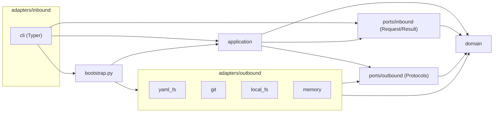

# Architecture Spine — Sinter, código da fatia 1

**Precedência:** em nomes de pasta, pacote, ponto de entrada, formato de `--json`, códigos de saída e versões, esta espinha vence o texto das histórias e do addendum (que foram alinhados a ela). Mapeamento do addendum antigo: `core/schemas` → `domain/model`; `core/authoring` → `application/{new,apply}`; `ports.py`/`CatalogStore` → `ports/outbound/{catalog_files,manifest_codec}`; `cli.py` → `adapters/inbound/cli`.

## Design Paradigm

**Hexagonal com DDD leve.** O `domain` guarda o modelo do catálogo (Pydantic = Apêndice A), as visões por nível e as regras puras. A `application` tem um caso de uso por subcomando e orquestra as portas. As `ports` definem o que entra (`inbound`: pedidos e resultados) e o que sai (`outbound`: interfaces para disco, YAML e Git). Os `adapters` ficam nas bordas: a CLI é **inbound**; `yaml_fs`, `git`, `local_fs` e `memory` são **outbound**. Só o `bootstrap.py` liga as peças.



| Camada | Pasta | Pode importar |
| --- | --- | --- |
| Domínio | `src/sinter/domain` | só a biblioteca padrão e Pydantic |
| Aplicação | `src/sinter/application` | `domain`, `ports` |
| Portas | `src/sinter/ports/{inbound,outbound}` | `domain` |
| Adaptadores de entrada | `src/sinter/adapters/inbound/cli` | `application`, `ports.inbound`, `domain`, `bootstrap` |
| Adaptadores de saída | `src/sinter/adapters/outbound/{yaml_fs,git,local_fs,memory}` | `ports.outbound`, `domain` |
| Composição | `src/sinter/bootstrap.py` | tudo, menos `adapters.inbound` |

## Inherited Invariants

| Inherited | From parent | Binds here |
| --- | --- | --- |
| AD-1 | architecture-harness_corp-2026-09-26 | Direção de dependência; `domain` sem I/O e sem relógio ("core" = `domain` + `application` + `ports`) |
| AD-2 | idem | `schemaVersion` em `organization.yaml`; recusa catálogo mais novo (aqui: no `load`, AD-29); pasta do domínio em minúsculas (AD-40) |
| AD-3 | idem | Escrita no conteúdo do catálogo só por `apply`, com as exceções fechadas de AD-36 |
| AD-4, AD-5 | idem | Manifestos do Apêndice A; regras e ADRs inline; `(calc)` nunca gravado; evidência estruturada |
| AD-6 | idem | Saídas determinísticas, ordenadas, byte a byte; `asOf` = data do commit |
| AD-8 | idem | Portas sem tipos de biblioteca; refinado por AD-28 |
| AD-9 | idem | Conteúdo de documento devolvido só em campo marcado (`content` + `source` + `locator`) — `read` e `get --raw` |
| AD-12 | idem | `schemas/*.json` gerado dos modelos; `--json` segue o schema (AD-38) |
| AD-13 | idem | Consultas mostram só `approved`, salvo `get <id>` direto (AD-45) |
| AD-14 | idem | `nextAdrNumber` é do autor do rascunho (AD-44) |
| AD-15 | idem | Autor = `git config`; trailers `Sinter-Action`, `Sinter-Items`, `Sinter-Version` |
| AD-17 | idem | Skills só chamam `sinter … --json`; regra verificável vive na CLI |
| AD-18, AD-19 | idem | Hierarquia, ids e prefixos; `modernized_by` em arquivo próprio |
| AD-22 | idem | Herança e calculados num lugar só (`domain/services/inheritance.py`, `calculated.py`) |
| AD-24 | idem | Níveis 0/1/2 + `read` (visões em AD-39) |
| Convenções | idem | IDs, manifestos, datas, envelope de erro, saída de CLI (com o código `3` desta espinha) |

## Invariants & Rules

### AD-25 — Camadas e pastas do hexágono [ADOPTED]

- **Binds:** all
- **Prevents:** código novo sem lugar óbvio; regra de negócio misturada com I/O; adaptador de entrada falando direto com adaptador de saída.
- **Rule:** o pacote `sinter` em `src/` tem só `domain/`, `application/`, `ports/inbound/`, `ports/outbound/`, `adapters/inbound/`, `adapters/outbound/` e `bootstrap.py`, com as dependências da tabela do paradigma. `domain/` se divide em `model/` (entidades por `kind`, blocos comuns, `registry.py`, `views.py`, `edits.py`, `catalog.py`), `services/` (herança, calculados, níveis, busca, diff, resumo, texto, markdown, tokens), `validation/` (motor, `finding.py`, `rules/`), `drafts/` (modelos de rascunho) e `errors.py`. A entidade de negócio continua `Domain` (`sinter.domain.model.Domain`).

### AD-26 — O caso de uso é a porta de entrada [ADOPTED]

- **Binds:** Epic-1..Epic-4, AD-12
- **Prevents:** CLI, skills e o futuro servidor com formatos de pedido/resposta diferentes; interface com uma implementação só; dois casos de uso para o mesmo subcomando.
- **Rule:** cada **subcomando folha** (`validate`, `get`, `get_raw`, `find`, `list_domains`, `list_areas`, `read`, `new`, `apply`, `catalog_init`, `fmt`, `schema_export`, `skills_install`) tem **um** caso de uso em `application/<nome>.py`: classe com `__call__(request) -> result`, que recebe as portas no construtor e chama `load` (AD-29) no início quando precisa do catálogo. `<Nome>Request` e `<Nome>Result` vivem em `ports/inbound/<nome>.py` e são o contrato; tipos usados por mais de um `Result` vivem em `ports/inbound/common.py` ou são visões do `domain` (AD-39). Não há `Protocol` para casos de uso.

### AD-27 — Composição só no `bootstrap.py` [ADOPTED]

- **Binds:** all
- **Prevents:** adaptadores instanciados em vários lugares; testes e servidor montando o sistema de jeitos diferentes; a raiz do catálogo em dois lugares; versão ou relógio lidos dentro da aplicação.
- **Rule:** `bootstrap.py` é o **único** módulo que instancia adaptadores de saída e casos de uso: `build(catalog_root: Path | None, *, sinter_version: str, files=None, vcs=None, local=None) -> Container` (`catalog_root=None` para `catalog_init` e `skills_install`, que não exigem catálogo). A versão do pacote é lida só aqui (`importlib.metadata`). A raiz pertence ao `Container`: nenhum `Request` tem `catalog_root` e nenhum `Result` contém caminho absoluto. Os testes montam o mesmo `Container` com `adapters/outbound/memory`. O servidor da fatia 2 reusa o `bootstrap`.

### AD-28 — Portas de saída da fatia 1

- **Binds:** Epic-1..Epic-4, parent AD-8, AD-10
- **Prevents:** objetos de ruamel ou de Git vazando para o domínio; cada caso de uso lendo arquivo de um jeito; caso de uso inventando operação de edição.
- **Rule:** refina o parent AD-8 (`CatalogStore` = `CatalogFiles` + `ManifestCodec`). As portas (`typing.Protocol` em `ports/outbound/`) são:
  - `CatalogFiles` (presa à raiz): `list()`, `read(path)`, `exists(path)`, `write_all(dict[path, text])` atômica (AD-44), cria pastas pai.
  - `ManifestCodec`: `split(texto) -> list[ManifestText]` (texto, dados `dict`, posições por documento), `format(texto) -> texto` (AD-30), `edit(texto, Edit) -> texto` com `Edit` fechado de `domain/model/edits.py` (AD-43).
  - `VersionControl`: `is_repo()`, `init()`, `head() -> CommitInfo{sha, date} | None`, `dirty(paths)` (inclui não rastreados), `commit_only(paths, message, trailers)`, `author()`.
  - `LocalFiles` (sem raiz fixa) e `PackageResources` (arquivos empacotados): usados **só** por `skills_install` e `schema_export` (AD-36).
  Elas trocam só tipos da biblioteca padrão e do `domain`; `dict` bruto só circula entre `ManifestCodec` e `load`. Porta nova exige nova AD. `SecretScanner` (parent AD-10) entra no passo de importação. Só portas com I/O têm versão `memory`.

### AD-29 — Um `Catalog` imutável por comando

- **Binds:** Epic-1..Epic-3, AD-22, NFR-2, NFR-3, NFR-6
- **Prevents:** casos de uso com visões diferentes do catálogo; `apply` validando por outro caminho; cascata de erros falsos por um arquivo inválido.
- **Rule:** `application/load.py` → `load(files, codec) -> (Catalog, Report)`. Recusa `schemaVersion` maior que o suportado (`CATALOG_VERSION_UNSUPPORTED`, AD-37). Produz um `domain.model.Catalog` **imutável**, indexado como em AD-41. Item que falha no schema fica no índice com `valid=False` (presente para unicidade e referências, ignorado pelas outras regras). `apply` valida `catalog.with_upserted(rascunho)` pelo mesmo motor (AD-31). Sem cache entre comandos.

### AD-30 — Um formatador canônico

- **Binds:** Story 3.3, Story 3.7, NFR-4
- **Prevents:** arquivos com formatos e ordens diferentes; diff de PR poluído; comentários perdidos; segunda lista de ordem de chaves.
- **Rule:** `ManifestCodec.format` é a **única** formatação: ruamel em round-trip, comentários presos ao seu nó, envelope `apiVersion → kind → metadata → spec`, chaves na **ordem dos campos do modelo** obtida de `domain.model.registry` (AD-40), recuo de 2 espaços com listas recuadas, LF e linha final; aspas e escalares em bloco mantidos. É idempotente (teste sobre todo o exemplo). Arquivo que falha no schema é formatado só no envelope. A ordem canônica substitui a "ordem do autor": comentários são preservados, a ordem das chaves não.

### AD-31 — Validação por registro de regras com código estável

- **Binds:** Epic-1, Story 3.2, Story 3.7, FR-17
- **Prevents:** uma função de validação gigante; mensagens usadas como contrato; `validate` e `apply --dry-run` divergindo; checagens de arquivo fora do motor.
- **Rule:** `validate_catalog(catalog, facts: FileFacts) -> Report`. Fase 0: marca `<obrigatório>` reconhecida no texto e trocada por ausente (`REQUIRED_MARK`, sem erro duplo). Fase 1: schema pelos modelos (`SCHEMA_*`). Fase 2: regras em `domain/validation/rules/`, cada uma função pura `(Catalog, FileFacts) -> Iterable[Finding]` com `@rule(code=…, severity=…)`, só sobre itens `valid`. `FileFacts` (por arquivo: `formatted`, `exists` de paths de docs) é calculado pela aplicação com a **mesma** função nos dois caminhos; no `apply`, `formatted` é medido depois de formatar. O `code` (SCREAMING_SNAKE, `<ASSUNTO>_<PROBLEMA>`) é estável; a mensagem pode mudar.

### AD-32 — Só o adaptador de entrada escreve na tela

- **Binds:** all, AD-12, AD-26
- **Prevents:** `print` espalhado; texto e `--json` dizendo coisas diferentes.
- **Rule:** `domain` e `application` nunca fazem `print`, logging nem leem `stdin`. A CLI renderiza o `Result`: `--json` por `to_json` (AD-38); texto por um módulo por subcomando em `adapters/inbound/cli/render/`, que imprime os fatos e o campo `summary` (AD-45) sem recompor frases. No passo 1 não há arquivo de log.

### AD-33 — Erros e códigos de saída

- **Binds:** all, convenção de saída do parent
- **Prevents:** cada comando decidindo seu código; skill tentando de novo um bug; envelope fora do schema.
- **Rule:** (a) estado do catálogo ou do rascunho = `Finding` no `Report` (AD-35) → saída `1` se houver `errors`; (b) pedido que não pode ser atendido = `SinterError(code, details)` com código da tabela fechada de AD-37; (c) qualquer outra exceção = bug → `3`, mensagem curta, detalhe só com `--debug`. A saída é calculada **só** por `exit_code(result_or_error)` em `adapters/inbound/cli/errors.py`, que também monta o envelope `{ "error": { code, message, details } }`. Com `--json`, resultado e envelope vão para stdout; sem `--json`, erros vão para stderr. Typer roda com `standalone_mode=False`, e erro de uso do Typer vira `USAGE_INVALID_OPTION` no envelope.

### AD-34 — As regras da arquitetura quebram o build

- **Binds:** all
- **Prevents:** a direção do hexágono se perdendo; proibições que dependem de alguém lembrar; saída mudando sem ninguém perceber.
- **Rule:** `uv run poe check` (local e CI) roda:
  - `lint-imports` com os contratos da tabela do paradigma, `include_external_packages = true` (`domain` não importa ruamel, typer, subprocess), "só `bootstrap` importa `adapters.outbound`", `adapters.inbound` ⟂ `adapters.outbound`, e "só `application.{apply,catalog_init,fmt}` importam a operação de escrita de `CatalogFiles`" (escrita em módulo próprio `ports/outbound/catalog_writer.py`);
  - `ruff check` com `T20` (sem `print` fora de `adapters/inbound/cli`) e `banned-api` em `domain` e `application` (`datetime.now`, `date.today`, `time.time`, `open`, `Path.read_text`/`write_text`, `subprocess`, `sys.stdin`, `importlib.metadata`, `os.environ`) + `ruff format --check`;
  - `mypy --strict` no pacote inteiro (plugin Pydantic);
  - `pytest`, incluindo golden files `tests/golden/` (regravados só com `--update-golden`), `tests/contract/` (`schemas/` em dia, tabela de AD-37) e `tests/skills/` (`skills-ref validate`).
  Os evals das skills (precisam de LLM) rodam fora do `check`, em `poe evals`, com resultado versionado ao lado da skill.

### AD-35 — Um só `Report` e um só formato de `Finding`

- **Binds:** Epic-1, Story 3.2, Epic-4, AD-31, AD-33
- **Prevents:** `validate` e `apply` com formas diferentes; `path` em quatro notações; golden mudando quando o exemplo cresce; duplicata citando um arquivo só.
- **Rule:** `Report = {errors: Finding[], warnings: Finding[]}` em `ports/inbound/common.py`, embutido como `report` em todo `Result` que valida. `Finding = {code, severity, file, path, message, line?, source?, related?: [{file, path}]}`:
  - `file` = caminho POSIX **relativo à raiz**; para rascunho, o caminho canônico de destino, com `source = "draft#<n>"` (documento 1-based);
  - `path` = segmentos com `.`, item de lista **pelo id** quando tem id (`spec.applications[app-camb-carteira].lifecycle`), índice 0-based só sem id; montado **só** por `format_path` (`domain/validation/finding.py`), usado por `Finding.at` e pelos helpers `problem`/`problem_at` das regras;
  - ordem: `file`, `line`, `path` (por segmento, índice numérico), `code`, `message`;
  - duplicata = um finding no arquivo que vem depois, com `related` apontando o primeiro.

### AD-36 — Quem grava em disco

- **Binds:** Story 1.6, 3.1, 3.3, 3.7, 4.5, parent AD-3
- **Prevents:** escrita no catálogo por caminhos não previstos; porta de disco genérica sem regra; pastas que somem no clone.
- **Rule:** no **conteúdo do catálogo**, só três casos de uso chamam `write_all`: `apply` (o caminho de AD-3); `catalog_init` (só em pasta vazia ou inexistente; cria esqueleto, `.gitkeep` nas pastas vazias e `.gitattributes` com `* text eol=lf`; commit `Sinter-Action: init`); `fmt` (só reescreve com `format`, verifica `dados(antes) == dados(depois)`, não comita). **Fora do catálogo**, só `skills_install` (destino `.claude/skills/` do projeto, do usuário ou `--path`; grava `.sinter-skill.json` com versão e hash de cada arquivo, e não sobrescreve arquivo com hash diferente sem `--force`) e `schema_export` usam `LocalFiles` + `PackageResources`.

### AD-37 — Tabela fechada de erros

- **Binds:** all, AD-33
- **Prevents:** a mesma condição com códigos diferentes por história; `details` sem schema.
- **Rule:** `domain/errors.py` declara cada `code` com `exit` e o modelo de `details` (publicado em `schemas/error.schema.json`; teste confere a tabela). Pré-condição de ambiente → `2`; item ou recurso pedido que não existe → `1`; estado do catálogo → finding. Tabela do passo 1:

  | code | exit |
  | --- | --- |
  | `USAGE_INVALID_OPTION`, `USAGE_NOT_A_CATALOG`, `USAGE_INIT_NOT_EMPTY`, `USAGE_NOT_A_GIT_REPO`, `USAGE_GIT_NOT_FOUND` | 2 |
  | `CATALOG_VERSION_UNSUPPORTED`, `ITEM_NOT_FOUND` (com até 3 sugestões), `ANCHOR_NOT_FOUND`, `FILE_DIRTY`, `ID_ALREADY_EXISTS`, `AREA_NOT_FOUND`, `SKILL_FILE_MODIFIED` | 1 |
  | `INTERNAL_ERROR` | 3 |

  `fmt --check` reporta `FILE_NOT_FORMATTED` como **error** nesse subcomando (no `validate` é warning). Código novo exige linha nesta tabela.

### AD-38 — Uma serialização só

- **Binds:** all, parent AD-12, NFR-2
- **Prevents:** `domain_id` num comando e `domainId` em outro; golden divergindo por ordem de chave ou `null` omitido.
- **Rule:** todo modelo (`domain/model`, visões e `ports/inbound`) herda de `SinterModel` (`alias_generator=to_camel`, `populate_by_name=True`, `extra="forbid"`, `frozen=True`). **Toda** saída usa `by_alias=True` por uma função só, `to_json` em `adapters/inbound/cli/render/json.py` (UTF-8 sem escape, indentação 2, ordem de chaves = ordem dos campos, `null` explícito); o `schema_export` usa o mesmo `by_alias`. A ordem das **listas** é do domínio (sumário, ordem do arquivo ou id; empate por id).

### AD-39 — Visões por nível são do domínio

- **Binds:** Epic-2, AD-24 do parent, NFR-1
- **Prevents:** `get`, `find`, `list`, `get area` e passos de jornada cada um com o seu "nível 0"; herdado marcado de jeitos diferentes.
- **Rule:** `domain/model/views.py` define `Level0` (união discriminada por `kind`, com `counts` de chaves fixas por kind), `Level1<Kind>`, `Level2<Kind>`, `Inherited[T] = {value, origin}`, `Omitted = {what, command}` e `Gap = {field, level}`. Só `domain/services/levels.py` as produz; todo `ports/inbound/*` as reusa e nunca redefine. Campo fora do nível não aparece. O orçamento de tokens do NFR-1 é medido só por `domain/services/tokens.py` (heurística fixa).

### AD-40 — Registro de kinds

- **Binds:** Epic-1, Epic-3, AD-30, parent AD-2, AD-18
- **Prevents:** mapa kind → pasta reimplementado em cada comando; `domains/CAMB` e `domains/camb` como dois domínios; mover ou renomear item deixando arquivo órfão.
- **Rule:** `domain/model/registry.py` é o **único** lugar com `kind → (modelo, prefixo de id, canonical_path(item))`. `canonical_path` usa `domainId.lower()` e toda comparação de pasta é sem diferenciar maiúsculas. `load`, `validate`, `new`, `apply` e o `ManifestCodec` (ordem das chaves) leem esse registro. `apply` recusa rascunho que muda o `id` ou o caminho canônico de um item existente (`APPLY_ID_CHANGED`, `APPLY_PATH_CHANGED`); mover e renomear ficam para comando futuro.

### AD-41 — Escopo dos ids no índice

- **Binds:** AD-29, Story 1.4, 2.3, 2.5
- **Prevents:** passos de jornadas diferentes com o mesmo id local se sobrescrevendo; área sem lugar no índice; doc reaproveitado indexado duas vezes.
- **Rule:** o índice global do `Catalog` guarda só ids com prefixo do Apêndice A.8, mais `area-` como pseudo-kind `Area` (arquivo `organization.yaml`). Etapas e passos são indexados por `(jor-id, id)`. Cada entrada guarda `{kind, file, path, line, valid}`, com `path` no formato de AD-35. Doc com `id` aponta para a definição; usos por `ref` ficam numa lista de referências.

### AD-42 — Modelos de rascunho têm uma fonte

- **Binds:** Story 3.4, 3.5, Epic-4
- **Prevents:** modelo no código e cópia na skill divergindo; texto explicativo do modelo indo para o catálogo.
- **Rule:** os modelos de rascunho são funções puras em `domain/drafts/<kind>.py` que montam o texto a partir do modelo e do registro. A skill obtém o rascunho só por `sinter new <kind> --json` (campo `draft`); `skills/*/assets/` não contém manifestos. Comentários do modelo começam com `#~` e são removidos pelo `apply` (aviso `DRAFT_TEMPLATE_COMMENT` no `--dry-run`); comentários do autor ficam.

### AD-43 — Edição de texto por operações fechadas

- **Binds:** Story 3.5, 3.6, Epic-4, AD-28
- **Prevents:** cada caso de uso inventando operação; arquivo existente reescrito a partir de `dict` e perdendo comentários.
- **Rule:** `domain/model/edits.py` define `Edit = InsertListItem(path, value, after?) | ReplaceField(path, value) | RemoveListItem(path)`, com `path` no formato de AD-35. `new subdomain` usa `ManifestCodec.edit` para atualizar o sumário do domínio; `apply` usa `split` e `format` por documento. Nenhum caso de uso gera texto de um arquivo que já existe a partir de `dict`.

### AD-44 — Semântica do `apply`

- **Binds:** Story 3.2, 3.3, 3.6, parent AD-3, AD-14
- **Prevents:** "sem mudança" com significados diferentes; contador incrementado duas vezes; gravação parcial; catálogo com erro antigo travando toda correção.
- **Rule:**
  - ação por item: `create` (id não está no índice), `unchanged` (`format(rascunho)` igual ao texto atual), senão `update`, com `changes: [{path, before, after}]` do diff de **dados** e `commentsChanged: bool`; todos `unchanged` → sem commit;
  - `apply` **nunca** altera o rascunho além de formatar e tirar `#~`: contadores (`nextAdrNumber`) são do autor, com aviso `ADR_COUNTER_NOT_ADVANCED`;
  - `apply` falha só por erros **novos** ou em itens do rascunho; erros que já existiam em outros arquivos voltam como warning `PREEXISTING_ERROR`;
  - `FILE_DIRTY` se qualquer destino tem alteração não commitada ou arquivo não rastreado;
  - gravação: `write_all` (temporário + rename por arquivo), depois `commit_only(paths)`; se o commit falhar, restaura o texto anterior de cada arquivo e devolve erro.

### AD-45 — Fatos estruturados, frases no `summary`

- **Binds:** Epic-2, Story 3.2, Epic-4, AD-32, parent AD-9, AD-13
- **Prevents:** "não preenchido" no lugar de uma lista; skill casando texto em português; conteúdo de documento agindo como instrução; consultas divergindo sobre itens não aprovados.
- **Rule:** os `Result` trazem fatos estruturados (listas vazias, `gaps: [Gap]`, `Inherited[T]`, `changes`); a frase em linguagem natural é o campo `summary: str`, produzido só por `domain/services/summary.py`. Skills leem fatos, nunca `summary`. Conteúdo de documento (`read`) e texto bruto (`get --raw`) vêm em `{content, source, locator}`. `get` (exceto `get <id>` direto), `find` e `list` mostram só itens `approved`; `get <id>` mostra qualquer status, com o status visível; `validate` valida todos.

### AD-46 — Normalização de texto num lugar só

- **Binds:** Story 1.5, 2.4, 2.5, 3.5
- **Prevents:** busca, glossário, âncora e slug de id com regras de acento e hífen diferentes.
- **Rule:** `domain/services/text.py` tem `fold(s)` (comparação: casefold + sem acento), `slug(s)` (ids: `[a-z0-9]+(-[a-z0-9]+)*`, nunca `--`) e `gh_anchor(s)` (âncora estilo GitHub), testadas por tabela. `domain/services/markdown.py` é o único que corta seções e monta sumário de títulos. Ninguém mais importa `unicodedata`.

### AD-47 — Como cada comando acha o catálogo

- **Binds:** all
- **Prevents:** cada comando resolvendo a raiz de um jeito.
- **Rule:** só a CLI resolve a raiz, nesta ordem: `--catalog <pasta>` > variável `SINTER_CATALOG` > subir a partir do diretório atual até achar `organization.yaml`. Sem raiz → `USAGE_NOT_A_CATALOG`. `catalog init [pasta]` usa a pasta dada ou o diretório atual; `skills install` não procura catálogo. A raiz resolvida vai para `bootstrap.build`.

### AD-48 — Empacotamento, CI e ambientes

- **Binds:** all, Story 1.1, 4.5, parent AD-12, AD-17
- **Prevents:** `skills/` e `schemas/` fora do pacote; versão em vários lugares; CI testando combinações diferentes da máquina do dev.
- **Rule:** build com `hatchling`; `skills/` e `schemas/` entram no wheel como dados do pacote (lidos por `PackageResources`). A versão é única, em `pyproject.toml`. Ponto de entrada: `sinter = "sinter.adapters.inbound.cli.app:main"`. CI no GitHub Actions: `uv sync --locked` + `poe check` em {Python 3.13, 3.14} × {ubuntu, macos}. Requisito em tempo de execução: `git` 2.40+, verificado ao usar `VersionControl` (`USAGE_GIT_NOT_FOUND`). Instalação no passo 1: `uv tool install` a partir do repositório; publicação em índice fica adiada.

## Consistency Conventions

| Concern | Convention |
| --- | --- |
| Caso de uso | `application/<nome>.py` → classe `<Nome>`; `ports/inbound/<nome>.py` → `<Nome>Request`, `<Nome>Result`; um por subcomando folha |
| Regra de validação | `domain/validation/rules/<assunto>.py`; código `<ASSUNTO>_<PROBLEMA>` (ex.: `SUBDOMAIN_SUMMARY_MISMATCH`, `DOM_REF_NOT_IN_CATALOG`) |
| Modelo | `domain/model/<kind>.py`; classe com o nome do `kind`; herda `SinterModel`; atributos snake_case, JSON/YAML camelCase; ordem dos campos = Apêndice A |
| Comando CLI | `adapters/inbound/cli/commands/<nome>.py` + `render/<nome>.py`; registrado em `adapters/inbound/cli/app.py` |
| Códigos de saída | `0` ok · `1` erro de validação ou item/recurso não encontrado · `2` uso errado ou ambiente · `3` erro interno |
| Erros | `SinterError(code, details)`; tabela de AD-37; mensagens em português |
| Ordenação | Toda lista de saída tem ordem definida; empate por id; findings como AD-35 |
| Testes | `tests/<camada>/test_<assunto>.py`; fixture = `tests/fixtures/exemplo-catalogo/` (cópia; teste falha se divergir de `docs/prd-dominio-2026-10-17/exemplo-catalogo/`); só dados sintéticos |
| Skills | `skills/sinter-<verbo>/` (padrão Agent Skills), evals ao lado; empacotadas com a CLI |

## Stack

| Name | Version |
| --- | --- |
| Python | 3.13+ (CI em 3.13 e 3.14) |
| uv | 0.13.x |
| hatchling (build) | 1.32.x |
| Pydantic | 2.14.x |
| Typer | 0.27.x |
| ruamel.yaml | 0.19.x |
| pytest | 9.1.x |
| import-linter | 2.15.x |
| mypy | 2.4.x |
| ruff | 0.17.x |
| poethepoet | 0.49.x |
| skills-ref (dev) | 0.1.x |
| git (execução) | 2.40+ |

## Structural Seed

```text
sinter/
  pyproject.toml              # hatchling; scripts sinter = "sinter.adapters.inbound.cli.app:main"; [tool.importlinter]; [tool.ruff]; [tool.poe.tasks] check/schemas/evals
  .github/workflows/check.yml
  src/sinter/
    domain/
      model/                  # base.py (SinterModel), blocks.py, organization.py, domain.py, subdomain.py, journey.py, relation.py,
                              # registry.py, catalog.py, views.py, edits.py
      services/               # inheritance, calculated, levels, search, diff, summary, text, markdown, tokens
      validation/             # engine.py, finding.py, rules/*.py
      drafts/                 # domain.py, subdomain.py, journey.py
      errors.py
    application/              # load, validate, get, get_raw, find, list_domains, list_areas, read, new, apply, catalog_init, fmt, schema_export, skills_install
    ports/
      inbound/                # common.py (Report, Finding) + <nome>.py
      outbound/               # catalog_files.py, catalog_writer.py, manifest_codec.py, version_control.py, local_files.py, package_resources.py
    adapters/
      inbound/cli/            # app.py, commands/, render/ (json.py + um por subcomando), errors.py
      outbound/
        yaml_fs/              # CatalogFiles + ManifestCodec (ruamel)
        git/                  # VersionControl (subprocess git)
        local_fs/             # LocalFiles + PackageResources
        memory/               # CatalogFiles + VersionControl + LocalFiles em memória
    bootstrap.py
  schemas/                    # JSON Schema gerado (poe schemas)
  skills/                     # sinter-find/, sinter-domain/ (+ evals)
  tests/
    domain/ application/ adapters/ cli/ golden/ contract/ skills/
    fixtures/exemplo-catalogo/
```

```mermaid
sequenceDiagram
  participant U as Pessoa / skill
  participant C as cli (inbound)
  participant B as bootstrap
  participant A as application.apply
  participant D as domain
  participant P as ports outbound
  U->>C: sinter apply - --dry-run --json
  C->>C: resolve raiz (AD-47)
  C->>B: build(raiz)
  C->>A: ApplyRequest(texto)
  A->>P: CatalogFiles + ManifestCodec.split/format
  A->>D: load → Catalog; with_upserted; validate_catalog; diff; summary
  A-->>C: ApplyResult(items, report, summary)
  C-->>U: to_json + exit_code
  Note over A,P: sem --dry-run: write_all → commit_only; se o commit falha, restaura
```

## Capability → Architecture Map

| Capability / Area | Lives in | Governed by |
| --- | --- | --- |
| Epic 1 — modelo e `validate` | `domain/model`, `domain/validation`, `application/{load,validate,schema_export}.py` | AD-29, AD-31, AD-35, AD-40, AD-41 |
| Epic 2 — `get`, `find`, `list`, `read`, área | `domain/services/{levels,inheritance,calculated,search,text,markdown,tokens}`, `domain/model/views.py`, `application/{get,find,list_*,read}.py` | AD-38, AD-39, AD-45, AD-46 |
| Epic 3 — `init`, `new`, `apply`, `get --raw`, `fmt` | `application/{catalog_init,new,apply,get_raw,fmt}.py`, `domain/{drafts,model/edits.py,services/diff,services/summary}`, `adapters/outbound/{yaml_fs,git}` | AD-30, AD-36, AD-42, AD-43, AD-44 |
| Epic 4 — skills e `skills install` | `skills/`, `application/skills_install.py`, `adapters/outbound/local_fs` | AD-36, AD-45, parent AD-17 |
| Contrato `--json` / `schemas/` | `ports/inbound`, `domain/model`, `render/json.py` | AD-26, AD-38, parent AD-12 |
| Erros e saída | `domain/errors.py`, `adapters/inbound/cli/errors.py` | AD-33, AD-37 |
| Empacotamento, CI, garantia | `pyproject.toml`, `.github/workflows/`, `tests/` | AD-34, AD-48 |

## Deferred

- **Servidor HTTP (inbound da fatia 2):** reusa `bootstrap` e os `Request/Result`; framework decidido na fatia 2.
- **`SecretScanner` e betterleaks:** passo de importação (parent AD-10).
- **Push, rebase, `people.yaml`, `Sinter-Role`:** passo 8 (parent AD-15, AD-23).
- **Mover e renomear itens:** comando próprio quando houver pedido; até lá `apply` recusa (AD-40).
- **`sinter migrate` e `sinter doctor`:** quando houver o primeiro `schemaVersion` 2 / o primeiro problema de ambiente relatado.
- **Windows:** fora da matriz de CI até haver usuário; LF já garantido por `.gitattributes`.
- **Publicação em índice (PyPI ou privado):** no primeiro piloto.
- **Logs em arquivo:** quando houver servidor ou importação longa.
- **Cache do `Catalog`:** só se o NFR-3 falhar numa medição.
- **Regras por organização (plugins):** quando um cliente pedir; o registro de AD-31 já permite.
- **`sinter new` interativo no terminal:** as skills fazem a entrevista.
