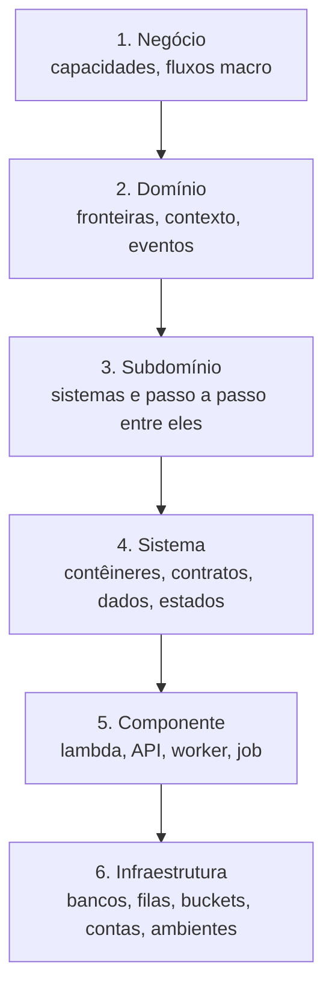
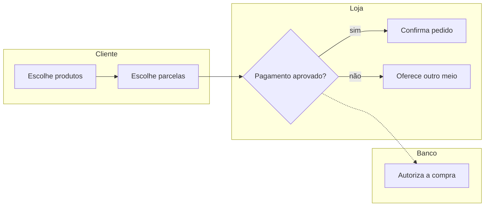
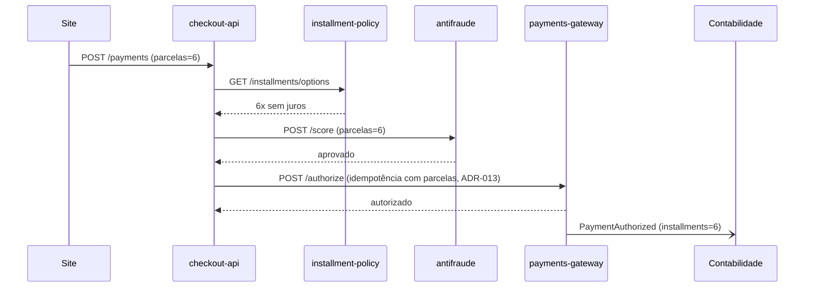
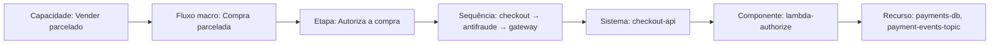

# Padrão de documentação do Sinter

Este é o "armário" de cada domínio: **o que** se documenta em cada camada, **com quais diagramas**, **de onde vem** a informação e **quem aprova**. O Sinter preenche o que dá para extrair e propõe o resto, e as pessoas curam.

**Princípio:** o mapa é construído **de baixo para cima** (da infraestrutura ao negócio), mas é **lido de cima para baixo**. Cada item de uma camada aponta para os itens da camada de baixo que o realizam. Assim, de uma capacidade de negócio dá para descer até a fila e o banco que a sustentam, e de uma lambda dá para subir até o fluxo de negócio que ela serve.



## Visão geral das camadas

| Camada | Pergunta que responde | Público principal | Diagramas | Origem principal | Quem aprova |
|---|---|---|---|---|---|
| 1. Negócio | O que a empresa faz e como o valor flui? | PM, diretoria, negócio | Mapa de capacidades, fluxo macro com raias | Pessoas (conversas, Confluence, reuniões) | PM / arquiteto de negócio |
| 2. Domínio | Onde começa e termina este domínio e com quem ele fala? | Arquiteto | Contexto (C4 nível 1), mapa de contexto entre domínios | Pessoas + código | Arquiteto de solução |
| 3. Subdomínio | Como os sistemas executam cada fluxo, passo a passo? | Arquiteto, tech lead | Sequência entre sistemas, fluxo de dados | Código + pessoas | Arquiteto de solução |
| 4. Sistema | Como este serviço é por dentro e o que promete aos outros? | Tech lead, dev | Contêiner (C4 nível 2), sequência interna, dados (ERD), estados | Código, OpenAPI, AsyncAPI, migrações | Tech lead |
| 5. Componente | O que esta lambda/API/worker faz, quando e com o quê? | Dev | Sequência curta, fluxo de dados | Código + infra como código | Tech lead |
| 6. Infraestrutura | Onde isso roda e do que depende? | Infra, devops, tech lead | Implantação (deployment) por ambiente | Terraform, CloudFormation, `serverless.yml`, manifests Kubernetes | Tech lead / infra |
| Transversal | Termos, regras, decisões e padrões que valem em várias camadas | Todos | — | Pessoas + código + docs | Conforme o item |

## 1. Negócio

**O que documenta**
- **Capacidades de negócio:** o que a empresa sabe fazer, em linguagem de negócio. Ex.: *Vender parcelado*, *Conciliar pagamentos*, *Estornar compra*.
- **Fluxos macro (fluxos de valor):** a sequência de etapas de negócio de ponta a ponta, com os **atores** (cliente, loja, banco, time interno) e os **pontos de decisão**. Ex.: *Compra parcelada no cartão*.
- **Indicadores** de cada fluxo (taxa de aprovação, tempo médio) e **regras de negócio** que o governam.

**Diagramas**
- **Mapa de capacidades:** caixas agrupadas por área, coloridas pelo sistema que as realiza.
- **Fluxo macro com raias:** uma raia por ator, etapas em linguagem de negócio, sem nome de sistema.

**Arquivos**
```
capacidades/vender-parcelado.md
fluxos/compra-parcelada.md          # etapas, atores, decisões, indicadores
```

**Liga para baixo:** cada **etapa** do fluxo macro aponta para o **passo a passo técnico** (camada 3) que a executa.

**Exemplo: fluxo macro "Compra parcelada"**


## 2. Domínio

**O que documenta**
- **Visão e fronteiras:** propósito, o que está dentro e o que está fora, dono.
- **Subdomínios** e a responsabilidade de cada um.
- **Contexto:** o domínio como uma caixa, com os atores e sistemas externos (adquirente, antifraude terceiro, outros domínios).
- **Mapa de contexto:** relação com outros domínios da empresa (quem depende de quem, quem publica eventos para quem).
- **Eventos de domínio principais:** `PaymentAuthorized`, `RefundIssued`…

**Diagramas:** Contexto (C4 nível 1) e mapa de contexto entre domínios. No app, é o nível **Domínio** (Mundo, Grafo, Caixas).

**Arquivos**
```
README.md            # visão, fronteiras, dono
mapa/contexto.md
mapa/relacoes-entre-dominios.md
eventos/payment-authorized.md
```

## 3. Subdomínio

**O que documenta**
- **Sistemas** do subdomínio e o papel de cada um.
- **Passo a passo técnico de cada fluxo:** para cada etapa de negócio, a **sequência de chamadas entre sistemas** (quem chama quem, com qual contrato, o que acontece em caso de erro). É aqui que o fluxo macro vira engenharia.

**Diagramas:** **sequência entre sistemas** (um por fluxo ou etapa) e **fluxo de dados** quando há pipeline ou batch.

**Arquivos**
```
subdominios/checkout.md
fluxos/compra-parcelada.sequencia.md   # o mesmo fluxo da camada 1, agora técnico
```

**Exemplo: sequência "Compra parcelada", etapa "Autoriza a compra"**


É esse diagrama que o app mostra como **fluxo passo a passo** no mapa do sistema.

## 4. Sistema (serviço / repo)

**O que documenta**
- **Ficha:** responsabilidade, dono, stack, repositório, subdomínio, criticidade.
- **Contêineres internos:** componentes (lambdas, API, workers), bancos e filas que o sistema usa.
- **Contratos:** APIs que expõe (OpenAPI), eventos que publica e consome (AsyncAPI), arquivos que troca.
- **Sequências internas** dos casos de uso principais.
- **Modelo de dados:** entidades principais e relações.
- **Estados** das entidades importantes. Ex.: pagamento `criado → em análise → autorizado → capturado | negado | estornado`.
- **Requisitos de qualidade:** tempo de resposta, disponibilidade, limites (timeouts, retentativas).

**Diagramas:** contêiner (C4 nível 2), sequência interna, dados (ERD) e estados.

**Arquivos**
```
sistemas/checkout-api/
  ficha.md
  conteineres.md
  contratos/post-payments.md        # gerado de openapi.yaml quando existir
  contratos/payment-authorized.md   # gerado de asyncapi.yaml quando existir
  dados.md
  estados/pagamento.md
```

**Liga para baixo:** cada contêiner aponta para os **componentes** (camada 5) e os **recursos de infra** (camada 6).

## 5. Componente

**O que documenta**, para cada lambda, endpoint, worker ou job:
- **Gatilho:** HTTP, evento, fila, agenda (cron).
- **Entrada e saída:** formato e exemplos.
- **Dependências:** outros componentes, bancos, filas, serviços externos.
- **Configuração relevante:** timeout, memória, concorrência, variáveis (sem valores secretos).
- **Erros e retentativas:** o que acontece quando falha, fila de mensagens mortas.

**Diagramas:** sequência curta ou fluxo de dados.

**Arquivos**
```
sistemas/checkout-api/componentes/
  lambda-authorize.md
  lambda-notify.md
  worker-reconcile.md
```

## 6. Infraestrutura

**O que documenta**
- **Recursos:** bancos, filas, tópicos, buckets, funções, clusters, API gateways, com o sistema e o componente que usam cada um.
- **Ambientes:** dev, homologação, produção, e as diferenças entre eles.
- **Contas, regiões e rede**, só no nível necessário para entender dependências (sem segredos, sem endereços sensíveis).

**Diagrama:** implantação por ambiente.

**Arquivos**
```
infraestrutura/
  recursos/payments-db.md
  recursos/payment-events-topic.md
  ambientes/producao.md
```

**Origem:** extraído de infraestrutura como código (Terraform, CloudFormation, `serverless.yml`, manifests Kubernetes). O que não está em código é proposto como "a confirmar".

## Transversal

| Gaveta | O que guarda | Exemplo |
|---|---|---|
| `glossario/` | Termos do negócio com definição única | *Parcela*, *Adquirente* |
| `regras-de-negocio/` | O que o negócio exige | *Juros a partir de 7x*, *timeout de 10 s* |
| `decisoes/` | ADRs: escolha, contexto, consequências | *ADR-013 Idempotência com parcelas* |
| `padroes/` | Como a empresa constrói | *Tópicos no formato dominio.evento.v1* |

Regras, decisões e padrões apontam para os itens das camadas a que se aplicam.

## Rastreabilidade vertical (o fio de ponta a ponta)



Esse fio permite duas perguntas que hoje ninguém responde rápido:
- **Do negócio para a infra:** "o que sustenta *Vender parcelado*?"
- **Da infra para o negócio:** "se a fila `payment-events-topic` parar, quais fluxos de negócio quebram?"

## Como os diagramas são guardados

- **Todo diagrama é texto versionado** no repo do domínio (Mermaid ou JSON do Archify), nunca imagem. Assim ele passa por PR e por curadoria como qualquer item.
- **O mesmo dado gera várias vistas:** o fluxo macro (camada 1) e a sequência (camada 3) são **o mesmo fluxo** em dois níveis de detalhe, ligados etapa a etapa.
- Tipos de diagrama usados: capacidades, fluxo com raias, contexto (C4 1), contêiner (C4 2), sequência, fluxo de dados, estados e implantação. Todos têm correspondente no Archify (architecture, workflow, sequence, dataflow, lifecycle).

## De onde vem cada coisa (extração)

| Camada | O Sinter extrai sozinho | O Sinter propõe com IA | Só pessoas |
|---|---|---|---|
| Negócio | — | Capacidades e fluxos a partir de docs e conversas | Indicadores, prioridades |
| Domínio | Sistemas e eventos do código | Fronteiras, subdomínios | Dono, propósito |
| Subdomínio | Chamadas entre sistemas (grafo) | Sequências completas com erros | Ligação etapa de negócio → sequência (confirmar) |
| Sistema | Contratos (OpenAPI/AsyncAPI), modelo de dados (migrações) | Ficha, estados | Criticidade, requisitos de qualidade |
| Componente | Gatilhos, dependências, configuração | Descrição | — |
| Infraestrutura | Recursos e ambientes da infra como código | Ligação recurso → componente | O que não está em código |

Extratores de mercado podem entrar pelo catálogo, sempre como **propostas**: skills de C4 a partir do código (ex.: c4-codebase-architecture, MIT), leitores de Terraform e o Graphify.

## Perguntas em aberto

1. Notação do fluxo macro de negócio: **raias simples** (como acima) ou **BPMN leve**?
2. Contratos: exigir OpenAPI/AsyncAPI no repo quando existir, ou aceitar descrição livre?
3. O nível de detalhe de **componente e infraestrutura** entra no MVP inteiro, ou só a lista de recursos e as ligações?
4. Qual infra priorizar no primeiro conector: AWS (Lambda, Terraform, `serverless.yml`) ou Kubernetes?
