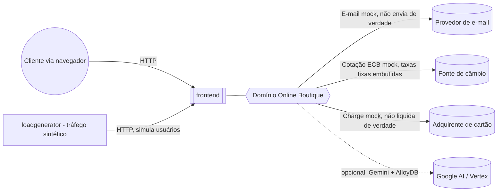

# Domínio Online Boutique

Loja de e-commerce cloud-native de demonstração (Google Cloud): o cliente navega por um catálogo de produtos, monta um carrinho, informa endereço e cartão de crédito e finaliza uma compra. O domínio cobre a jornada completa de compra self-service, sem necessidade de login/cadastro. `[extracted, README.md#L15-L18]`

## Fronteiras

- **Dentro:** catálogo de produtos, carrinho de compras, conversão de moeda, cotação e execução de frete (mock), cobrança de cartão (mock), envio de confirmação por e-mail (mock), recomendações e anúncios contextuais, assistente de compras conversacional (opcional, baseado em IA generativa).
- **Fora:** gestão de estoque/fulfillment real, autenticação/identidade de cliente (não existe login), gateway de pagamento real (o `paymentservice` é um mock que não se conecta a nenhuma adquirente), CRM, backoffice financeiro/contábil. `[inferred — não há nenhum sistema desse tipo no repositório]`
- Todo o domínio roda em um único cluster Kubernetes; não há integração de saída documentada com sistemas de negócio externos (ERP, adquirente de cartão, transportadora real). `[extracted — ausência de clientes HTTP/SDK externos fora do próprio cluster nos 12 serviços]`

## Dono

Não identificado no repositório (não há `CODEOWNERS` nem seção de propriedade por serviço). `[a confirmar com o PM/tech lead]`

## Subdomínios

| Subdomínio | Responsabilidade | Sistemas |
|---|---|---|
| [Catálogo e Descoberta](./subdominios/catalogo-e-descoberta.md) | Expor produtos, buscar, recomendar e anunciar | productcatalogservice, recommendationservice, adservice |
| [Carrinho e Sessão](./subdominios/carrinho-e-sessao.md) | Identificar o visitante e manter o carrinho entre requisições | frontend (sessão), cartservice |
| [Checkout e Pagamento](./subdominios/checkout-e-pagamento.md) | Converter moeda, cobrar, expedir e confirmar o pedido | checkoutservice, paymentservice, shippingservice, emailservice, currencyservice |
| [Assistente de Compras](./subdominios/assistente-de-compras.md) | Responder perguntas do cliente sobre o catálogo usando IA generativa (recurso opcional) | shoppingassistantservice |

O `frontend` participa de todos os subdomínios como porta de entrada HTTP; está descrito com detalhe em [sistemas/frontend](./sistemas/frontend/ficha.md).

## Contexto

`[extracted, arquitetura sincrona confirmada em src/*/main.* — nenhum serviço externo é chamado de fato; "e-mail", "câmbio" e "adquirente" são simulados em memória — ver componentes de emailservice, currencyservice e paymentservice]`

## Eventos de domínio

Não há mensageria assíncrona (fila, tópico ou barramento de eventos) neste domínio: toda comunicação entre sistemas é síncrona via gRPC. Ver [eventos/README.md](./eventos/README.md) para a evidência completa. `[extracted]`

## Como ler este repositório

- Comunicação entre serviços (gRPC, quem chama quem): ver [subdominios/](./subdominios/) e as fichas em [sistemas/*/ficha.md](./sistemas/) (seções "Expõe"/"Consome"), com o contrato completo em [sistemas/README.md](./sistemas/README.md).
- Infraestrutura Kubernetes: ver [infraestrutura/](./infraestrutura/).
- Fluxo de compra passo a passo: ver [fluxos/compra-do-cliente.md](./fluxos/compra-do-cliente.md) (visão de negócio) e [fluxos/compra-do-cliente.sequencia.md](./fluxos/compra-do-cliente.sequencia.md) (sequência técnica completa).
- Relatório de cobertura, conflitos e perguntas em aberto: [RELATORIO.md](./RELATORIO.md).
