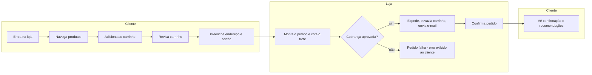

# Compra do cliente

Objetivo: permitir que um visitante, sem se cadastrar, transforme o interesse em produtos em um pedido pago, com frete cotado e e-mail de confirmação — do primeiro clique na loja até a tela de "pedido confirmado". `[inferred a partir do comportamento do frontend/checkoutservice; a intenção de negócio deve ser validada com o PM]`

## Atores

- **Cliente** — visitante da loja; não se autentica, é identificado por um cookie de sessão gerado automaticamente. `[extracted, src/frontend/middleware.go#L87-L107]`
- **Loja** — o conjunto de sistemas do domínio, tratado aqui como um único ator de negócio (o detalhe de quem-fala-com-quem está na sequência técnica).
- **Tráfego de teste** — o `loadgenerator` simula este mesmo fluxo automaticamente em ambientes de carga/demo, seguindo os mesmos passos de um cliente real. `[extracted, src/loadgenerator/locustfile.py#L44-L86]`

## Etapas

| # | Etapa | Ator | Decisão ou resultado | Técnica |
|---|---|---|---|---|
| 1 | Entra na loja e recebe uma sessão | Cliente | Cookie de sessão é criado se não existir | [passo 1](./compra-do-cliente.sequencia.md#passo-1-entrada-e-sessão) |
| 2 | Navega a vitrine e abre produtos | Cliente | Vê preço já convertido para a moeda escolhida | [passo 2](./compra-do-cliente.sequencia.md#passo-2-vitrine-e-preço) |
| 3 | Adiciona um ou mais produtos ao carrinho | Cliente | Carrinho persistido, associado à sessão | [passo 3](./compra-do-cliente.sequencia.md#passo-3-adicionar-ao-carrinho) |
| 4 | Revisa o carrinho | Cliente | Vê itens, preços convertidos e recomendações relacionadas | [passo 4](./compra-do-cliente.sequencia.md#passo-4-revisar-carrinho) |
| 5 | Preenche endereço de entrega e dados do cartão e confirma | Cliente | Formulário validado no frontend antes de seguir | [passo 5](./compra-do-cliente.sequencia.md#passo-5-envio-do-formulário-de-checkout) |
| 6 | Loja monta o pedido a partir do carrinho | Loja | Busca cada item no catálogo e converte cada preço para a moeda do cliente | [passo 6](./compra-do-cliente.sequencia.md#passo-6-montagem-do-pedido) |
| 7 | Loja cota e converte o frete | Loja | Cotação calculada e convertida para a moeda do cliente | [passo 7](./compra-do-cliente.sequencia.md#passo-7-cotação-de-frete) |
| 8 | Loja cobra o cartão | Loja | **Se a cobrança falhar (cartão inválido, bandeira não aceita ou vencido) o pedido inteiro falha aqui** — não há oferecer outro meio de pagamento nesta versão | [passo 8](./compra-do-cliente.sequencia.md#passo-8-cobrança) |
| 9 | Loja expede o pedido | Loja | Gera código de rastreio (mock) | [passo 9](./compra-do-cliente.sequencia.md#passo-9-expedição) |
| 10 | Loja esvazia o carrinho do cliente | Loja | Efeito colateral; **se falhar, o erro é apenas logado e o pedido é confirmado do mesmo jeito** | [passo 10](./compra-do-cliente.sequencia.md#passo-10-esvaziar-carrinho) |
| 11 | Loja envia e-mail de confirmação | Loja | Mock: não envia e-mail de verdade; **se falhar, o erro é apenas logado e o pedido é confirmado do mesmo jeito** | [passo 11](./compra-do-cliente.sequencia.md#passo-11-confirmação-por-e-mail) |
| 12 | Cliente vê a confirmação do pedido | Cliente | Tela final com itens, total pago e recomendações | [passo 12](./compra-do-cliente.sequencia.md#passo-12-resposta-ao-cliente) |

## Diagrama

## Indicadores

Nenhum indicador de negócio (taxa de conversão, ticket médio, abandono de carrinho) está instrumentado no código além de logs técnicos e tracing OpenTelemetry — não há métricas de negócio expostas. `[extracted — ausência de client de métricas de negócio; a confirmar com o PM se existem fora do repositório]`

## Regras que governam
- [Bandeiras de cartão aceitas](../regras-de-negocio/bandeiras-de-cartao-aceitas.md)
- [Cartão não pode estar vencido](../regras-de-negocio/cartao-nao-pode-estar-vencido.md)
- [Sessão sem login](../regras-de-negocio/sessao-sem-login.md)
- [Moedas suportadas para exibição](../regras-de-negocio/moedas-suportadas.md)
- [Falhas de expedição e e-mail não revertem o pedido](../regras-de-negocio/falha-pos-cobranca-nao-reverte-pedido.md)
