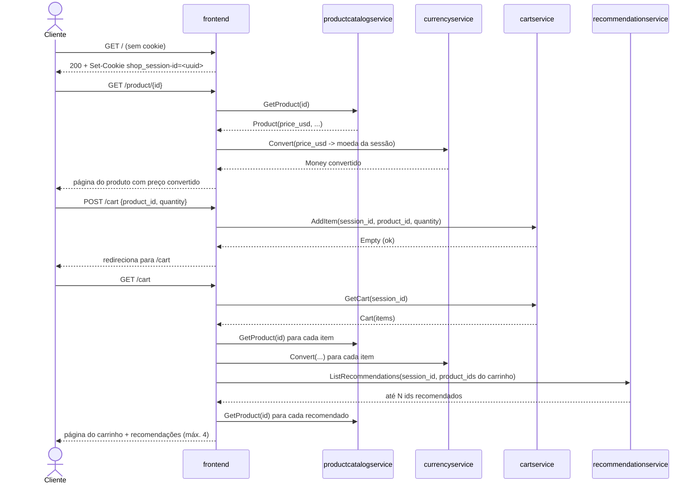
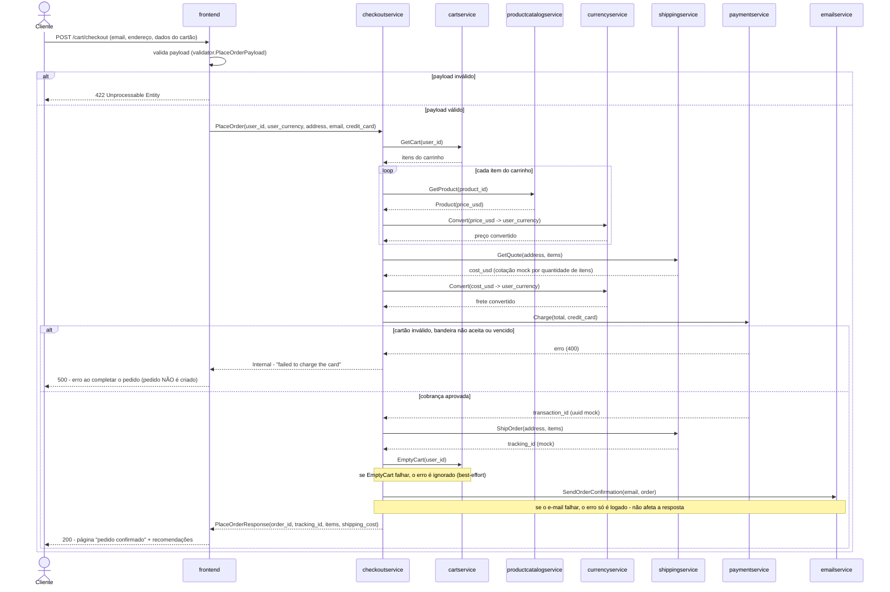

# Compra do cliente: sequência técnica

Realiza as etapas do [fluxo macro](./compra-do-cliente.md). Todas as chamadas entre sistemas são **gRPC síncronas**; a única chamada HTTP é do navegador para o `frontend`. Todos os endereços vêm de variáveis de ambiente do Deployment de cada serviço (ex.: `CART_SERVICE_ADDR=cartservice:7070`), fixadas nos manifestos Kubernetes. `[extracted, kubernetes-manifests/*.yaml]`

## Diagrama 1 — Navegação e carrinho (passos 1 a 4)

`[extracted, src/frontend/handlers.go#L59-L318; src/frontend/rpc.go#L30-L117]`

## Diagrama 2 — Checkout (passos 5 a 12)

`[extracted, src/checkoutservice/main.go#L237-L394; src/frontend/handlers.go#L320-L400]`

## Passos

### Passo 1: Entrada e sessão
O navegador acessa `GET /`. O middleware do `frontend` lê o cookie `shop_session-id`; se ausente, gera um UUID e grava o cookie com validade de 48h (`cookieMaxAge = 60*60*48`). Esse valor é o `user_id`/`session_id` usado por todos os serviços a partir daqui — não há cadastro nem login. `[extracted, src/frontend/middleware.go#L87-L107; src/frontend/main.go#L41-L45]`

### Passo 2: Vitrine e preço
Para a home (`GET /`) e a página de produto (`GET /product/{id}`), o `frontend` busca produtos em `productcatalogservice.ListProducts`/`GetProduct` e converte cada `Money` para a moeda atual da sessão via `currencyservice.Convert`. A home também busca um anúncio contextual (`adservice.GetAds`) com timeout de 100 ms. `[extracted, src/frontend/handlers.go#L59-L210; src/frontend/rpc.go#L119-L124]`

### Passo 3: Adicionar ao carrinho
`POST /cart` chama `cartservice.AddItem(user_id, product_id, quantity)`. O `cartservice` lê o carrinho serializado (protobuf) do Redis (`redis-cart:6379`), soma a quantidade se o produto já existir, e regrava. `[extracted, src/frontend/handlers.go#L211-L238; src/cartservice/src/cartstore/RedisCartStore.cs#L32-L64]`

### Passo 4: Revisar carrinho
`GET /cart` busca o carrinho (`cartservice.GetCart`), resolve cada item no catálogo, converte os preços e busca recomendações (`recommendationservice.ListRecommendations`), que por sua vez são resolvidas de volta no catálogo. O `frontend` corta a lista de recomendações em no máximo 4 itens para caber na UI. `[extracted, src/frontend/handlers.go#L251-L318; src/frontend/rpc.go#L99-L117]`

### Passo 5: Envio do formulário de checkout
`POST /cart/checkout` traz e-mail, endereço (rua, cidade, estado, país, CEP) e dados do cartão (número, mês/ano de expiração, CVV). O `frontend` valida o payload (`validator.PlaceOrderPayload.Validate()`) **antes** de chamar o `checkoutservice`; falha aqui retorna 422 sem nenhuma chamada de rede adicional. `[extracted, src/frontend/handlers.go#L320-L352]`

### Passo 6: Montagem do pedido
O `checkoutservice.PlaceOrder` gera um `order_id` (UUID) e chama `cartservice.GetCart`. Para cada item, busca o produto no `productcatalogservice` e converte seu preço para a moeda do cliente via `currencyservice.Convert`, montando a lista de `OrderItem`. `[extracted, src/checkoutservice/main.go#L237-L260, #L296-L318]`

### Passo 7: Cotação de frete
`shippingservice.GetQuote` calcula um valor determinístico a partir da contagem total de itens (não depende do endereço de fato, embora o endereço seja passado no contrato). O resultado em USD é convertido para a moeda do cliente. `[extracted, src/shippingservice/main.go#L118-L138; src/checkoutservice/main.go#L279-L295]`

### Passo 8: Cobrança
`paymentservice.Charge` valida o número do cartão com `simple-card-validator`, aceita **somente Visa e MasterCard**, verifica que a expiração é no futuro e devolve um `transaction_id` aleatório — nenhuma cobrança real ocorre. Qualquer uma dessas validações falhando lança um erro que o `checkoutservice` propaga como falha da chamada `PlaceOrder` inteira. **Não existe fluxo de "tentar outro cartão" nesta versão** — a interação termina em erro para o cliente. `[extracted, src/paymentservice/charge.js#L61-L86; src/checkoutservice/main.go#L262-L266]`

### Passo 9: Expedição
Somente após a cobrança ser aprovada, `shippingservice.ShipOrder` é chamado e devolve um `tracking_id` mock (hash determinístico, não um código de rastreio real). `[extracted, src/shippingservice/main.go#L140-L154; src/checkoutservice/main.go#L268-L271]`

### Passo 10: Esvaziar carrinho
`cartservice.EmptyCart` é chamado para o `user_id`. O `checkoutservice` **descarta o erro** dessa chamada (`_ = cs.emptyUserCart(...)`) — se falhar, o carrinho pode continuar com os itens já comprados, mas o pedido é confirmado do mesmo jeito. `[extracted, src/checkoutservice/main.go#L273-L275]`

### Passo 11: Confirmação por e-mail
`emailservice.SendOrderConfirmation` é chamado com o resultado do pedido. O serviço apenas loga o "envio" (ou, em modo real, usa SendGrid se configurado) — é best-effort: o erro é logado como `Warn` e **não** interrompe a resposta ao cliente. `[extracted, src/checkoutservice/main.go#L277-L282; src/emailservice/email_server.py#L62-L109]`

### Passo 12: Resposta ao cliente
O `checkoutservice` devolve `PlaceOrderResponse` com o pedido completo. O `frontend` soma o total pago (itens + frete), busca recomendações adicionais e renderiza a página de confirmação. `[extracted, src/frontend/handlers.go#L354-L400]`

## Caminho de erro (consolidado)

| Chamada | Se falhar | Efeito no pedido |
|---|---|---|
| `cartservice.GetCart` | Erro retornado ao cliente (500) | Pedido não é criado |
| `productcatalogservice.GetProduct` (por item) | Erro retornado ao cliente (500) | Pedido não é criado |
| `currencyservice.Convert` (preço ou frete) | Erro retornado ao cliente (500) | Pedido não é criado |
| `shippingservice.GetQuote` | Erro retornado ao cliente (500) | Pedido não é criado |
| `paymentservice.Charge` | Erro retornado ao cliente (500) | **Pedido não é criado** — mas se o mock realmente cobrasse, isso seria uma cobrança sem pedido; risco a validar |
| `shippingservice.ShipOrder` | Erro retornado ao cliente (503 Unavailable) | Cartão já foi cobrado; pedido não é criado — **inconsistência potencial: cliente pago sem pedido registrado** `[inferred — risco de negócio a confirmar]` |
| `cartservice.EmptyCart` | Ignorado (log implícito via erro descartado) | Pedido é confirmado normalmente |
| `emailservice.SendOrderConfirmation` | Logado como aviso | Pedido é confirmado normalmente |

Todas as chamadas gRPC usam `grpc.NewClient` sem timeout nem retry explícitos por chamada (exceto `adservice`, que tem timeout de 100 ms no frontend) — na ausência de configuração de timeout/circuit breaker, o comportamento padrão do gRPC (bloqueante, sem deadline) se aplica. `[extracted — nenhuma chamada `context.WithTimeout` encontrada nos clients gRPC do checkoutservice, exceto no chooseAd do frontend]`
