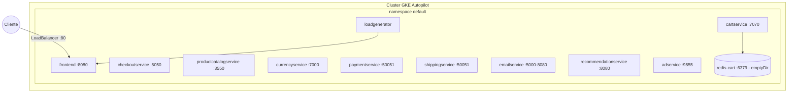

# Ambiente padrão (base Kubernetes / GKE Autopilot)

Configuração de referência do repositório: um único namespace, 11 Deployments + Services de aplicação, mais o Redis in-cluster. Sem overlay aplicado, este é o comportamento: backend de carrinho = Redis in-cluster, sem malha Istio, sem assistente de IA, com `loadgenerator` ativo. `[extracted, kubernetes-manifests/kustomization.yaml]`

## Implantação

`[extracted, kubernetes-manifests/*.yaml — portas e nomes de Service extraídos de cada manifesto]`

## Segurança de container (aplicada a todos os Deployments)
`runAsNonRoot`, `runAsUser/Group 1000`, `readOnlyRootFilesystem: true`, `allowPrivilegeEscalation: false`, `capabilities.drop: [ALL]` — ver [padrão de segurança de containers](../../padroes/seguranca-de-containers.md). `[extracted, presente em todos os `kubernetes-manifests/*.yaml`]`

## Probes
Todo serviço gRPC usa `readinessProbe`/`livenessProbe` do tipo `grpc` na própria porta do serviço (recurso nativo do Kubernetes ≥ 1.24, sem sidecar de grpc_health_probe). O `frontend` usa `httpGet /_healthz`. `[extracted]`
