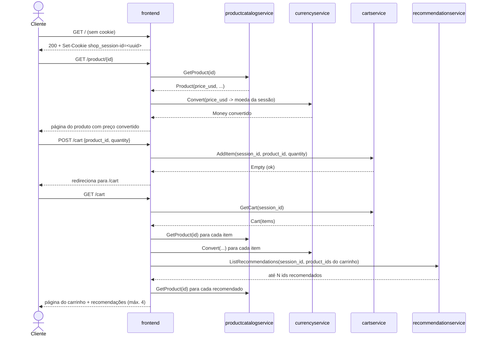
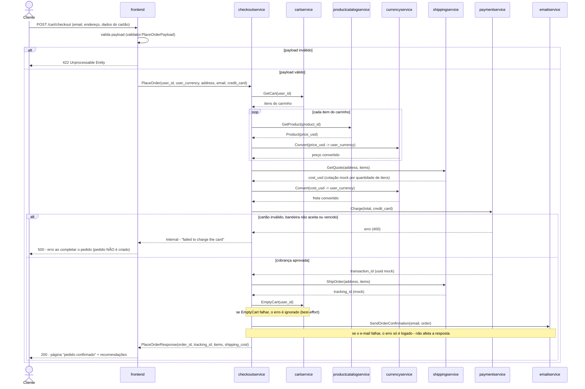

# Contexto do domínio Online Boutique

Loja de e-commerce cloud-native de demonstração (Google Cloud): o cliente navega por um catálogo de produtos, monta um carrinho, informa endereço e cartão de crédito e finaliza uma compra. O domínio cobre a jornada completa de compra self-s

Legenda: `[id] título (tipo, origem) — resumo`. Origem: extraído = lido nas fontes; inferido = a confirmar.

## 2. Domínio
- [dom-online-boutique] Domínio Online Boutique (domain, extraído) — Loja de e-commerce cloud-native de demonstração (Google Cloud): o cliente navega por um catálogo de produtos, monta um carrinho, informa endereço e cartão de crédito e finaliza uma
- [dom-online-boutique-eventos] Eventos de domínio (domain, extraído) — Este domínio **não publica nem consome eventos assíncronos**. Foi buscado por bibliotecas e padrões de mensageria (Kafka, Pub/Sub, RabbitMQ/AMQP, SQS, SNS) em todo o código-fonte d | realiza dom-online-boutique
- [dom-online-boutique-relacoes] Relações com outros domínios (domain, inferido) — O repositório documenta um único domínio autocontido (demo de referência); não há outro domínio de negócio (ex.: "Estoque", "Contabilidade", "Marketing") no mesmo repositório ou ci | realiza dom-online-boutique

## 1. Negócio
- [cap-assistir-compra-com-ia] Assistir a compra com IA (recurso opcional) (capability, misto) — A empresa pode oferecer um assistente conversacional que sugere produtos do catálogo a partir de uma pergunta em linguagem natural do cliente (ex.: "o que você recomenda para decor
- [cap-descobrir-e-recomendar-produtos] Descobrir e recomendar produtos (capability, inferido) — A empresa consegue guiar o cliente até produtos relevantes: por navegação/busca no catálogo, por recomendações associadas ao que já está no carrinho e por anúncios contextuais nas 
- [cap-vender-produtos-online] Vender produtos online (capability, inferido) — A empresa consegue vender produtos diretamente ao consumidor final por um site self-service, sem exigir cadastro: o visitante navega, monta um carrinho, escolhe a moeda de exibição
- [flow-compra-do-cliente] Compra do cliente (flow, misto) — Objetivo: permitir que um visitante, sem se cadastrar, transforme o interesse em produtos em um pedido pago, com frete cotado e e-mail de confirmação — do primeiro clique na loja a | realiza cap-vender-produtos-online

## 3. Subdomínio
- [flow-compra-do-cliente-sequencia] Compra do cliente: sequência técnica (flow, extraído) — Realiza as etapas do [fluxo macro](./compra-do-cliente.md). Todas as chamadas entre sistemas são **gRPC síncronas**; a única chamada HTTP é do navegador para o `frontend`. Todos os | realiza flow-compra-do-cliente
- [sub-assistente-de-compras] Subdomínio Assistente de Compras (subdomain, extraído) — Recurso opcional (desligado por padrão) que responde perguntas em linguagem natural sobre o catálogo usando busca vetorial + um modelo de linguagem generativo. `[extracted]` | realiza dom-online-boutique, cap-assistir-compra-com-ia
- [sub-carrinho-e-sessao] Subdomínio Carrinho e Sessão (subdomain, extraído) — Identifica o visitante sem exigir cadastro e mantém o carrinho de compras entre requisições, mesmo sem estado no navegador além de um cookie. `[extracted]` | realiza dom-online-boutique, cap-vender-produtos-online
- [sub-catalogo-e-descoberta] Subdomínio Catálogo e Descoberta (subdomain, extraído) — Responsável por manter e expor o catálogo de produtos e por ajudar o cliente a descobrir itens além do que ele já procurou (recomendações e anúncios). `[extracted a partir das resp | realiza dom-online-boutique, cap-descobrir-e-recomendar-produtos
- [sub-checkout-e-pagamento] Subdomínio Checkout e Pagamento (subdomain, extraído) — Orquestra a finalização do pedido: reúne o carrinho, precifica na moeda do cliente, cota e executa o frete, cobra o cartão e confirma por e-mail. `[extracted]` | realiza dom-online-boutique, cap-vender-produtos-online

## 4. Sistema
- [sys-indice] Sistemas do domínio e contrato gRPC comum (system, extraído) — Todos os sistemas do domínio (exceto o `shoppingassistantservice`, que expõe HTTP/Flask, e o `frontend`, que expõe HTTP para o navegador) implementam um serviço gRPC definido em um | realiza dom-online-boutique
- [sys-adservice] adservice (system, extraído) — Devolve anúncios de texto associados a categorias de produto (contexto da página atual). `[extracted, README.md#L35]` | realiza sub-catalogo-e-descoberta
- [sys-cartservice] cartservice (system, extraído) — Guarda o carrinho de compras por `user_id` (o cookie de sessão do frontend) e o devolve sob demanda. `[extracted, README.md#L28]` | realiza sub-carrinho-e-sessao
- [sys-checkoutservice] checkoutservice (system, extraído) — Orquestrador da finalização do pedido: é o único sistema do domínio que fala com `paymentservice`, `shippingservice` e `emailservice`. `[extracted]` | realiza sub-checkout-e-pagamento
- [sys-currencyservice] currencyservice (system, extraído) — Converte um valor monetário de uma moeda para outra. É o serviço de maior QPS do domínio segundo o README (chamado a cada preço exibido ou calculado). `[extracted, README.md#L30]` | realiza sub-checkout-e-pagamento, sub-catalogo-e-descoberta
- [sys-emailservice] emailservice (system, extraído) — Envia (mock, por padrão) o e-mail de confirmação do pedido. `[extracted, README.md#L32]` | realiza sub-checkout-e-pagamento
- [sys-frontend] frontend (system, extraído) — Servidor HTTP que renderiza a vitrine, o carrinho e o checkout; é a única porta de entrada do domínio para o navegador e para o `loadgenerator`. Não persiste nada por conta própria | realiza sub-carrinho-e-sessao
- [sys-loadgenerator] loadgenerator (system, extraído) — Ferramenta de teste/demo (Locust) que simula clientes reais navegando e comprando na loja continuamente. Não faz parte do domínio de negócio — é infraestrutura de teste/demonstraçã
- [sys-paymentservice] paymentservice (system, extraído) — Valida os dados de um cartão de crédito e simula a cobrança, devolvendo um id de transação. **Não há integração real com nenhuma adquirente/processadora** — nenhum valor é de fato  | realiza sub-checkout-e-pagamento
- [sys-productcatalogservice] productcatalogservice (system, extraído) — Fonte de verdade dos produtos vendidos na loja: lista, busca e devolve detalhe. Não tem banco de dados — o catálogo é um arquivo JSON estático empacotado na imagem. `[extracted]` | realiza sub-catalogo-e-descoberta
- [sys-recommendationservice] recommendationservice (system, extraído) — Sugere produtos a partir dos itens já no carrinho do cliente. `[extracted, README.md#L34]` | realiza sub-catalogo-e-descoberta
- [sys-shippingservice] shippingservice (system, extraído) — Dá uma cotação de frete e "expede" o pedido (mock: gera um código de rastreio determinístico; não integra transportadora real). `[extracted, README.md#L33]` | realiza sub-checkout-e-pagamento
- [sys-shoppingassistantservice] shoppingassistantservice (system, extraído) — Responde perguntas em linguagem natural sobre o catálogo, usando busca por similaridade vetorial (AlloyDB) e um modelo de linguagem generativo (Gemini via `langchain_google_genai`) | realiza sub-assistente-de-compras

## 5. Componente
- [cmp-checkoutservice-placeorder] PlaceOrder (component, extraído) — Endpoint gRPC único do `checkoutservice`; orquestra todo o passo a passo do checkout (ver [sequência técnica completa](../../../fluxos/compra-do-cliente.sequencia.md)). | realiza sys-checkoutservice
- [cmp-paymentservice-charge] Charge (component, extraído) — Sem retentativa. Três validações, nesta ordem, cada uma lança uma exceção que vira erro gRPC: | realiza sys-paymentservice

## 6. Infraestrutura
- [env-producao-gke] Ambiente padrão (base Kubernetes / GKE Autopilot) (environment, extraído) — Configuração de referência do repositório: um único namespace, 11 Deployments + Services de aplicação, mais o Redis in-cluster. Sem overlay aplicado, este é o comportamento: backen | realiza dom-online-boutique
- [env-variantes-kustomize] Variantes de implantação (componentes Kustomize) (environment, extraído) — O mesmo conjunto de manifestos base pode ser combinado com "componentes" Kustomize (`kustomize/components/*`) para trocar comportamento sem alterar código. Cada linha abaixo é inde | realiza dom-online-boutique
- [res-alloydb] AlloyDB (resource, extraído) — Assim como o Spanner, não é provisionado pelo Terraform deste repositório — o overlay assume uma instância AlloyDB já existente. `[extracted]` | realiza sys-cartservice, sys-shoppingassistantservice
- [res-gke-autopilot] Cluster GKE Autopilot (resource, extraído) — O Terraform, além de criar o cluster, habilita as APIs do Google Cloud necessárias (`container`, `monitoring`, `cloudtrace`, `cloudprofiler`, e `redis` se `var.memorystore=true`) e | realiza dom-online-boutique
- [res-memorystore-redis] Memorystore (Redis gerenciado) (resource, extraído) — Esta é a única alternativa aos três backends do `cartservice` que é efetivamente **provisionada por este próprio Terraform**; Spanner e AlloyDB (ver [res-spanner-cartservice](./spa | realiza sys-cartservice
- [res-redis-cart] redis-cart (resource, extraído) — O volume é `emptyDir` — **não sobrevive a um restart do pod**; o carrinho é efetivamente descartável/não durável neste ambiente padrão. `[extracted]` | realiza sys-cartservice
- [res-secret-manager] Secret Manager (segredo do AlloyDB) (resource, extraído) — Nenhum valor de segredo foi copiado para esta documentação — apenas o nome da variável que aponta para ele (`ALLOYDB_SECRET_NAME`), conforme registrado no [RELATORIO.md](../../RELA | realiza sys-shoppingassistantservice
- [res-service-mesh-istio] Malha de serviço (Istio / Cloud Service Mesh) (resource, extraído) — Este é um caminho de rede **alternativo**, não cumulativo por padrão, ao `Service` `frontend-external` (`LoadBalancer`) já definido em `kubernetes-manifests/frontend.yaml`. Qual do | realiza sys-frontend
- [res-spanner-cartservice] Cloud Spanner (backend alternativo do cartservice) (resource, extraído) — **Este componente Kustomize não cria a instância Spanner** — ele só aponta o serviço para uma instância que precisa existir previamente (o placeholder `SPANNER_DB_USER_GSA_ID` prec | realiza sys-cartservice

## Transversal
- [dec-indice] Decisões (ADRs) (decision, extraído) — Nenhum ADR ou registro de decisão arquitetural foi encontrado no repositório-fonte (não há `docs/adr/`, `decisions/` nem qualquer arquivo nomeado como tal). As justificativas de de
- [term-cotacao-de-frete] Cotação de frete (term, extraído) — Valor em USD devolvido por `shippingservice.GetQuote`, calculado apenas a partir da contagem total de itens do carrinho — o endereço de entrega é recebido no contrato mas não influ
- [term-moeda-de-exibicao] Moeda de exibição (term, extraído) — Código ISO 4217 (ex.: `USD`, `EUR`, `BRL`) escolhido pelo cliente via `POST /setCurrency` e guardado no cookie `shop_currency`. Todo preço mostrado — e o total cobrado no checkout 
- [term-pedido] Pedido (OrderResult) (term, extraído) — Resultado devolvido por `checkoutservice.PlaceOrder`: id do pedido, itens com preço convertido, custo e endereço de frete, e código de rastreio. **Não é persistido em nenhum banco*
- [term-sessao] Sessão (term, extraído) — Identificador único (UUID) atribuído automaticamente a cada visitante da loja no primeiro acesso, guardado no cookie `shop_session-id`. É o mesmo valor usado como `user_id` em `car
- [std-comunicacao-sincrona-grpc] Comunicação síncrona via gRPC, um contrato compartilhado (standard, extraído) — Todo sistema interno do domínio (exceto o `shoppingassistantservice`, HTTP/Flask) implementa um serviço gRPC gerado a partir do mesmo arquivo `protos/demo.proto`, versionado uma ve
- [std-healthcheck-grpc] Health check padrão gRPC (standard, extraído) — Todo serviço gRPC do domínio registra o serviço padrão `grpc.health.v1.Health` (`Check`/`Watch`), consumido pelas probes nativas `readinessProbe.grpc`/`livenessProbe.grpc` do Kuber
- [std-seguranca-de-containers] Segurança de containers (baseline Kubernetes) (standard, extraído) — Todo `Deployment` do domínio define o mesmo `securityContext` restritivo, tanto no pod quanto no container: `runAsNonRoot: true`, `runAsUser`/`runAsGroup: 1000`, `fsGroup: 1000`, `
- [rule-bandeiras-de-cartao-aceitas] Bandeiras de cartão aceitas (rule, extraído) — Somente cartões **Visa** e **MasterCard** são aceitos. Qualquer outra bandeira identificada (ex.: American Express, Diners Club) é rejeitada com a mensagem "Sorry, we cannot proces
- [rule-cartao-nao-pode-estar-vencido] Cartão não pode estar vencido (rule, extraído) — A cobrança só é aceita se `ano_expiração*12 + mês_expiração >= ano_atual*12 + mês_atual`; caso contrário a cobrança é recusada com `ExpiredCreditCard`. `[extracted]`
- [rule-falha-pos-cobranca-nao-reverte-pedido] Falhas após a cobrança não revertem o pedido (nem sempre bloqueiam) (rule, extraído) — Depois que `paymentservice.Charge` é aprovado:
- [rule-limite-de-anuncios-servidos] Limite de anúncios servidos (rule, extraído) — No máximo `MAX_ADS_TO_SERVE = 2` anúncios são devolvidos por chamada, tanto no caso de correspondência por categoria quanto no fallback aleatório. O `frontend` chama esse serviço c
- [rule-moedas-suportadas] Moedas suportadas para exibição (rule, extraído) — O `currencyservice` conhece um conjunto de códigos de moeda (arquivo `data/currency_conversion.json`), mas o `frontend` filtra essa lista por uma whitelist própria (`whitelistedCur
- [rule-recomendacao-nao-e-personalizada] Recomendação não é personalizada (rule, extraído) — Apesar do nome, o `recommendationservice` não usa histórico de compras, similaridade de produto nem qualquer modelo — ele sorteia aleatoriamente até um número fixo de produtos do c
- [rule-sessao-sem-login] Sessão sem login (rule, extraído) — A loja não exige cadastro nem autenticação. Ao primeiro acesso, um `session_id` (UUID) é gerado e gravado num cookie (`shop_session-id`, validade de 48h); esse id é usado como `use

## Sequências (passo a passo técnico)
### Compra do cliente: sequência técnica [flow-compra-do-cliente-sequencia]

### Compra do cliente: sequência técnica [flow-compra-do-cliente-sequencia]

