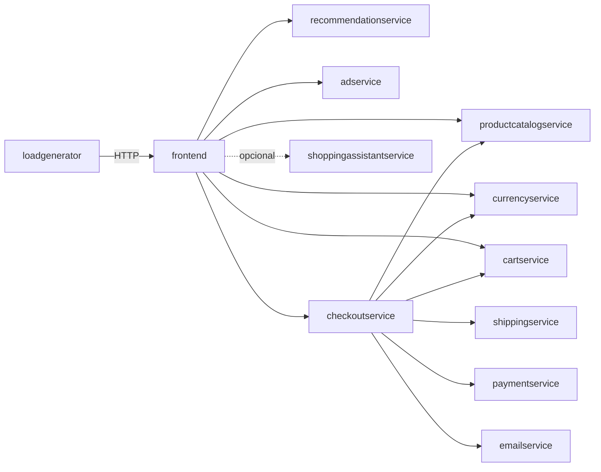

# Sistemas do domínio e contrato gRPC comum

Todos os sistemas do domínio (exceto o `shoppingassistantservice`, que expõe HTTP/Flask, e o `frontend`, que expõe HTTP para o navegador) implementam um serviço gRPC definido em um único arquivo compartilhado no repositório-fonte: `protos/demo.proto` (pacote `hipstershop`). Cada serviço Go/Node/Python/C#/Java gera seu próprio stub a partir do mesmo `.proto` (cópias em `src/<serviço>/genproto/`). `[extracted]`

Todos os serviços gRPC também implementam o health check padrão (`grpc.health.v1.Health`), usado pelas probes de `readiness`/`liveness` do Kubernetes. `[extracted, kubernetes-manifests/*.yaml — todas usam `readinessProbe.grpc.port`]`

## Índice de sistemas

| Sistema | Subdomínio | Stack | Expõe (RPC/HTTP) |
|---|---|---|---|
| [frontend](./frontend/ficha.md) | Carrinho e Sessão | Go | HTTP (páginas + `/bot`) |
| [cartservice](./cartservice/ficha.md) | Carrinho e Sessão | C# / .NET | `CartService` |
| [productcatalogservice](./productcatalogservice/ficha.md) | Catálogo e Descoberta | Go | `ProductCatalogService` |
| [recommendationservice](./recommendationservice/ficha.md) | Catálogo e Descoberta | Python | `RecommendationService` |
| [adservice](./adservice/ficha.md) | Catálogo e Descoberta | Java | `AdService` |
| [currencyservice](./currencyservice/ficha.md) | Checkout e Pagamento | Node.js | `CurrencyService` |
| [checkoutservice](./checkoutservice/ficha.md) | Checkout e Pagamento | Go | `CheckoutService` |
| [paymentservice](./paymentservice/ficha.md) | Checkout e Pagamento | Node.js | `PaymentService` |
| [shippingservice](./shippingservice/ficha.md) | Checkout e Pagamento | Go | `ShippingService` |
| [emailservice](./emailservice/ficha.md) | Checkout e Pagamento | Python | `EmailService` |
| [shoppingassistantservice](./shoppingassistantservice/ficha.md) | Assistente de Compras | Python (Flask) | HTTP `/` (chat) |
| [loadgenerator](./loadgenerator/ficha.md) | (ferramenta de teste, não é subdomínio de negócio) | Python (Locust) | — (é cliente, não expõe nada) |

## Contrato gRPC — serviços e métodos

| Serviço | Método | Requisição → Resposta | Linhas em `demo.proto` |
|---|---|---|---|
| CartService | AddItem, GetCart, EmptyCart | `AddItemRequest→Empty`, `GetCartRequest→Cart`, `EmptyCartRequest→Empty` | L23-L52 |
| RecommendationService | ListRecommendations | `ListRecommendationsRequest→ListRecommendationsResponse` | L56-L67 |
| ProductCatalogService | ListProducts, GetProduct, SearchProducts | `Empty→ListProductsResponse`, `GetProductRequest→Product`, `SearchProductsRequest→SearchProductsResponse` | L71-L103 |
| ShippingService | GetQuote, ShipOrder | `GetQuoteRequest→GetQuoteResponse`, `ShipOrderRequest→ShipOrderResponse` | L107-L136 |
| CurrencyService | GetSupportedCurrencies, Convert | `Empty→GetSupportedCurrenciesResponse`, `CurrencyConversionRequest→Money` | L140-L173 |
| PaymentService | Charge | `ChargeRequest→ChargeResponse` | L177-L195 |
| EmailService | SendOrderConfirmation | `SendOrderConfirmationRequest→Empty` | L199-L220 |
| CheckoutService | PlaceOrder | `PlaceOrderRequest→PlaceOrderResponse` | L224-L239 |
| AdService | GetAds | `AdRequest→AdResponse` | L243-L263 |

`[extracted, protos/demo.proto]`. Todas as mensagens usam o tipo comum `Money` (código de moeda ISO 4217 + unidades + nanos, L146-L161) e `Address`/`CartItem` compartilhados entre serviços.

## Quem chama quem (visão consolidada)

`[extracted — construído a partir dos `mustMapEnv`/clients de cada `main.*` e das envs `*_SERVICE_ADDR` nos manifestos Kubernetes]`

Nenhum sistema chama o `frontend` de volta, e nenhum sistema além do `checkoutservice` chama `paymentservice`, `shippingservice` ou `emailservice` — o `checkoutservice` é o único orquestrador do domínio.
