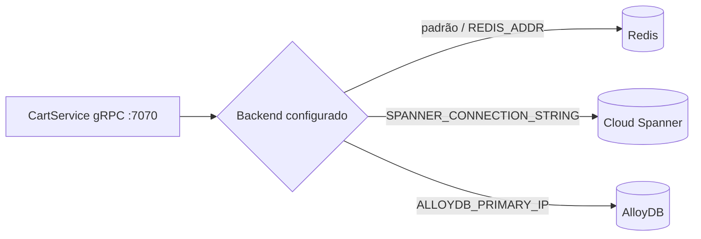
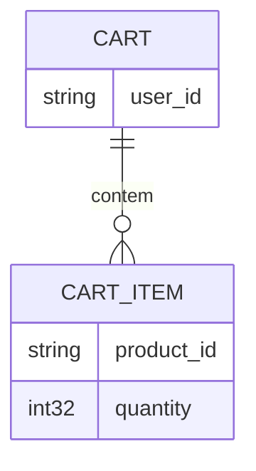

# cartservice

Guarda o carrinho de compras por `user_id` (o cookie de sessão do frontend) e o devolve sob demanda. `[extracted, README.md#L28]`

| Campo | Valor |
|---|---|
| Subdomínio | Carrinho e Sessão |
| Dono | Não identificado `[a confirmar]` |
| Stack | C# / .NET, `Microsoft.Extensions.Caching.Distributed` |
| Repositório | `src/cartservice/` |
| Criticidade | Alta — sem carrinho não há checkout `[inferred]` |

## Contêineres

O backend de armazenamento é escolhido em runtime por variável de ambiente (`Startup.cs`), sem trocar código do serviço:

`[extracted, src/cartservice/src/Startup.cs#L25-L58]`

No manifesto Kubernetes padrão do repositório, o backend ativo é sempre **Redis** (`REDIS_ADDR=redis-cart:6379`); Spanner e AlloyDB só entram via overlays Kustomize (`kustomize/components/spanner`, `kustomize/components/alloydb`). `[extracted, kubernetes-manifests/cartservice.yaml]`

## Expõe

| Contrato | Tipo | Detalhe |
|---|---|---|
| `CartService.AddItem` | gRPC | Adiciona item (soma quantidade se já existir) |
| `CartService.GetCart` | gRPC | Devolve o carrinho do usuário (vazio se não existir) |
| `CartService.EmptyCart` | gRPC | Zera o carrinho |

`[extracted, protos/demo.proto#L23-L52]`

## Consome
- Nenhum outro sistema do domínio — apenas o banco configurado (Redis/Spanner/AlloyDB).

## Dados

Serializado como protobuf binário, chave = `user_id`. `[extracted, src/cartservice/src/cartstore/RedisCartStore.cs#L32-L64]`

## Estados

Sem máquina de estados — o carrinho é sobrescrito por completo a cada escrita (não há versão/histórico).

## Qualidade

- Se o cache/banco estiver inacessível, o serviço lança `RpcException(FailedPrecondition)` — o `checkoutservice` propaga isso como falha 500 ao cliente. `[extracted, src/cartservice/src/cartstore/RedisCartStore.cs#L58-L64]`
