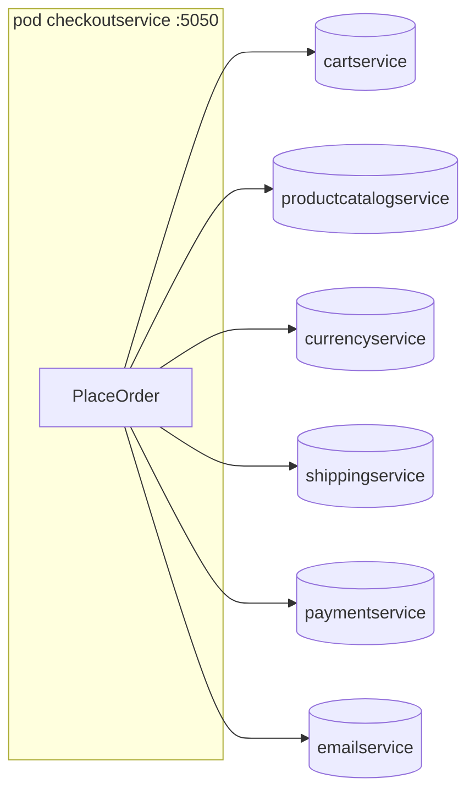
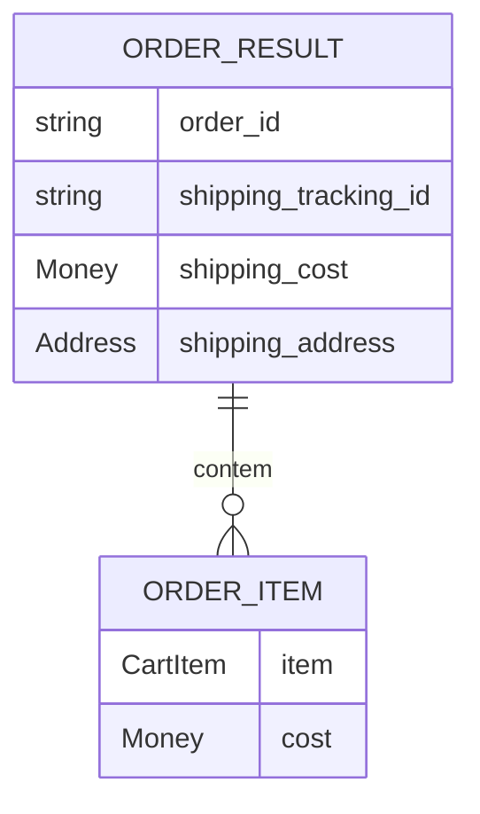

# checkoutservice

Orquestrador da finalização do pedido: é o único sistema do domínio que fala com `paymentservice`, `shippingservice` e `emailservice`. `[extracted]`

| Campo | Valor |
|---|---|
| Subdomínio | Checkout e Pagamento |
| Dono | Não identificado `[a confirmar]` |
| Stack | Go, gRPC, OpenTelemetry |
| Repositório | `src/checkoutservice/` |
| Criticidade | Alta — é o caminho crítico de receita `[inferred]` |

## Contêineres

`[extracted, src/checkoutservice/main.go#L237-L394]`

## Expõe

| Contrato | Tipo | Detalhe |
|---|---|---|
| `CheckoutService.PlaceOrder` | gRPC (porta 5050) | Ver [componente PlaceOrder](./componentes/place-order.md) |
| `grpc.health.v1.Health` | gRPC | Sempre `SERVING` (não valida as 6 dependências) `[extracted, src/checkoutservice/main.go#L245-L251]` |

## Consome

| Sistema | Contrato | Tipo |
|---|---|---|
| cartservice | GetCart, EmptyCart | gRPC |
| productcatalogservice | GetProduct | gRPC |
| currencyservice | Convert | gRPC |
| shippingservice | GetQuote, ShipOrder | gRPC |
| paymentservice | Charge | gRPC |
| emailservice | SendOrderConfirmation | gRPC |

## Dados

`OrderResult` (não persistido — devolvido na resposta e depois descartado; **não há tabela nem log de pedidos**, ver [pergunta em aberto](../../RELATORIO.md)):

`[extracted, protos/demo.proto#L203-L220]`

## Estados

Não há máquina de estados do pedido — `PlaceOrder` é uma chamada única, síncrona, tudo-ou-nada até o ponto da cobrança (ver caminho de erro na [sequência técnica](../../fluxos/compra-do-cliente.sequencia.md#caminho-de-erro-consolidado)).

## Qualidade

- Todas as conexões gRPC de saída são estabelecidas uma vez no boot (`mustConnGRPC`), sem retry se o serviço de destino cair depois. `[extracted, src/checkoutservice/main.go#L109-L120]`
- Falha em `EmptyCart` e em `SendOrderConfirmation` é absorvida (não propaga erro ao cliente) — ver [regra](../../regras-de-negocio/falha-pos-cobranca-nao-reverte-pedido.md).
- Falha em `ShipOrder` **depois** da cobrança aprovada retorna erro ao cliente sem estorno — risco de negócio a validar.
