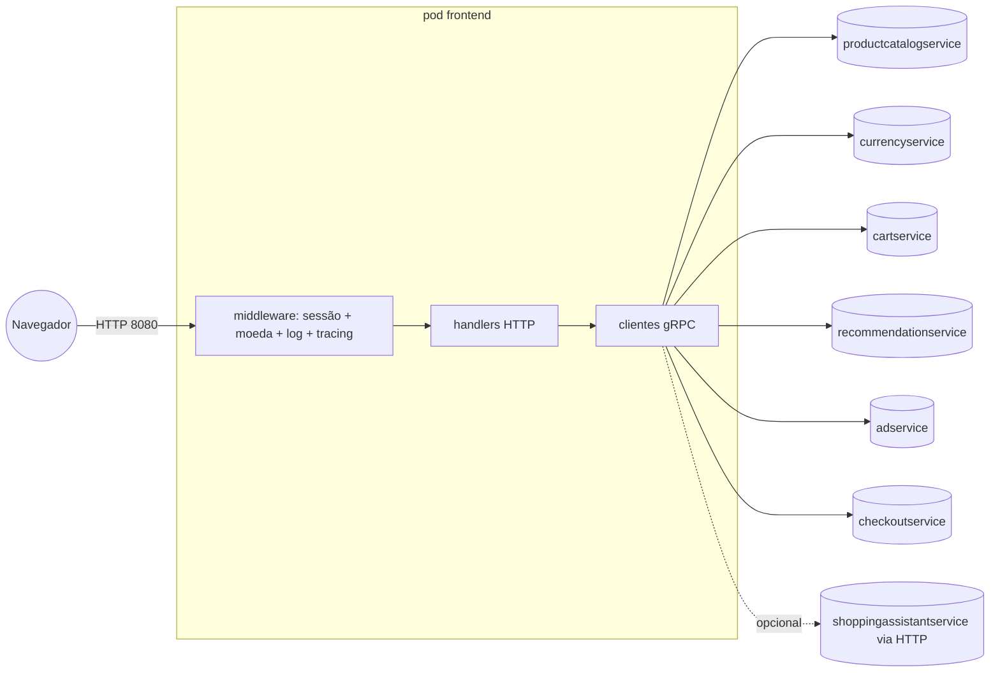

# frontend

Servidor HTTP que renderiza a vitrine, o carrinho e o checkout; é a única porta de entrada do domínio para o navegador e para o `loadgenerator`. Não persiste nada por conta própria — é um agregador que chama os demais serviços via gRPC. `[extracted]`

| Campo | Valor |
|---|---|
| Subdomínio | Carrinho e Sessão (ponto de entrada de todos os subdomínios) |
| Dono | Não identificado no repositório `[a confirmar]` |
| Stack | Go, `gorilla/mux`, templates HTML server-side |
| Repositório | `src/frontend/` (monorepo) |
| Criticidade | Alta — ponto único de entrada; sem ele nenhum fluxo de negócio funciona `[inferred]` |

## Contêineres

`[extracted, src/frontend/main.go#L91-L163]`

## Expõe

| Contrato | Tipo | Detalhe |
|---|---|---|
| `GET /` | HTTP | Home: lista produtos + moeda + anúncio |
| `GET /product/{id}` | HTTP | Detalhe do produto + recomendações |
| `GET /cart`, `POST /cart`, `POST /cart/empty` | HTTP | Ver, adicionar e esvaziar carrinho |
| `POST /setCurrency` | HTTP | Troca a moeda de exibição (cookie `shop_currency`) |
| `POST /cart/checkout` | HTTP | Finaliza o pedido (ver [fluxo de compra](../../fluxos/compra-do-cliente.sequencia.md)) |
| `GET /logout` | HTTP | Invalida o cookie de sessão |
| `GET /assistant`, `POST /bot` | HTTP | UI e endpoint do assistente de compras (só ativo com `ENABLE_ASSISTANT=true`) |
| `GET /_healthz` | HTTP | Liveness/readiness (sempre "ok", não checa dependências) |

`[extracted, src/frontend/main.go#L150-L163]`

## Consome

| Sistema | Contrato | Tipo |
|---|---|---|
| productcatalogservice | ListProducts, GetProduct, SearchProducts | gRPC |
| currencyservice | GetSupportedCurrencies, Convert | gRPC |
| cartservice | AddItem, GetCart, EmptyCart | gRPC |
| recommendationservice | ListRecommendations | gRPC |
| adservice | GetAds (timeout 100 ms) | gRPC |
| checkoutservice | PlaceOrder | gRPC |
| shoppingassistantservice | POST / (chat) | HTTP (opcional) |

`[extracted, src/frontend/rpc.go]`

## Dados

Não há modelo de dados persistente próprio; o estado do visitante vive em dois cookies: `shop_session-id` (uuid, 48h) e `shop_currency`. `[extracted, src/frontend/main.go#L41-L45]`

## Qualidade

- `GetAds` tem timeout de 100 ms (`context.WithTimeout`) — se estourar, a home segue sem anúncio. `[extracted, src/frontend/rpc.go#L119-L121]`
- Conexões gRPC para os demais serviços não têm timeout/retry configurado (`grpc.NewClient` simples). `[extracted]`
- `/_healthz` não valida dependências — só confirma que o processo HTTP está de pé; probes de readiness/liveness do Kubernetes usam esse endpoint com um cookie fixo. `[extracted, kubernetes-manifests/frontend.yaml#L46-L58]`
