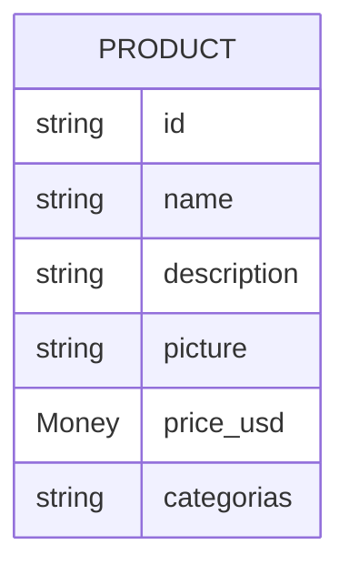

# productcatalogservice

Fonte de verdade dos produtos vendidos na loja: lista, busca e devolve detalhe. Não tem banco de dados — o catálogo é um arquivo JSON estático empacotado na imagem. `[extracted]`

| Campo | Valor |
|---|---|
| Subdomínio | Catálogo e Descoberta |
| Dono | Não identificado `[a confirmar]` |
| Stack | Go |
| Repositório | `src/productcatalogservice/` |
| Criticidade | Alta — praticamente todas as páginas dependem dele `[inferred]` |

## Contêineres

`[extracted — arquivo de dados local, não é um recurso de infraestrutura externo]`

## Expõe

| Contrato | Tipo | Detalhe |
|---|---|---|
| `ProductCatalogService.ListProducts` | gRPC | Lista todos os produtos |
| `ProductCatalogService.GetProduct` | gRPC | Detalhe por id |
| `ProductCatalogService.SearchProducts` | gRPC | Busca por texto |

`[extracted, protos/demo.proto#L71-L103]`

## Consome
- Nenhum outro sistema.

## Dados

`[extracted, protos/demo.proto#L77-L87]`

## Qualidade
- Catálogo estático versionado junto com o código (deploy de novo produto = novo build da imagem). `[inferred a partir da ausência de qualquer chamada de escrita/admin no contrato]`
