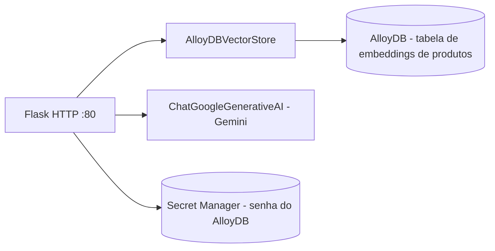

# shoppingassistantservice

Responde perguntas em linguagem natural sobre o catálogo, usando busca por similaridade vetorial (AlloyDB) e um modelo de linguagem generativo (Gemini via `langchain_google_genai`). Recurso opcional, desligado por padrão. `[extracted]`

| Campo | Valor |
|---|---|
| Subdomínio | Assistente de Compras |
| Dono | Não identificado `[a confirmar]` |
| Stack | Python, Flask, LangChain, `langchain_google_alloydb_pg` |
| Repositório | `src/shoppingassistantservice/` |
| Criticidade | Baixa — feature opcional, não faz parte do caminho de compra `[extracted]` |

## Contêineres

`[extracted, src/shoppingassistantservice/shoppingassistantservice.py#L20-L60]`

## Expõe

| Contrato | Tipo | Detalhe |
|---|---|---|
| `POST /` | HTTP | Recebe a pergunta do cliente e devolve texto gerado a partir dos produtos similares encontrados |

## Consome
- AlloyDB (vetores de produto) e Secret Manager (senha do banco) diretamente — não via outro sistema do domínio.
- API do Google Generative AI (Gemini) para gerar a resposta e os embeddings.

## Qualidade
- Requer `PROJECT_ID`, `REGION`, `ALLOYDB_DATABASE_NAME`, `ALLOYDB_TABLE_NAME`, `ALLOYDB_CLUSTER_NAME`, `ALLOYDB_INSTANCE_NAME`, `ALLOYDB_SECRET_NAME` — se qualquer uma faltar, o processo falha no boot (`os.environ[...]` sem default). `[extracted, src/shoppingassistantservice/shoppingassistantservice.py#L19-L24]`
- Segredo: senha do Postgres/AlloyDB é buscada em runtime no Secret Manager, nunca fica em variável de ambiente em texto puro. `[extracted, src/shoppingassistantservice/shoppingassistantservice.py#L36-L39]`
