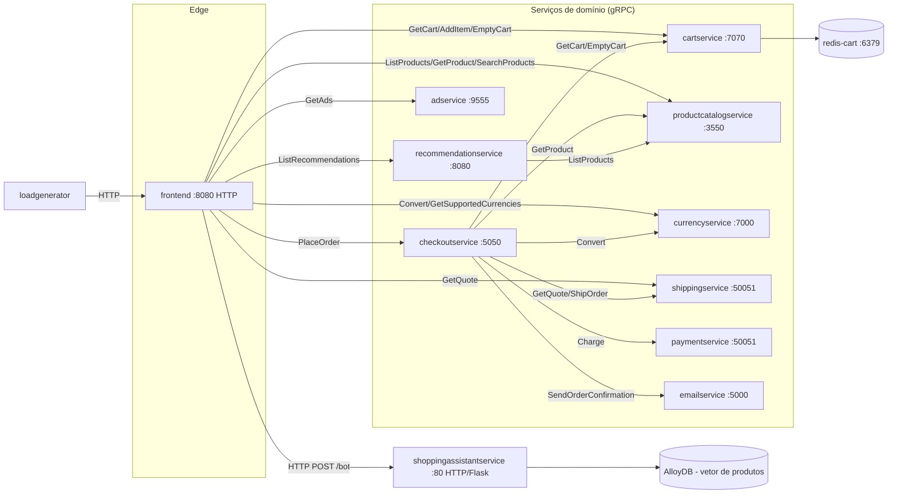

# 2. Como os Serviços se Falam

## 2.1 Protocolo: gRPC + protobuf, ponto a ponto, síncrono

Toda comunicação **entre** microsserviços de negócio é feita por **chamadas
gRPC síncronas** (request/response), usando um único arquivo de contrato:
`protos/demo.proto` (pacote `hipstershop`). Cada serviço compila esse mesmo
`.proto` para a sua linguagem (Go, C#, Node.js, Python, Java) e gera um
stub cliente e um esqueleto servidor. Não existe barramento de eventos,
fila (Kafka/RabbitMQ/PubSub) ou webhook entre os serviços — se um serviço
downstream está fora do ar, a chamada gRPC falha e o erro sobe na pilha de
chamadas até o `frontend`.

A única exceção é o **`frontend`**, que fala **HTTP/HTML** com o navegador do
usuário (é o único serviço "web" tradicional) e também expõe um endpoint
`/bot` (`chatBotHandler`) que faz uma chamada **HTTP** (não gRPC) para o
`shoppingassistantservice`, que roda como um servidor Flask.

## 2.2 Descoberta de serviço: DNS interno do Kubernetes

Não há service mesh de descoberta dinâmica nem service registry — a
"descoberta" é feita via **variáveis de ambiente com nomes de Service do
Kubernetes**, resolvidos por DNS interno do cluster (`<service>.<namespace>.svc.cluster.local`,
abreviado para `<service>:<porta>` dentro do mesmo namespace). Cada Deployment
recebe o endereço dos serviços de quem depende hard-coded no manifest, por
exemplo (`kubernetes-manifests/checkoutservice.yaml`):

```yaml
env:
- name: PRODUCT_CATALOG_SERVICE_ADDR
  value: "productcatalogservice:3550"
- name: SHIPPING_SERVICE_ADDR
  value: "shippingservice:50051"
- name: PAYMENT_SERVICE_ADDR
  value: "paymentservice:50051"
- name: EMAIL_SERVICE_ADDR
  value: "emailservice:5000"
- name: CURRENCY_SERVICE_ADDR
  value: "currencyservice:7000"
- name: CART_SERVICE_ADDR
  value: "cartservice:7070"
```

Cada serviço Go/C#/Python lê essas variáveis no start-up (`mustMapEnv`) e
abre uma conexão gRPC persistente (`grpc.NewClient`, insegura/sem TLS de
aplicação — TLS mTLS fica a cargo do Istio quando habilitado) para cada
dependência, mantida durante todo o ciclo de vida do pod.

## 2.3 Mapa de comunicação (quem chama quem)



Observações sobre o grafo:

- `checkoutservice` é o único serviço que **também é cliente** de outros
  cinco serviços (cart, catálogo, moeda, frete, pagamento, e-mail) — ele
  concentra toda a complexidade de orquestração da compra.
- `productcatalogservice`, `currencyservice`, `paymentservice`,
  `shippingservice`, `adservice`, `emailservice` são **folhas** no grafo:
  não chamam ninguém, só respondem. Isso os torna fáceis de escalar
  independentemente e sem risco de dependência cíclica.
- `recommendationservice` tem uma única dependência de saída
  (`productcatalogservice.ListProducts`), usada para montar a lista de
  produtos candidatos a recomendar.
- Não existe chamada `checkoutservice → recommendationservice` nem
  `checkoutservice → adservice`: recomendações e anúncios são só uma
  preocupação de apresentação do `frontend`, nunca do processo de compra em
  si.

## 2.4 Contratos por serviço (RPCs expostos)

Extraído diretamente de `protos/demo.proto`:

| Serviço | RPC | Request → Response |
|---|---|---|
| CartService | `AddItem` | `AddItemRequest{user_id, CartItem{product_id, quantity}}` → `Empty` |
| | `GetCart` | `GetCartRequest{user_id}` → `Cart{user_id, items[]}` |
| | `EmptyCart` | `EmptyCartRequest{user_id}` → `Empty` |
| ProductCatalogService | `ListProducts` | `Empty` → `ListProductsResponse{products[]}` |
| | `GetProduct` | `GetProductRequest{id}` → `Product` |
| | `SearchProducts` | `SearchProductsRequest{query}` → `SearchProductsResponse{results[]}` |
| RecommendationService | `ListRecommendations` | `{user_id, product_ids[]}` → `{product_ids[]}` |
| ShippingService | `GetQuote` | `{address, items[]}` → `{cost_usd: Money}` |
| | `ShipOrder` | `{address, items[]}` → `{tracking_id}` |
| CurrencyService | `GetSupportedCurrencies` | `Empty` → `{currency_codes[]}` |
| | `Convert` | `{from: Money, to_code}` → `Money` |
| PaymentService | `Charge` | `{amount: Money, credit_card}` → `{transaction_id}` |
| EmailService | `SendOrderConfirmation` | `{email, order: OrderResult}` → `Empty` |
| CheckoutService | `PlaceOrder` | `{user_id, user_currency, address, email, credit_card}` → `{order: OrderResult}` |
| AdService | `GetAds` | `{context_keys[]}` → `{ads[]}` |

Todos os serviços gRPC também implementam o **protocolo de health check
padrão** (`grpc.health.v1.Health` — `protos/grpc/health/v1/health.proto`),
usado pelas *probes* de liveness/readiness do Kubernetes (ver documento 3).

## 2.5 Resiliência (e sua ausência)

- **No código de aplicação:** não há retries, timeouts customizados,
  circuit breakers ou fallback explícitos nas chamadas gRPC dos serviços
  (ex.: `checkoutservice.chargeCard`, `quoteShipping` simplesmente propagam o
  erro do gRPC como `status.Errorf(codes.Internal, ...)`). Uma falha em
  qualquer serviço-folha durante `PlaceOrder` derruba o checkout inteiro
  — a única exceção deliberada é o envio de e-mail: se
  `sendOrderConfirmation` falhar, o erro é apenas logado (`log.Warnf`) e o
  pedido é considerado concluído mesmo assim.
- **Tracing distribuído:** todos os serviços Go instrumentam gRPC com
  OpenTelemetry (`otelgrpc`), propagando contexto de trace via
  `ENABLE_TRACING=1` e exportando para um `COLLECTOR_SERVICE_ADDR` (padrão:
  OpenTelemetry Collector), permitindo correlacionar uma compra através de
  todos os serviços envolvidos.
- **Na malha de serviço (opcional):** quando o componente Kustomize
  `service-mesh-istio` está habilitado, o Istio injeta sidecars Envoy em
  cada pod, que then podem fornecer mTLS, retries e circuit breaking de
  forma transparente — mas isso é infraestrutura, não está no código dos
  serviços (ver documento 3, seção Istio).
