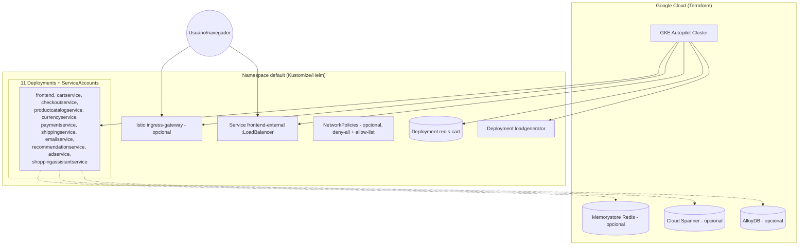

# 3. Infraestrutura no Kubernetes

## 3.1 Formas de implantar (3 caminhos, mesmo destino)

O repositório oferece três caminhos equivalentes para colocar os 11+1
serviços no ar, todos apontando para o mesmo conjunto de imagens de
container:

1. **Manifests YAML "crus"** em `kubernetes-manifests/*.yaml` — um
   Deployment + Service + ServiceAccount por serviço, prontos para
   `kubectl apply -f ./release/kubernetes-manifests.yaml` (arquivo
   consolidado versionado em `release/`).
2. **Kustomize** (`kustomize/base` + `kustomize/components/*`) — a mesma
   base, mas componível: permite ligar/desligar variantes (Spanner em vez de
   Redis, Istio, network policies, branding etc.) via *overlays* sem editar
   os YAMLs base.
3. **Helm chart** (`helm-chart/`) — mesmo conjunto de recursos, parametrizado
   por `values.yaml` (imagem/tag por serviço, réplicas, recursos, feature
   flags), com `NOTES.txt` pós-instalação.

O **Skaffold** (`skaffold.yaml`, `apiVersion: skaffold/v3`) amarra tudo:
builda as 11 imagens (uma por diretório em `src/*`, com Docker/BuildKit,
multi-arch `linux/amd64` + `linux/arm64`, tag = git commit) e implanta via
`manifests.kustomize.paths: [kubernetes-manifests]` + `deploy.kubectl`.
`cloudbuild.yaml` usa esse mesmo Skaffold em CI para build/push de imagens.

## 3.2 Anatomia de um serviço (padrão repetido 9x)

Cada serviço de negócio segue exatamente o mesmo template de manifest
(`kubernetes-manifests/<service>.yaml`), ilustrado aqui pelo
`checkoutservice`:

```yaml
apiVersion: apps/v1
kind: Deployment
metadata:
  name: checkoutservice
spec:
  selector: {matchLabels: {app: checkoutservice}}
  template:
    spec:
      serviceAccountName: checkoutservice     # SA dedicada por serviço
      securityContext:
        fsGroup: 1000
        runAsGroup: 1000
        runAsNonRoot: true                    # nunca roda como root
        runAsUser: 1000
      containers:
        - name: server
          securityContext:
            allowPrivilegeEscalation: false
            capabilities: {drop: [ALL]}       # capabilities Linux zeradas
            privileged: false
            readOnlyRootFilesystem: true      # FS raiz somente leitura
          image: checkoutservice
          ports: [{containerPort: 5050}]
          readinessProbe: {grpc: {port: 5050}}   # health check gRPC nativo
          livenessProbe:  {grpc: {port: 5050}}
          env: [...]                              # endereços das dependências
          resources:
            requests: {cpu: 100m, memory: 64Mi}
            limits:   {cpu: 200m, memory: 128Mi}
---
apiVersion: v1
kind: Service
metadata: {name: checkoutservice}
spec:
  type: ClusterIP
  ports: [{name: grpc, port: 5050, targetPort: 5050}]
---
apiVersion: v1
kind: ServiceAccount
metadata: {name: checkoutservice}
```

Pontos notáveis do padrão de segurança/operação, repetidos em todos os
11 serviços:

- **Postura de segurança "hardened" por padrão:** `runAsNonRoot`,
  `readOnlyRootFilesystem: true`, `capabilities.drop: [ALL]`,
  `allowPrivilegeEscalation: false` — sem exceções.
- **Probes usando o protocolo gRPC nativo do Kubernetes** (`readinessProbe.grpc`)
  para os serviços gRPC — dependem do `grpc.health.v1.Health` que cada
  serviço registra (`healthpb.RegisterHealthServer`). O `frontend`, por ser
  HTTP, usa `httpGet` em `/_healthz` com um cookie especial
  (`shop_session-id=x-readiness-probe` / `x-liveness-probe`).
  Ver `kubernetes-manifests/frontend.yaml` linhas 50-65.
- **Requests/limits pequenos e consistentes** (tipicamente 100m/64Mi de
  request e 200m/128Mi de limit) — desenhado para caber facilmente em
  clusters pequenos/GKE Autopilot.
  `cartservice` pede mais memória de start (`memory: 128Mi` no manifest) por
  causa do cliente Redis/.NET.
- **ServiceAccount dedicada por Deployment** — pré-requisito para aplicar
  Workload Identity (GCP) ou RBAC granular por serviço depois.
- **`Service` sempre `ClusterIP`** (não exposto fora do cluster), exceto:

## 3.3 As duas exceções à regra: Redis e o Frontend público

- **`redis-cart`** (dentro de `kubernetes-manifests/cartservice.yaml`): um
  segundo Deployment no mesmo arquivo, rodando a imagem oficial
  `redis:alpine`, porta `6379`, com um `volumeMount` (`redis-data`) — é o
  único componente com estado de disco no cluster por padrão. `cartservice`
  aponta para ele via env `REDIS_ADDR=redis-cart:6379`.
- **`frontend`** expõe **dois** Services:
  - `frontend` (ClusterIP, porta 80 → 8080) — usado internamente por
    Istio/loadgenerator.
  - `frontend-external` — tipo `LoadBalancer`, é o **único ponto de entrada
    público** do domínio inteiro. Todo tráfego de usuário externo entra por
    aqui (ou pelo Istio Gateway, se habilitado — ver 3.5).

## 3.4 Kustomize: base + componentes opcionais

`kustomize/base/kustomization.yaml` referencia os 11 manifests padrão (os
mesmos de `kubernetes-manifests/`, porém como base componível). Sobre essa
base, `kustomize/components/` oferece **componentes plugáveis** (cada um com
seu próprio README explicando o trade-off), usados via
`kubectl apply -k` com `components: [...]` na kustomization do usuário:

| Componente | O que muda |
|---|---|
| `spanner` | Troca a persistência do carrinho de Redis para **Cloud Spanner** (`SpannerCartStore.cs`) |
| `alloydb` | Troca a persistência do carrinho para **AlloyDB** (`AlloyDBCartStore.cs`); também usado pelo `shoppingassistantservice` como vector store |
| `memorystore` | Usa **Memorystore (Redis gerenciado)** em vez do Redis rodando como pod no cluster |
| `service-mesh-istio` | Injeta os manifests de `istio-manifests/` (Gateway, VirtualServices, ServiceEntries) |
| `network-policies` | Adiciona `NetworkPolicy` por serviço + uma política **deny-all** de base (Zero Trust de rede: só o tráfego explicitamente listado passa) |
| `non-public-frontend` | Remove o `frontend-external` (LoadBalancer), forçando acesso só via port-forward/mesh |
| `single-shared-session` | Fixa um `session_id` único para todos os visitantes (útil para demos determinísticas) |
| `shopping-assistant` | Ativa o `shoppingassistantservice` (Deployment próprio + flag `ENABLE_ASSISTANT`) |
| `cymbal-branding` | Reskin visual (marca fictícia "Cymbal") |
| `custom-base-url` | Serve a aplicação sob um path base customizado |
| `without-loadgenerator` | Remove o Deployment de `loadgenerator` via patch (`delete-loadgenerator.patch.yaml`) |
| `container-images-registry` / `-tag` / `-tag-suffix` | Trocam o registro/tag das imagens de container |

Isso mostra que a persistência do carrinho (Redis/Spanner/AlloyDB/Memorystore)
é um **detalhe de infraestrutura plugável**, não algo hard-coded no domínio —
`cartservice` só enxerga a interface `ICartStore` (`src/cartservice/src/cartstore/ICartStore.cs`)
e o Kustomize decide qual implementação concreta é injetada por variável de
ambiente/manifest.

## 3.5 Istio (malha de serviço opcional)

Quando o componente `service-mesh-istio` é aplicado, `istio-manifests/`
adiciona três recursos `networking.istio.io/v1alpha3`:

- **`Gateway` (`frontend-gateway`)** — expõe a porta 80/HTTP no
  ingress-gateway padrão do Istio (`istio: ingressgateway`) para qualquer
  host (`"*"`).
- **`VirtualService` (`frontend-ingress`)** — roteia todo tráfego do
  Gateway acima para o Service `frontend:80`.
- **`VirtualService` (`frontend`)** — roteamento interno para
  `frontend.default.svc.cluster.local:80` (permite futura configuração de
  canary/traffic-splitting no próprio serviço).
- **`ServiceEntry` (`allow-egress-googleapis`, `allow-egress-google-metadata`)**
  — como o Istio por padrão bloqueia egress não declarado, essas entradas
  liberam explicitamente saída para `*.googleapis.com`,
  `accounts.google.com` e o metadata server do GCE
  (`169.254.169.254` / `metadata.google.internal`), necessários para
  Workload Identity e chamadas a APIs do Google Cloud (profiler, tracing,
  Spanner/AlloyDB, Gemini).

Com Istio ativo, cada pod ganha um sidecar Envoy — é aí que mTLS entre
serviços, retries e circuit breaking passam a existir de fato (o código dos
serviços, como visto no documento 2, não implementa nada disso sozinho).

## 3.6 Provisionamento de cluster (Terraform)

`terraform/main.tf` provisiona a infraestrutura **fora** do Kubernetes,
necessária para rodar o cluster:

- Habilita APIs do Google Cloud (`container`, `monitoring`, `cloudtrace`,
  `cloudprofiler`, e opcionalmente `redis.googleapis.com` se
  `var.memorystore=true`).
- Cria o cluster **GKE em modo Autopilot** (`google_container_cluster`,
  `enable_autopilot = true`) — sem gestão manual de node pools.
- Busca credenciais do cluster via módulo `gcloud`.
- Roda `kubectl apply -k ${var.filepath_manifest} -n ${var.namespace}`
  como um `null_resource.apply_deployment` — ou seja, o próprio Terraform
  invoca o Kustomize/kubectl para aplicar os manifests descritos acima.
- `memorystore.tf` cuida da instância gerenciada de Redis quando essa
  variante está habilitada.

Ou seja: **Terraform cria o cluster GKE + dependências gerenciadas do GCP**;
**Kustomize/Helm/kubectl aplicam os workloads dentro dele**. São duas
camadas independentes, conectadas pelo `null_resource` acima.

## 3.7 Resumo da topologia de infraestrutura


