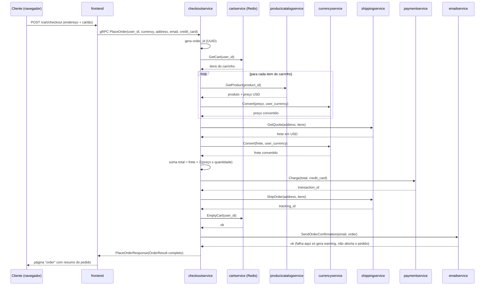

# 4. Fluxo de Compra do Cliente — Passo a Passo

Este documento descreve o caminho completo de um cliente, da primeira
visita ao site até o recebimento do e-mail de confirmação do pedido,
apontando a linha de código exata responsável por cada etapa. As rotas HTTP
citadas são registradas em `src/frontend/main.go` (linhas 150-163); os
handlers estão em `src/frontend/handlers.go`.

## 4.1 Passo 0 — Sessão anônima (acontece em toda requisição)

Antes de qualquer rota, o middleware `ensureSessionID`
(`src/frontend/middleware.go`) roda em toda requisição:

- Se o navegador não enviar o cookie `shop_session-id`, o frontend gera um
  novo UUID e o define como cookie (validade de longo prazo).
- Esse `session_id` **é** o `user_id` usado em todas as chamadas gRPC
  subsequentes (carrinho, recomendações, checkout). Não há cadastro nem
  login — a "conta" do cliente é só esse cookie.

## 4.2 Passo 1 — Home page (`GET /`)

Handler: `homeHandler` (`handlers.go:59`).

1. `fe.getCurrencies()` → gRPC `CurrencyService.GetSupportedCurrencies` —
   popula o seletor de moeda.
2. `fe.getProducts()` → gRPC `ProductCatalogService.ListProducts` — lista
   completa de produtos do catálogo (vem de um JSON estático embarcado no
   `productcatalogservice`).
3. `fe.getCart(session_id)` → gRPC `CartService.GetCart` — só para exibir o
   contador de itens no carrinho no cabeçalho.
4. Para cada produto: `fe.convertCurrency()` → gRPC
   `CurrencyService.Convert` — converte o preço USD do catálogo para a
   moeda atualmente selecionada pelo cliente.
5. `fe.chooseAd()` → gRPC `AdService.GetAds` — busca um anúncio contextual
   (sem palavras-chave nesta página, contexto vazio).
6. Renderiza o template `home` com produtos, moedas e tamanho do carrinho.

## 4.3 Passo 2 — Trocar moeda (`POST /setCurrency`)

Handler: `setCurrencyHandler`. Grava a moeda escolhida em outro cookie
(`shop_currency`); não chama nenhum serviço de backend diretamente — a
conversão de fato só acontece nas próximas páginas renderizadas (todas leem
`currentCurrency(r)` do cookie).

## 4.4 Passo 3 — Ver detalhe de um produto (`GET /product/{id}`)

Handler: `productHandler` (`handlers.go:144`).

1. `fe.getProduct(id)` → gRPC `ProductCatalogService.GetProduct`.
2. `fe.getCurrencies()` e `fe.getCart()` (mesmo que na home).
3. `fe.convertCurrency()` — preço do produto na moeda do cliente.
4. `fe.getRecommendations(session_id, [id])` → gRPC
   `RecommendationService.ListRecommendations`, que por sua vez chama
   `ProductCatalogService.ListProducts` internamente e filtra produtos
   diferentes do atual (falha aqui é tolerada — só gera um warning de log,
   nunca quebra a página).
5. `fe.chooseAd(categorias_do_produto)` → gRPC `AdService.GetAds`, agora
   com as categorias do produto como `context_keys` — é assim que o anúncio
   fica "relacionado" ao produto visto.
6. (Opcional) Se um serviço de *packaging* HTTP externo estiver configurado
   via `PACKAGING_SERVICE_URL`, busca peso/dimensões — feature opcional,
   não crítica.
7. Renderiza o template `product`.

## 4.5 Passo 4 — Adicionar ao carrinho (`POST /cart`)

Handler: `addToCartHandler` (`handlers.go:211`).

1. Valida `quantity`/`product_id` (`validator.AddToCartPayload.Validate()`).
2. `fe.getProduct(product_id)` → confirma que o produto existe
   (`ProductCatalogService.GetProduct`).
3. `fe.insertCart(session_id, product_id, quantity)` → gRPC
   `CartService.AddItem` — o `cartservice` grava o item no Redis (chave =
   `session_id`/`user_id`).
4. Responde com **redirect 302** para `/cart`.

## 4.6 Passo 5 — Ver carrinho (`GET /cart`)

Handler: `viewCartHandler` (`handlers.go:251`).

1. `fe.getCurrencies()`.
2. `fe.getCart(session_id)` → gRPC `CartService.GetCart` — lista real de
   itens no carrinho.
3. `fe.getRecommendations(session_id, ids_do_carrinho)` — recomendações
   baseadas em **todos** os itens já no carrinho (não crítico).
4. `fe.getShippingQuote(cart, moeda)` → gRPC `ShippingService.GetQuote` —
   cotação de frete estimada a partir da quantidade de itens (mock:
   `shippingservice/quote.go` retorna `$0` se não houver itens ou
   `$8.99` fixo caso contrário).
5. Para cada item do carrinho: busca produto + converte preço + multiplica
   pela quantidade (`money.MultiplySlow`).
6. Soma tudo (`money.Sum`) incluindo o frete → `total_cost`.
7. Renderiza o template `cart` com o formulário de checkout (endereço +
   cartão de crédito) embutido na própria página.

## 4.7 Passo 6 — Finalizar a compra (`POST /cart/checkout`) — o núcleo do domínio

Handler: `placeOrderHandler` (`handlers.go:320`). É aqui que o cliente
submete endereço de entrega + dados de cartão de crédito.

1. O frontend monta um único `PlaceOrderRequest` (user_id = session_id,
   moeda atual, endereço, e-mail, dados do cartão) e chama **uma única
   RPC**: `CheckoutService.PlaceOrder`. A partir daqui, toda a orquestração
   sai do `frontend` e passa a viver inteiramente dentro do
   `checkoutservice` (`src/checkoutservice/main.go`, função `PlaceOrder`).

Dentro de `checkoutservice.PlaceOrder`, na ordem exata em que o código
executa:

Detalhamento fiel ao código (`checkoutservice/main.go`):

1. **Gera o `order_id`** — `uuid.NewUUID()`. É o único identificador do
   pedido; não é persistido em nenhum banco.
2. **`prepareOrderItemsAndShippingQuoteFromCart`**, que por sua vez:
   a. `getUserCart` → `CartService.GetCart(user_id)`.
   b. `prepOrderItems` → para **cada item do carrinho**, chama
      `ProductCatalogService.GetProduct(product_id)` e depois
      `CurrencyService.Convert(preço_usd, user_currency)` — ou seja, N
      itens no carrinho = N chamadas a `productcatalogservice` + N
      chamadas a `currencyservice`, feitas sequencialmente.
   c. `quoteShipping` → `ShippingService.GetQuote(address, itens)` (em
      USD).
   d. `convertCurrency` do frete de USD para a moeda do usuário.
3. **Calcula o total** somando frete + (preço unitário x quantidade) de
   cada item, usando o pacote `money` (aritmética decimal exata baseada em
   `units`/`nanos`, evitando ponto flutuante).
4. **Cobra o cartão** — `chargeCard` → `PaymentService.Charge(total, credit_card)`.
   No `paymentservice` (`src/paymentservice/charge.js`), a validação real
   acontece:
   - Número do cartão validado por `simple-card-validator`.
   - Só aceita bandeiras **VISA** ou **Mastercard** (`UnacceptedCreditCard`
     para qualquer outra).
   - Verifica se a validade (mês/ano) já não expirou
     (`ExpiredCreditCard`).
   - Se tudo passar, gera um `transaction_id` aleatório (UUID) — **não há
     gateway de pagamento real, é 100% mock**, mas os erros de validação
     são reais e podem derrubar o checkout (o frontend devolve HTTP 500
     ao cliente se a cobrança falhar).
5. **Se a cobrança passou**, despacha o envio — `shipOrder` →
   `ShippingService.ShipOrder(address, itens)`, que gera um `tracking_id`
   pseudo-aleatório (`shippingservice/tracker.go`) — também mock, sem
   transportadora real.
6. **Esvazia o carrinho** — `emptyUserCart` → `CartService.EmptyCart(user_id)`.
   Nota de comportamento: o código ignora explicitamente o erro dessa
   chamada (`_ = cs.emptyUserCart(...)`) — mesmo que falhe, o pedido segue
   como concluído.
7. **Monta o `OrderResult`** (order_id, tracking_id, frete, endereço,
   itens com custo) — esta struct nunca é salva em disco/banco; existe só
   na resposta desta chamada e no corpo do e-mail do próximo passo.
8. **Envia e-mail de confirmação** — `sendOrderConfirmation` →
   `EmailService.SendOrderConfirmation(email, order)`. Se falhar, o erro é
   **apenas logado como warning** — o pedido é considerado bem-sucedido
   mesmo sem e-mail confirmado (única etapa do fluxo com esse tratamento
   tolerante a falha; todas as outras chamadas gRPC, se falharem, abortam
   o `PlaceOrder` inteiro com `codes.Internal`/`codes.Unavailable`).
9. Retorna `PlaceOrderResponse{Order: orderResult}` ao frontend.

## 4.8 Passo 7 — Página de confirmação

De volta no `frontend` (`placeOrderHandler`, após a RPC retornar):

1. Busca novas recomendações (`getRecommendations`, sem produto de
   referência) para incentivar uma nova compra.
2. Recalcula o total pago somando frete + itens do `OrderResult` retornado
   (para exibição — o valor "oficial" cobrado já veio do
   `checkoutservice`).
3. Renderiza o template `order` com o resumo: `order_id`, `tracking_id`,
   endereço de entrega, itens comprados e total pago.

A partir daqui o cliente pode continuar navegando (carrinho já está vazio)
ou sair (`GET /logout`, que apenas invalida o cookie de sessão).

## 4.9 Onde uma falha interrompe a compra

| Etapa | O que acontece se falhar |
|---|---|
| `CartService.GetCart` | Checkout aborta (`codes.Internal`) |
| `ProductCatalogService.GetProduct` (por item) | Checkout aborta |
| `CurrencyService.Convert` (preço ou frete) | Checkout aborta |
| `ShippingService.GetQuote` | Checkout aborta |
| `PaymentService.Charge` | Checkout aborta — cliente vê erro 500, nada é cobrado de fato pois é mock, mas a experiência falha |
| `ShippingService.ShipOrder` | Checkout aborta **mesmo já tendo cobrado o cartão** (`codes.Unavailable`) — no código atual não há estorno/compensação, é uma falha de consistência conhecida deste app de demonstração |
| `CartService.EmptyCart` | Ignorado silenciosamente — pedido segue como sucesso, carrinho pode continuar populado |
| `EmailService.SendOrderConfirmation` | Ignorado (log de warning) — pedido segue como sucesso |

Esse último ponto é relevante para quem for usar este repositório como
referência: **não existe transação distribuída nem saga de compensação** —
se o pagamento for aprovado e o frete falhar, o cliente é cobrado (no mock)
sem receber confirmação de pedido bem-sucedida.

## 4.10 Fluxo simulado por tráfego sintético

O `loadgenerator` (`src/loadgenerator/locustfile.py`) formaliza esse mesmo
fluxo como comportamento de usuário simulado, com pesos relativos de
frequência por ação (`tasks` do Locust):

`index` (peso 1) → `setCurrency` (peso 2) → `browseProduct` (peso 10) →
`addToCart` (peso 2) → `viewCart` (peso 3) → `checkout` (peso 1), com
`logout` disponível também. Ou seja, o próprio repositório documenta,
em forma executável, que navegar produtos é ~10x mais comum que finalizar
uma compra — uma boa referência de proporção de tráfego esperado por etapa
do funil.
