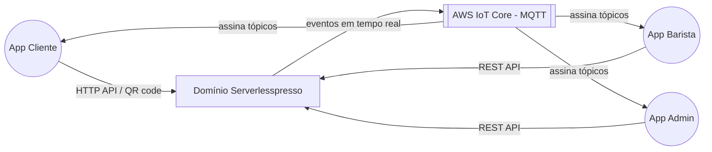

# Domínio Serverlesspresso
Serverlesspresso é o backend serverless de um estande de café pop-up (mostrado pela primeira vez no AWS re:Invent 2021): recebe o pedido de bebida de um cliente via QR code, orquestra o ciclo de vida do pedido até a entrega pelo barista e mantém três apps de front-end (cliente, barista, admin/config — não incluídos neste repositório) atualizados em tempo real via AWS IoT Core.

## Fronteiras
- **Dentro:** autenticação do cliente (Cognito, sem senha, via SMS), emissão e validação de tokens/QR code, verificação de capacidade e horário de funcionamento da loja, orquestração do pedido (Step Functions), armazenamento do pedido e do cardápio (DynamoDB), notificação em tempo real (IoT Core), página de "jornada do pedido" (HTML gerado e publicado em S3/CloudFront), métricas operacionais e extensões desacopladas (event player, robô de pedidos, persistência de métricas, tempo médio de espera).
- **Fora:** os três aplicativos de front-end (cliente, barista, admin) — mencionados no README raiz como "not included"; pagamento (não há cobrança no fluxo, é um evento promocional); fabricação física da bebida (feita por um humano ou por um robô simulado na extensão `OrderRobotExtension`).

## Dono
Não identificado no código. **Pergunta para o PM/tech lead:** quem é o time dono deste domínio hoje (o repositório é um sample da AWS, `aws-samples/serverless-coffee`, mantido originalmente pelo time de Developer Advocacy da AWS)?

## Subdomínios
| Subdomínio | Responsabilidade | Sistemas |
|---|---|---|
| [Núcleo e identidade](./subdominios/nucleo-e-identidade.md) | Bus de eventos, autenticação sem senha do cliente, endpoint IoT | sys-nucleo-serverlesspresso |
| [Configuração da loja](./subdominios/configuracao-da-loja.md) | Cardápio, horário/capacidade da loja, "loja aberta/fechada" | sys-config-service |
| [Pedido](./subdominios/pedido.md) | Do QR code ao pedido entregue: validação, orquestração, gestão de estado, contagem, notificação e jornada do pedido | sys-validator-service, sys-order-processing-service, sys-order-manager-service, sys-counting-service, sys-publisher-service, sys-order-journey-service, sys-metrics-service |
| [Extensões](./subdominios/extensoes.md) | Add-ons desacoplados que só escutam eventos do bus, sem acesso aos recursos do core | sys-ext-event-player, sys-ext-order-robot, sys-ext-persist-metrics-dynamodb, sys-ext-wait-times |

## Contexto

Os três apps de front-end não estão neste repositório (ver README.md raiz); a fronteira do domínio documentado aqui é o backend.

## Eventos de domínio
Todos os eventos trafegam no barramento `Serverlesspresso` (EventBridge custom bus), `source: awsserverlessda.serverlesspresso`. Contrato técnico completo de cada evento em `sistemas/<sistema-produtor>/contratos/`.

| Evento (detail-type) | Produtor | Consumidores | Contrato |
|---|---|---|---|
| `Validator.NewOrder` | validator-service | order-processing-service (inicia o SFN), metrics-service, order-journey-service, publisher-service | [validator-new-order](./sistemas/validator-service/contratos/validator-new-order.md) |
| `OrderProcessor.WorkflowStarted` | order-processing-service | order-manager-service, order-journey-service, publisher-service | [order-processor-workflow-started](./sistemas/order-processing-service/contratos/order-processor-workflow-started.md) |
| `OrderProcessor.WaitingCompletion` | order-processing-service | order-manager-service, order-journey-service, publisher-service, extensão wait-times | [order-processor-waiting-completion](./sistemas/order-processing-service/contratos/order-processor-waiting-completion.md) |
| `OrderProcessor.OrderTimeOut` | order-processing-service | metrics-service, order-journey-service, publisher-service | [order-processor-order-timeout](./sistemas/order-processing-service/contratos/order-processor-order-timeout.md) |
| `OrderProcessor.ShopUnavailable` | order-processing-service | order-journey-service, publisher-service | (inferred; sem consumidor dedicado encontrado no código — ver RELATORIO.md) |
| `OrderProcessor.orderFinished` | order-processing-service | order-journey-service (gera a página HTML da jornada), extensão wait-times, publisher-service | [order-processor-order-finished](./sistemas/order-processing-service/contratos/order-processor-order-finished.md) |
| `OrderManager.WaitingCompletion` | order-manager-service | metrics-service, publisher-service, order-journey-service, extensão persist-metrics-dynamodb, extensão wait-times | [order-manager-waiting-completion](./sistemas/order-manager-service/contratos/order-manager-waiting-completion.md) |
| `OrderManager.Order{eventId}-COMPLETED` / `...-CANCELLED` | order-manager-service | order-journey-service (usa para escolher a imagem do diagrama), publisher-service | [order-manager-order-state-changed](./sistemas/order-manager-service/contratos/order-manager-order-state-changed.md) |
| `OrderManager.MakeOrder` | order-manager-service | publisher-service, order-journey-service | [order-manager-make-order](./sistemas/order-manager-service/contratos/order-manager-make-order.md) |
| `ConfigService.ConfigChanged` | config-service | publisher-service, order-journey-service | [config-service-config-changed](./sistemas/config-service/contratos/config-service-config-changed.md) |

Este domínio não usa pastas separadas `mapa/` e `eventos/`: o diagrama de contexto e a tabela de eventos já estão completos aqui, e o contrato técnico de cada evento vive junto do sistema que o produz — ver nota em `RELATORIO.md`.
