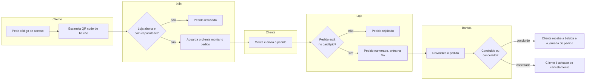

# Pedido de café
Do momento em que o cliente escaneia o QR code no balcão até o barista entregar (ou cancelar) a bebida, mantendo o cliente informado em tempo real.

## Atores
- **Cliente** — pede a bebida pelo celular
- **Loja** (sistema automatizado: capacidade, cardápio, fila) — decide se aceita o pedido
- **Barista** — prepara e conclui ou cancela o pedido

## Etapas
| # | Etapa | Ator | Decisão ou resultado | Técnica |
|---|---|---|---|---|
| 1 | Cliente pede um código de acesso ao abrir o app | Cliente | — | [passo 1](./pedido-de-cafe.sequencia.md#passo-1) |
| 2 | Cliente escaneia o QR code físico do balcão e confirma | Cliente | Token válido? Ainda há tokens disponíveis na janela de tempo? | [passo 2](./pedido-de-cafe.sequencia.md#passo-2) |
| 3 | Loja verifica se está aberta e se há vaga na fila | Loja | Loja aberta? Fila com capacidade livre? | [passo 3](./pedido-de-cafe.sequencia.md#passo-3) |
| 4 | Cliente monta e envia o pedido de bebida | Cliente | O pedido está no cardápio vigente? | [passo 4](./pedido-de-cafe.sequencia.md#passo-4) |
| 5 | Pedido recebe um número e entra na fila do barista | Loja | — | [passo 5](./pedido-de-cafe.sequencia.md#passo-5) |
| 6 | Barista reivindica, prepara e conclui (ou cancela) o pedido | Barista | Concluído ou cancelado? | [passo 6](./pedido-de-cafe.sequencia.md#passo-6) |
| 7 | Cliente acompanha o status em tempo real e vê a jornada do pedido ao final | Cliente / Loja | — | [passo 7](./pedido-de-cafe.sequencia.md#passo-7) |

## Diagrama

## Indicadores
- Tempo médio entre pedido e entrega (a confirmar com o PM)
- Taxa de cancelamento de pedidos (a confirmar com o PM)
- Pedidos por barista / por janela de tempo (a confirmar com o PM)
- Utilização da capacidade máxima da fila (a confirmar com o PM)

## Regras que governam
- [Limite de tokens por janela de tempo](../regras-de-negocio/limite-de-tokens-por-janela.md)
- [Capacidade máxima de pedidos simultâneos](../regras-de-negocio/capacidade-maxima-concorrente.md)
- [Timeout do cliente para enviar o pedido](../regras-de-negocio/timeout-cliente-envio-pedido.md)
- [Timeout do barista para concluir o pedido](../regras-de-negocio/timeout-barista-preparo.md)
