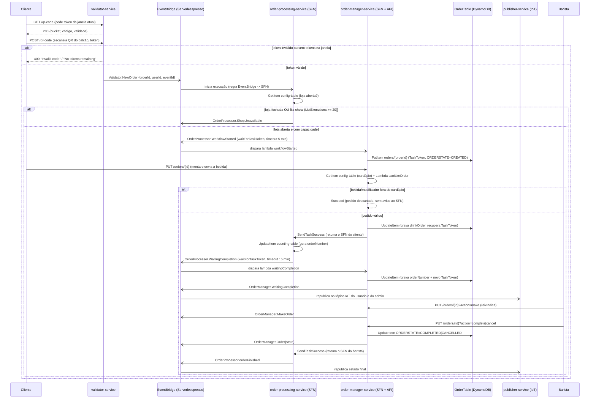

# Pedido de café: sequência técnica
Realiza as etapas do [fluxo macro](./pedido-de-cafe.md). Dois Step Functions cooperam via **EventBridge (assíncrono)** e **Task Tokens (`waitForTaskToken` / `SendTaskSuccess`)**: `order-processor-state-machine` fica "pausado" esperando o cliente e depois o barista, e é acordado pelo `order-manager-state-machine` guardando/recuperando o token no DynamoDB.

## Diagrama

## Passos
### Passo 1
`validator-service` — `GET /qr-code` (HTTP API, Cognito JWT, exige grupo `admin`). Gera/recupera um "bucket" de tokens por janela de 5 minutos (`serverlesspresso-validator` DynamoDB), com `availableTokens` vindo do cardápio do evento (`ConfigTable.drinksPerBarcode`). Fonte: `backends/9-validator/code/getCode.js`.

### Passo 2
Cliente envia `POST /qr-code {eventId, token}`. `verifyCode.js` confere o token contra o bucket da janela atual, decrementa `availableTokens` e, se válido, publica `Validator.NewOrder` no bus com um novo `orderId` (`nanoid()`) e o `userId` (`sub` do JWT Cognito). Fonte: `backends/9-validator/code/verifyCode.js`.

### Passo 3
Uma regra do EventBridge (`detail-type: Validator.NewOrder`) aciona **diretamente** a state machine `order-processor-state-machine` (sem lambda intermediária). Ela busca `config-table` para saber se a loja está aberta (`GetStore.Item.storeOpen.BOOL`) e, se sim, chama `ListExecutions` na própria state machine para checar se já existem 20 execuções `RUNNING` (capacidade máxima hardcoded). Se a loja estiver fechada ou a fila cheia, emite `OrderProcessor.ShopUnavailable` e termina. Fonte: `backends/4-order-processing/statemachine/op.asl.json`.

### Passo 4
Com capacidade livre, o SFN emite `OrderProcessor.WorkflowStarted` com `events:putEvents.waitForTaskToken` (heartbeat 300 s = 5 min) e fica pausado. O evento aciona a lambda `workflowStarted` do `order-manager-service`, que grava o pedido (`PK=orders`, `SK=orderId`, `TaskToken`, `ORDERSTATE={eventId}-CREATED`) em `serverlesspresso-order-table`. O cliente então chama `PUT /orders/{id}` (API Gateway → Step Functions `StartExecution` **direto**, sem lambda) na `order-manager-state-machine`, que busca o cardápio, invoca a lambda `sanitizeOrder` para validar bebida/modificadores e, se válido, grava o pedido e retoma o SFN do cliente com `SendTaskSuccess`. Se o cliente não enviar em 5 minutos, o `Catch` de `States.Timeout` dispara `OrderProcessor.OrderTimeOut` e o pedido morre.

### Passo 5
De volta no `order-processing-service`, a state machine incrementa `IDvalue` em `serverlesspresso-counting-table` (contador de pedidos do evento) e emite `OrderProcessor.WaitingCompletion` (novo `waitForTaskToken`, heartbeat 900 s = 15 min). A lambda `waitingCompletion` do `order-manager-service` grava o novo `TaskToken` e o `orderNumber` no pedido e publica `OrderManager.WaitingCompletion` com os dados completos (inclusive `drinkOrder`) — esse é o evento que o `publisher-service`, o `order-journey-service`, o `metrics-service` e as extensões `wait-times`/`persist-metrics` consomem.

### Passo 6
O barista age via `PUT /orders/{id}?action=make|unmake|complete|cancel` (mesma rota direta API Gateway → Step Functions, mas nesta chamada quem inicia é a `order-manager-state-machine` na "outra ponta": ela decide a ação pelo campo `action`). `make`/`unmake` gravam `baristaUserId` e emitem `OrderManager.MakeOrder`; `complete`/`cancel` gravam `ORDERSTATE` e emitem `OrderManager.Order{eventId}-COMPLETED` ou `...-CANCELLED`, e então chamam `SendTaskSuccess` no `TaskToken` guardado no passo 5, retomando o `order-processing-service`.

### Passo 7
O `order-processing-service`, retomado, sempre emite `OrderProcessor.orderFinished` (o ASL não distingue conclusão de cancelamento nesse ponto — ver conflito em `RELATORIO.md`). Esse evento aciona a state machine do `order-journey-service`, que consulta todos os eventos daquele `orderId` em `OrderJourneyEventsTable`, invoca a lambda `GenerateHtml` para montar uma página de linha do tempo e salva o HTML em S3 (servido via CloudFront). Em paralelo, o `publisher-service` republica cada evento do fluxo nos tópicos MQTT do IoT Core para os apps de cliente, barista e admin em tempo real.

### Caminho de erro
- **Token inválido ou esgotado (passo 2):** `verifyCode.js` retorna 400 sem publicar evento; nada entra no fluxo.
- **Loja fechada ou fila cheia (passo 3):** `OrderProcessor.ShopUnavailable`; não há lambda consumidor identificado no código para esse evento — ver pergunta em `RELATORIO.md`.
- **Cliente não envia o pedido em 5 min (passo 4):** `Catch States.Timeout` → `OrderProcessor.OrderTimeOut`; a lambda `OrderTimedOut` do order-manager marca `ORDERSTATE={eventId}-CANCELLED` com o motivo.
- **Bebida fora do cardápio (passo 4):** a state machine do order-manager termina em `Succeed` sem gravar nem notificar o cliente — o SFN do order-processing continua esperando até estourar o timeout de 5 min. **Comportamento provavelmente não intencional** — ver pergunta em `RELATORIO.md`.
- **Barista não conclui em 15 min (passo 6):** `Catch States.Timeout` → `OrderProcessor.OrderTimeOut` novamente, mesma lambda `OrderTimedOut`.
- **Lambda `Sanitize order` indisponível:** `Retry` de até 6 tentativas (backoff x2, 2 s inicial) antes de propagar o erro.
