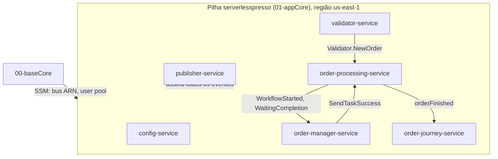

# Ambiente "consolidado" (pilha 01-appCore)
Segunda e última pilha do caminho de implantação documentado no README raiz ("Install microservices"). Reúne, em um único `template.yaml`, os recursos de **config-service, validator-service, order-processing-service, order-manager-service, publisher-service, order-journey-service** e a tabela de contagem — todos com `CodeUri` apontando de volta para `../backends/<n>-*/`. É este o ambiente que efetivamente implementa o [fluxo de pedido de café](../../fluxos/pedido-de-cafe.sequencia.md) segundo o caminho de instalação oficial.

## Implantação

**Nota:** `metrics-service` (backends/7) **não** está incluído neste `template.yaml` — ver `modulos-standalone-backends.md`.
