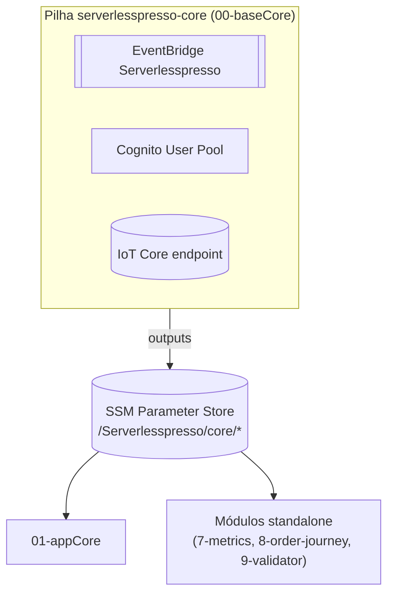

# Ambiente "core" (pilha 00-baseCore)
Primeira pilha a ser implantada (README raiz, seção "Installing the backend"), sempre na região `us-east-1` por instrução do README. Cria o bus de eventos, o Cognito e o endpoint IoT, e publica os identificadores desses recursos em **AWS Systems Manager Parameter Store** (`/Serverlesspresso/core/*`) para as pilhas seguintes consumirem via `AWS::SSM::Parameter::Value<String>`.

## Implantação

