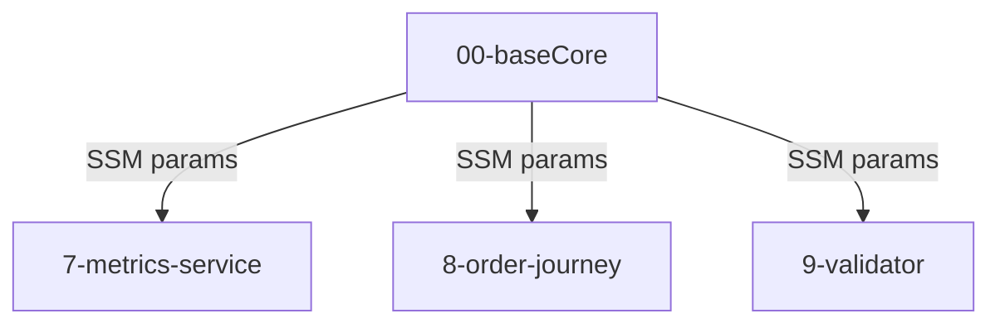

# Ambiente "módulos standalone" (backends/*/template.yaml)
**Achado, não instrução oficial de deploy.** Além da pilha consolidada `01-appCore`, três diretórios de `backends/` têm o **seu próprio** `template.yaml`, completo e implantável isoladamente, lendo os parâmetros do core via SSM (`AWS::SSM::Parameter::Value<String>`, ex. `/Serverlesspresso/core/eventbusname`):
- `backends/7-metrics-service/template.yaml`
- `backends/8-order-journey/template.yaml`
- `backends/9-validator/template.yaml`

O README raiz **não menciona** implantar esses templates separadamente — só instrui `00-baseCore` + `01-appCore`. A leitura mais provável (não confirmada) é que estes são os módulos incrementais do workshop (cada um implantado isoladamente durante uma etapa do tutorial em workshop.serverlesscoffee.com) e que `01-appCore` é a versão "tudo junto" montada depois. Isso implica que, dependendo de qual caminho um time realmente segue, **duas topologias diferentes e não totalmente equivalentes coexistem no repositório** (ex.: `validator-service` standalone usa HTTP API + JWT authorizer manual, enquanto a versão em `01-appCore` usa REST API + Cognito User Pools authorizer).

## Implantação

**Pergunta para o tech lead:** qual topologia está de fato em produção/uso — só `01-appCore`, ou os módulos standalone substituindo partes dela? (ver `RELATORIO.md`)
