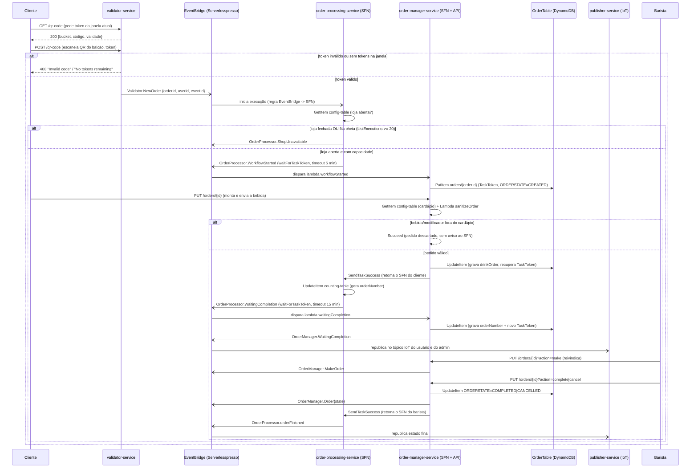

# Contexto do domínio Serverlesspresso

Serverlesspresso é o backend serverless de um estande de café pop-up (mostrado pela primeira vez no AWS re:Invent 2021): recebe o pedido de bebida de um cliente via QR code, orquestra o ciclo de vida do pedido até a entrega pelo barista e m

Legenda: `[id] título (tipo, origem) — resumo`. Origem: extraído = lido nas fontes; inferido = a confirmar.

## 2. Domínio
- [dom-serverlesspresso] Domínio Serverlesspresso (domain, misto) — Serverlesspresso é o backend serverless de um estande de café pop-up (mostrado pela primeira vez no AWS re:Invent 2021): recebe o pedido de bebida de um cliente via QR code, orques | realiza cap-vender-cafe-sob-demanda

## 1. Negócio
- [cap-vender-cafe-sob-demanda] Vender café sob demanda em um evento pop-up (capability, inferido) — A empresa consegue operar um balcão de café pop-up onde o cliente pede pelo celular via QR code, entra numa fila com capacidade limitada, e acompanha o pedido até a entrega pelo ba
- [flow-pedido-de-cafe] Pedido de café (flow, inferido) — Do momento em que o cliente escaneia o QR code no balcão até o barista entregar (ou cancelar) a bebida, mantendo o cliente informado em tempo real. | realiza cap-vender-cafe-sob-demanda

## 3. Subdomínio
- [flow-pedido-de-cafe-sequencia] Pedido de café: sequência técnica (flow, extraído) — Realiza as etapas do [fluxo macro](./pedido-de-cafe.md). Dois Step Functions cooperam via **EventBridge (assíncrono)** e **Task Tokens (`waitForTaskToken` / `SendTaskSuccess`)**: ` | realiza flow-pedido-de-cafe
- [sub-configuracao-da-loja] Subdomínio Configuração da loja (subdomain, extraído) — Mantém o cardápio do evento, o estado "aberto/fechado" da loja e o limite de bebidas por token, e avisa o resto do sistema quando essa configuração muda. | realiza dom-serverlesspresso
- [sub-extensoes] Subdomínio Extensões (subdomain, extraído) — Add-ons opcionais que demonstram a extensibilidade da arquitetura orientada a eventos: cada um só cria novas regras do EventBridge sobre o bus `Serverlesspresso` existente, não tem | realiza dom-serverlesspresso
- [sub-nucleo-e-identidade] Subdomínio Núcleo e identidade (subdomain, extraído) — Recursos fundacionais que todos os outros subdomínios usam: o barramento de eventos, a autenticação sem senha do cliente (Cognito com desafio customizado via SMS) e o endpoint do A | realiza dom-serverlesspresso
- [sub-pedido] Subdomínio Pedido (subdomain, inferido) — Do QR code escaneado pelo cliente até a bebida entregue: validação de token, verificação de capacidade, orquestração via Step Functions, persistência do estado do pedido, contagem  | realiza dom-serverlesspresso

## 4. Sistema
- [ctr-config-service-config-changed] ConfigService.ConfigChanged (contract, extraído) — { | realiza sys-config-service
- [sys-config-service] config-service (system, extraído) — Fonte de verdade do cardápio do evento e do estado "loja aberta/fechada"; avisa o resto do sistema quando essa configuração muda. | realiza sub-configuracao-da-loja
- [sys-counting-service] counting-service (system, extraído) — **Sistema parcialmente órfão.** A tabela `CountingTable` (`serverlesspresso-counting-table`) é real e usada — mas na pilha consolidada (`01-appCore`) quem incrementa o contador é u | realiza sub-pedido
- [sys-ext-event-player] extensao-event-player (system, extraído) — Step Functions que reproduz uma sequência gravada de eventos reais do Serverlesspresso (um em cada ~5 s, ao longo de ~15 minutos), útil para testar extensões e dashboards sem preci | realiza sub-extensoes
- [sys-ext-order-robot] extensao-order-robot (system, extraído) — Duas state machines que simulam, respectivamente, um "robô cliente" fazendo pedidos em lote e um "robô barista" preparando-os automaticamente — usadas para gerar carga/demonstração | realiza sub-extensoes
- [sys-ext-persist-metrics-dynamodb] extensao-persist-metrics-dynamodb (system, extraído) — Exemplo de extensão "EventBridge → SQS → Lambda → DynamoDB": uma regra roteia `OrderManager.WaitingCompletion` para uma fila SQS, que alimenta uma lambda que grava em uma tabela Dy | realiza sub-extensoes
- [sys-ext-wait-times] extensao-wait-times (system, extraído) — Calcula o tempo médio de preparo por tipo de bebida a partir dos eventos de início (`OrderManager.WaitingCompletion`) e fim (`OrderProcessor.orderFinished`) do pedido, e publica o  | realiza sub-extensoes
- [sys-metrics-service] metrics-service (system, extraído) — Publica métricas customizadas no CloudWatch a partir de 4 eventos do domínio, para observar o funcionamento do balcão (quantos pedidos, quantos cancelados, quantos com timeout). | realiza sub-pedido
- [sys-nucleo-serverlesspresso] nucleo-serverlesspresso (system, extraído) — Pilha fundacional (`00-baseCore`): cria o barramento de eventos, o fluxo de autenticação sem senha do Cognito (login por SMS com código de 6 dígitos) e descobre o endpoint do AWS I | realiza sub-nucleo-e-identidade
- [sys-order-journey-service] order-journey-service (system, extraído) — Grava **todos** os eventos do domínio (não só os do pedido) em uma tabela própria e, quando um pedido termina, monta uma página HTML com a linha do tempo do pedido e a publica em S | realiza sub-pedido
- [ctr-order-manager-make-order] OrderManager.MakeOrder (contract, extraído) — { | realiza sys-order-manager-service
- [ctr-order-manager-order-state-changed] OrderManager.Order{eventId}-COMPLETED / OrderManager.Order{eventId}-CANCELLED (contract, extraído) — { | realiza sys-order-manager-service
- [ctr-order-manager-waiting-completion] OrderManager.WaitingCompletion (contract, extraído) — { | realiza sys-order-manager-service
- [sys-order-manager-service] order-manager-service (system, extraído) — Guarda o estado de cada pedido (`serverlesspresso-order-table`) e expõe a API que o app do cliente e o app do barista usam para montar, reivindicar, concluir e cancelar pedidos. Ta | realiza sub-pedido
- [ctr-order-processor-order-finished] OrderProcessor.orderFinished (contract, extraído) — { | realiza sys-order-processing-service
- [ctr-order-processor-order-timeout] OrderProcessor.OrderTimeOut (contract, extraído) — { | realiza sys-order-processing-service
- [ctr-order-processor-waiting-completion] OrderProcessor.WaitingCompletion (contract, extraído) — { | realiza sys-order-processing-service
- [ctr-order-processor-workflow-started] OrderProcessor.WorkflowStarted (contract, extraído) — { | realiza sys-order-processing-service
- [sys-order-processing-service] order-processing-service (system, extraído) — Orquestra o pedido do lado do cliente: confere se a loja está aberta e se há capacidade, aguarda o cliente montar o pedido, gera o número do pedido e aguarda o barista concluir — t | realiza sub-pedido
- [sys-publisher-service] publisher-service (system, extraído) — Ponte entre o EventBridge e o AWS IoT Core: republica os eventos de negócio como mensagens MQTT em tópicos que os três apps (cliente, barista, admin) assinam para atualização em te | realiza sub-pedido
- [ctr-validator-new-order] Validator.NewOrder (contract, extraído) — { | realiza sys-validator-service
- [sys-validator-service] validator-service (system, extraído) — Emite o token de acesso (QR code) por janela de tempo e valida o token escaneado pelo cliente no balcão, iniciando o pedido. | realiza sub-pedido

## 5. Componente
- [cmp-config-changed] config-changed (component, extraído) — Republica no EventBridge qualquer alteração gravada em `ConfigTable` (cardápio, loja aberta/fechada). | realiza sys-config-service
- [cmp-config-fill-databases] fill-databases-custom-resource (component, extraído) — Custom Resource do CloudFormation que popula `ConfigTable` (cardápio inicial) e `CountingTable` (contador zerado) toda vez que a pilha `01-appCore` é criada ou atualizada. | realiza sys-config-service
- [cmp-config-rest-api] rest-api-config (component, extraído) — Rotas de leitura e escrita da configuração da loja, todas em integração direta do API Gateway com o DynamoDB (sem lambda). | realiza sys-config-service
- [cmp-counting-get-order-id] get-order-id (component, extraído) — Incrementa e devolve o contador de pedidos. | realiza sys-counting-service
- [cmp-counting-reset-order-id] reset-order-id (component, extraído) — Zera o contador de pedidos. | realiza sys-counting-service
- [cmp-metrics-order-manager-cancelled] order-manager-order-cancelled-metric (component, extraído) — Registra no CloudWatch pedidos cancelados pelo barista. | realiza sys-metrics-service
- [cmp-metrics-order-manager-waiting-completion] order-manager-waiting-completion-metric (component, extraído) — Registra no CloudWatch cada pedido que entrou na fila do barista. | realiza sys-metrics-service
- [cmp-metrics-order-processor-timeout] order-processor-order-timeout-metric (component, extraído) — Registra no CloudWatch pedidos perdidos por timeout (cliente ou barista). | realiza sys-metrics-service
- [cmp-metrics-validator-new-order] validator-new-order-metric (component, extraído) — Registra no CloudWatch cada novo pedido validado. | realiza sys-metrics-service
- [cmp-nucleo-create-auth-challenge] create-auth-challenge (component, extraído) — Gera o código de 6 dígitos e envia por SMS via SNS. | realiza sys-nucleo-serverlesspresso
- [cmp-nucleo-define-auth-challenge] define-auth-challenge (component, extraído) — Decide o próximo passo do login sem senha: emitir o desafio customizado, aceitar, ou falhar após tentativas demais. | realiza sys-nucleo-serverlesspresso
- [cmp-nucleo-get-iot-endpoint] get-iot-endpoint (component, extraído) — Custom Resource que descobre o endpoint de dados do AWS IoT Core da conta, para o `publisher-service` publicar mensagens MQTT. | realiza sys-nucleo-serverlesspresso
- [cmp-nucleo-pre-sign-up] pre-sign-up (component, extraído) — Confirma automaticamente o cadastro do cliente por telefone, sem exigir verificação manual. | realiza sys-nucleo-serverlesspresso
- [cmp-nucleo-verify-auth-challenge] verify-auth-challenge-response (component, extraído) — Confere se o código de 6 dígitos digitado pelo usuário bate com o gerado. | realiza sys-nucleo-serverlesspresso
- [cmp-order-journey-generate-html] generate-html (component, extraído) — Monta o HTML da linha do tempo do pedido (imagens, mensagens amigáveis de cada evento, botão de compartilhar no Twitter/X). | realiza sys-order-journey-service
- [cmp-order-journey-state-machine] order-journey-state-machine (component, extraído) — Grava cada evento do domínio como uma linha na tabela de jornada; ao ver `OrderProcessor.orderFinished`, busca todo o histórico do pedido e manda montar a página HTML. | realiza sys-order-journey-service
- [cmp-order-manager-state-machine] order-manager-state-machine (component, extraído) — Decide, pelo campo `action` recebido, se está tratando o envio do pedido pelo cliente, a reivindicação/liberação pelo barista, ou a conclusão/cancelamento — e em qualquer um dos úl | realiza sys-order-manager-service
- [cmp-order-manager-order-timed-out] order-timed-out (component, extraído) — Marca o pedido como cancelado quando o cliente ou o barista estouram o tempo limite no `order-processing-service`. | realiza sys-order-manager-service
- [cmp-order-manager-rest-api-orders] rest-api-orders (component, extraído) — As 3 rotas da API de pedidos usadas pelos apps de cliente e barista. **Nenhuma delas passa por uma lambda** — são integrações diretas do API Gateway (`x-amazon-apigateway-integrati | realiza sys-order-manager-service
- [cmp-order-manager-sanitize-order] sanitize-order (component, extraído) — Confere se a bebida pedida e seus modificadores existem no cardápio vigente antes de gravar o pedido. | realiza sys-order-manager-service
- [cmp-order-manager-waiting-completion] waiting-completion (component, extraído) — Grava o número do pedido e o novo Task Token (o que vai destravar o barista) e avisa o resto do sistema que o pedido está na fila, pronto para ser preparado. | realiza sys-order-manager-service
- [cmp-order-manager-workflow-started] workflow-started (component, extraído) — Cria o registro inicial do pedido assim que o `order-processing-service` sinaliza que está esperando o cliente montar a bebida. | realiza sys-order-manager-service
- [cmp-order-processor-state-machine] order-processor-state-machine (component, extraído) — State machine (Standard) que controla todo o ciclo de vida do pedido do lado do cliente até a entrada na fila do barista, e é retomada até o fim do pedido. | realiza sys-order-processing-service
- [cmp-publisher-admin] publisher-admin (component, extraído) — Republica eventos de `OrderManager.*`, `OrderProcessor.*`, `Validator.*` e `ConfigService.*` no tópico MQTT do painel administrativo. | realiza sys-publisher-service
- [cmp-publisher-config] publisher-config (component, extraído) — Republica `ConfigService.ConfigChanged` no tópico MQTT de configuração, avisando os apps quando o cardápio ou o status da loja mudam. | realiza sys-publisher-service
- [cmp-publisher-user] publisher-user (component, extraído) — Republica eventos de `OrderManager.*` e `OrderProcessor.*` no tópico MQTT pessoal do cliente dono do pedido. | realiza sys-publisher-service
- [cmp-validator-get-qr-code] get-qr-code (component, extraído) — Gera ou recupera o "bucket" de tokens da janela de 5 minutos atual e devolve o código para o app do cliente exibir como QR code. | realiza sys-validator-service
- [cmp-validator-verify-qr-code] verify-qr-code (component, extraído) — Confere o token escaneado contra o bucket da janela atual; se válido, gera o `orderId` e publica `Validator.NewOrder`, iniciando o pedido. | realiza sys-validator-service

## 6. Infraestrutura
- [env-consolidado-01-appcore] Ambiente "consolidado" (pilha 01-appCore) (environment, extraído) — Segunda e última pilha do caminho de implantação documentado no README raiz ("Install microservices"). Reúne, em um único `template.yaml`, os recursos de **config-service, validato | realiza sys-config-service, sys-validator-service, sys-order-processing-service, sys-order-manager-service, sys-publisher-service, sys-order-journey-service, sys-counting-service
- [env-core-00-basecore] Ambiente "core" (pilha 00-baseCore) (environment, extraído) — Primeira pilha a ser implantada (README raiz, seção "Installing the backend"), sempre na região `us-east-1` por instrução do README. Cria o bus de eventos, o Cognito e o endpoint I | realiza sys-nucleo-serverlesspresso
- [env-modulos-standalone-backends] Ambiente "módulos standalone" (backends/*/template.yaml) (environment, inferido) — **Achado, não instrução oficial de deploy.** Além da pilha consolidada `01-appCore`, três diretórios de `backends/` têm o **seu próprio** `template.yaml`, completo e implantável is | realiza sys-metrics-service, sys-order-journey-service, sys-validator-service
- [res-ddb-config-table] DynamoDB "serverlesspresso-config-table" (resource, extraído) —  | realiza sys-config-service
- [res-ddb-counting-table] DynamoDB "serverlesspresso-counting-table" (resource, extraído) —  | realiza sys-counting-service
- [res-ddb-order-journey-events-table] DynamoDB "OrderJourneyEventsTable" (resource, extraído) —  | realiza sys-order-journey-service
- [res-ddb-order-table] DynamoDB "serverlesspresso-order-table" (resource, extraído) —  | realiza sys-order-manager-service
- [res-ddb-validator-table] DynamoDB "serverlesspresso-validator" (resource, extraído) —  | realiza sys-validator-service
- [res-event-bus-serverlesspresso] EventBridge bus "Serverlesspresso" (resource, extraído) —  | realiza sys-nucleo-serverlesspresso
- [res-http-api-validator] API Gateway do validator-service (resource, extraído) —  | realiza sys-validator-service
- [res-identity-pool-cognito] Cognito Identity Pool "ServerlesspressoIdentityPool" (resource, extraído) —  | realiza sys-nucleo-serverlesspresso
- [res-iot-core-realtime] AWS IoT Core (realtime messaging) (resource, extraído) —  | realiza sys-nucleo-serverlesspresso
- [res-journey-bucket-s3] S3 bucket "serverlesspresso-order-journey-{region}-{accountId}" (resource, extraído) —  | realiza sys-order-journey-service
- [res-journey-cloudfront] CloudFront "JourneyCloudFront" (resource, extraído) —  | realiza sys-order-journey-service
- [res-metrics-queue-sqs] SQS "MetricsQueue" (resource, extraído) —  | realiza sys-ext-persist-metrics-dynamodb
- [res-metrics-table-dynamodb] DynamoDB "serverlesspresso-metrics-table" (resource, extraído) —  | realiza sys-ext-persist-metrics-dynamodb
- [res-rest-api-config] API Gateway REST "ServerlesspressoConfigServiceRestApi" (resource, extraído) —  | realiza sys-config-service
- [res-rest-api-order-manager] API Gateway REST "ServerlesspressoOrdermanagerRestApi" (resource, extraído) —  | realiza sys-order-manager-service
- [res-user-pool-cognito] Cognito User Pool "ServerlesspressoUserPool" (resource, extraído) —  | realiza sys-nucleo-serverlesspresso

## Transversal
- [dec-001-integracoes-diretas-sem-lambda-glue] ADR-001 Preferir integrações diretas de serviço a "lambdas de cola" (proposto, sem documento original) (decision, inferido) — Status: proposta (inferida do código; **não existe ADR no repositório** — este documento é uma reconstrução, marcado `inferred`) — Data: desconhecida
- [term-barista] Barista (term, inferido) — Ator humano (ou simulado pela extensão `OrderRobotExtension`/`backends/5-order-manager/robot/`) que reivindica (`make`/`unmake`), prepara e conclui (`complete`) ou cancela (`cancel
- [term-bucket-de-tokens] Bucket (de tokens) (term, extraído) — Registro em `serverlesspresso-validator` que representa uma janela de tempo fixa (5 minutos, `TIME_INTERVAL`) durante a qual um único código (`last_code`) é válido e um número limi
- [term-eventid] eventId (term, extraído) — Identificador do "evento pop-up" físico (ex.: um dia específico do balcão em um re:Invent ou conferência). É a partição usada em quase todas as tabelas (`config-{eventId}`, `orderI
- [term-task-token] Task Token (term, extraído) — Identificador opaco que o AWS Step Functions gera quando uma execução usa o padrão `waitForTaskToken`. O `order-processing-service` gera um token, o `order-manager-service` guarda 
- [std-orquestracao-por-task-token] Orquestração por Task Token entre duas state machines (standard, inferido) — Como o domínio conecta um processo de longa duração (o pedido, minutos a horas) com ações humanas assíncronas (cliente monta o pedido, barista conclui), sem fazer polling nem mante
- [rule-capacidade-maxima-concorrente] Capacidade máxima de pedidos simultâneos (rule, extraído) — No máximo **20 pedidos** podem estar em andamento ao mesmo tempo (execuções `RUNNING` da `order-processor-state-machine`); um 21º pedido é recusado com `OrderProcessor.ShopUnavaila | realiza flow-pedido-de-cafe
- [rule-limite-de-tokens-por-janela] Limite de tokens por janela de tempo (rule, extraído) — A cada janela de 5 minutos, só um número limitado de bebidas pode ser resgatado por token (`ConfigTable.drinksPerBarcode`, valor configurável por evento). Isso limita quantos clien | realiza flow-pedido-de-cafe
- [rule-timeout-barista-preparo] Timeout do barista para concluir o pedido (rule, extraído) — Depois que o pedido entra na fila com um número, o barista tem **15 minutos** (`HeartbeatSeconds: 900` no state `Emit - Awaiting Completion TT`) para concluir ou cancelar antes de  | realiza flow-pedido-de-cafe
- [rule-timeout-cliente-envio-pedido] Timeout do cliente para enviar o pedido (rule, extraído) — Depois de escanear o QR code, o cliente tem **5 minutos** (`HeartbeatSeconds: 300` no state `Emit - Workflow Started TT`) para montar e enviar a bebida antes de o pedido ser cancel | realiza flow-pedido-de-cafe

## Sequências (passo a passo técnico)
### Pedido de café: sequência técnica [flow-pedido-de-cafe-sequencia]

