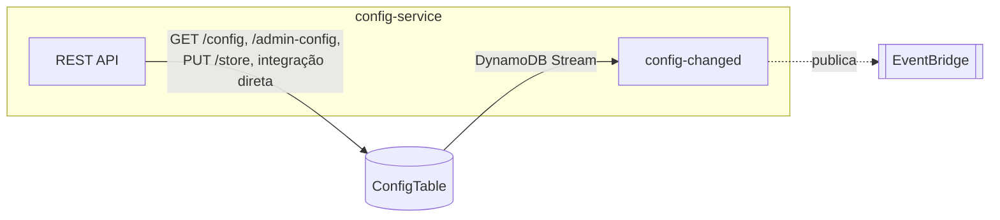

# config-service
Fonte de verdade do cardápio do evento e do estado "loja aberta/fechada"; avisa o resto do sistema quando essa configuração muda.

| Campo | Valor |
|---|---|
| Subdomínio | Configuração da loja |
| Dono | Não identificado |
| Stack | Node.js 14.x (Lambda) + API Gateway (integração direta com DynamoDB) |
| Repositório | `backends/2-config-service/`; recursos em `01-appCore/template.yaml` |
| Criticidade | Média-alta — se `storeOpen` ou o cardápio estiverem errados, o `order-processing-service` recusa ou aceita pedidos incorretamente |

## Contêineres


## Expõe
| Contrato | Tipo | Detalhe |
|---|---|---|
| `GET /config`, `GET /admin-config`, `PUT /store` | REST API (integração direta com DynamoDB) | [rest-api-config](./componentes/rest-api-config.md) |
| `ConfigService.ConfigChanged` | Evento | [contrato](./contratos/config-service-config-changed.md) |

## Consome
Nenhuma dependência de outro sistema do domínio.

## Dados
```mermaid
erDiagram
  CONFIG {
    string PK "config-eventId"
    boolean storeOpen
    number drinksPerBarcode
    array menu
  }
```
Tabela `serverlesspresso-config-table`, com `StreamViewType: NEW_AND_OLD_IMAGES`. Fonte: `01-appCore/template.yaml#L316-L328`; conteúdo inicial em `01-appCore/initDB/initMenuState.JSON`.

## Estados
Não há máquina de estados de entidade; `storeOpen` é um booleano simples.

## Qualidade
- `ConfigChangedFunction`: `BatchSize: 1`, `StartingPosition: TRIM_HORIZON` no DynamoDB Stream — processa uma mudança por vez, sem paralelismo
- Timeout: 15 s
