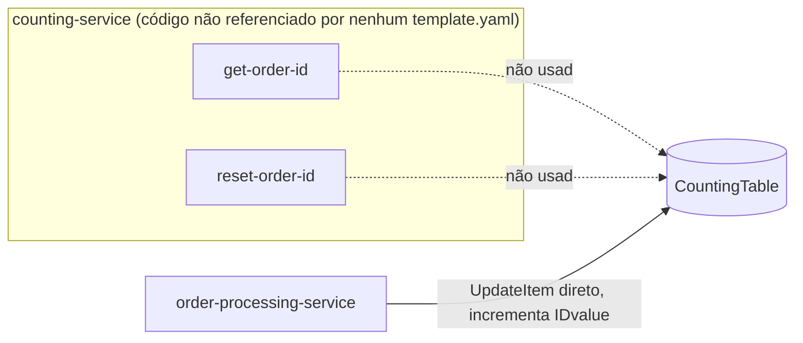

# counting-service
**Sistema parcialmente órfão.** A tabela `CountingTable` (`serverlesspresso-counting-table`) é real e usada — mas na pilha consolidada (`01-appCore`) quem incrementa o contador é um state (`Generate Order Number`) direto dentro do `order-processing-service`, não as lambdas deste diretório.

| Campo | Valor |
|---|---|
| Subdomínio | Pedido |
| Dono | Não identificado |
| Stack | Node.js (Lambda) — mas sem `template.yaml` próprio |
| Repositório | `backends/1-counting-service/code/` |
| Criticidade | Baixa como está hoje (código não implantado); a **função** que ele cumpre (gerar `orderNumber`) é crítica e está embutida no `order-processing-service` |

## Contêineres


## Expõe
Nenhum contrato ativo.

## Consome
Nenhum.

## Dados
```mermaid
erDiagram
  COUNTER {
    string PK "orderID-eventId"
    number IDvalue
  }
```
Tabela `serverlesspresso-counting-table`, populada inicialmente por `01-appCore/initDB/initCountingState.JSON`.

## Estados
N/A.

## Qualidade
- Nenhum `template.yaml` em `backends/1-counting-service/` referencia `getOrderId.js`/`resetOrderId.js` como função Lambda — **achado a confirmar com o tech lead** (ver `RELATORIO.md`)
