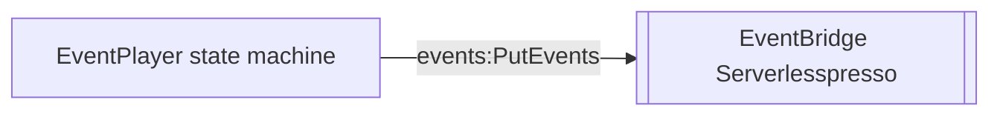

# extensao-event-player
Step Functions que reproduz uma sequência gravada de eventos reais do Serverlesspresso (um em cada ~5 s, ao longo de ~15 minutos), útil para testar extensões e dashboards sem precisar operar o balcão de verdade.

| Campo | Valor |
|---|---|
| Subdomínio | Extensões |
| Dono | Não identificado |
| Stack | Step Functions (AWS SAM) |
| Repositório | `extensions/EventPlayer/` |
| Criticidade | Nenhuma (ferramenta de teste/demo) |

## Contêineres

## Expõe
Nenhum contrato de negócio; entrada manual `{"eventId":"ABC"}` via console do Step Functions.

## Consome
Nenhuma.

## Dados / Estados
N/A.

## Qualidade
Implantado e removido de forma independente do core (regra da pasta `extensions/`, ver `subdominios/extensoes.md`); recria seu próprio `AWS::Events::EventBus` chamado `Serverlesspresso` no template — **pode colidir com o bus já criado por `00-baseCore`** se implantado na mesma conta/região sem ajuste (ver `RELATORIO.md`).
