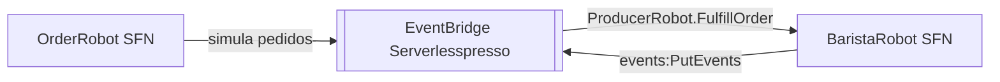

# extensao-order-robot
Duas state machines que simulam, respectivamente, um "robô cliente" fazendo pedidos em lote e um "robô barista" preparando-os automaticamente — usadas para gerar carga/demonstração sem humanos.

| Campo | Valor |
|---|---|
| Subdomínio | Extensões |
| Dono | Não identificado |
| Stack | Step Functions (AWS SAM) |
| Repositório | `extensions/OrderRobotExtension/` |
| Criticidade | Nenhuma (ferramenta de carga/demo) |

## Contêineres

## Expõe
`BaristaRobot` escuta `ProducerRobot.FulfillOrder` (prefixo); não há evidência no repositório de quem publica esse evento — possivelmente o próprio `OrderRobot` ou o app `robot/` do order-manager (`backends/5-order-manager/robot/`). **Inferido, a confirmar.**

## Consome
| Evento | Tipo |
|---|---|
| `ProducerRobot.FulfillOrder` | Evento (EventBridge) |

## Dados / Estados
N/A.

## Qualidade
Implantado/removido de forma independente do core.
