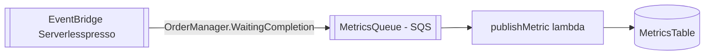

# extensao-persist-metrics-dynamodb
Exemplo de extensão "EventBridge → SQS → Lambda → DynamoDB": uma regra roteia `OrderManager.WaitingCompletion` para uma fila SQS, que alimenta uma lambda que grava em uma tabela DynamoDB própria da extensão.

| Campo | Valor |
|---|---|
| Subdomínio | Extensões |
| Dono | Não identificado |
| Stack | SQS + Lambda (Node.js 16.x) + DynamoDB (AWS SAM, com `AWS::Serverless::Connector`) |
| Repositório | `extensions/PersistOrderMetricsToDynamoDB/` |
| Criticidade | Nenhuma (exemplo de referência para novas extensões) |

## Contêineres

## Expõe
Nenhum contrato externo.

## Consome
| Evento | Tipo |
|---|---|
| `OrderManager.WaitingCompletion` | Evento (EventBridge → SQS) |

## Dados
Tabela `serverlesspresso-metrics-table` (`PK`/`SK`), capacidade provisionada (5 RCU/5 WCU) — diferente do padrão `PAY_PER_REQUEST` usado no core.

## Qualidade
- Fila SQS com `VisibilityTimeout: 30s`, `ReceiveMessageWaitTimeSeconds: 5` (long polling)
- `EventSourceMapping`: lotes de até 10 mensagens, janela de 30 s
