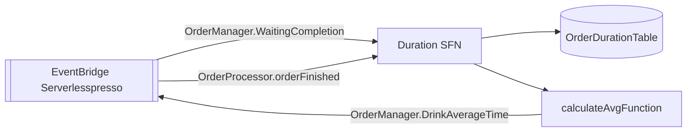

# extensao-wait-times
Calcula o tempo médio de preparo por tipo de bebida a partir dos eventos de início (`OrderManager.WaitingCompletion`) e fim (`OrderProcessor.orderFinished`) do pedido, e publica o resultado de volta no bus.

| Campo | Valor |
|---|---|
| Subdomínio | Extensões |
| Dono | Não identificado |
| Stack | AWS CDK (TypeScript) — único sistema do domínio que não usa SAM |
| Repositório | `extensions/WaitTimes/` |
| Criticidade | Nenhuma (métrica de negócio complementar) |

## Contêineres

## Expõe
| Evento | Tipo |
|---|---|
| `OrderManager.DrinkAverageTime` | Evento (EventBridge) — média das últimas 10 (`nbItemsForAverage`) durações por bebida |

## Consome
| Evento | Tipo |
|---|---|
| `OrderManager.WaitingCompletion` | Evento (grava o horário de início) |
| `OrderProcessor.orderFinished` | Evento (grava o horário de fim e dispara o cálculo) |

## Dados
`OrderDurationTable` (DynamoDB, chave `orderId`, GSI `drinkIndex` por `drink`).

## Qualidade
X-Ray (`tracing: ACTIVE`/`tracingEnabled: true`) habilitado na lambda e na state machine — único sistema do domínio com tracing explícito no código lido.
