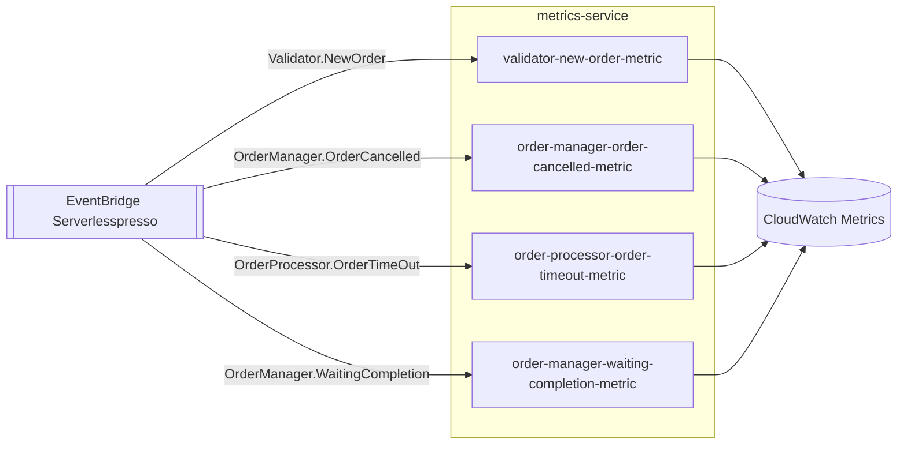

# metrics-service
Publica métricas customizadas no CloudWatch a partir de 4 eventos do domínio, para observar o funcionamento do balcão (quantos pedidos, quantos cancelados, quantos com timeout).

| Campo | Valor |
|---|---|
| Subdomínio | Pedido |
| Dono | Não identificado |
| Stack | Node.js 14.x (Lambda) |
| Repositório | `backends/7-metrics-service/` — **stack próprio, standalone, não referenciado por `01-appCore/template.yaml`** |
| Criticidade | Baixa — puramente observabilidade; sua ausência não afeta o pedido |

## Contêineres

## Expõe
Nenhum contrato; só grava métricas no CloudWatch (`cloudwatch:PutMetricData` via `CloudWatchPutMetricPolicy`).

## Consome
| Sistema | Contrato | Tipo |
|---|---|---|
| validator-service | `Validator.NewOrder` | Evento |
| order-manager-service | `OrderManager.OrderCancelled`* | Evento |
| order-processing-service | `OrderProcessor.OrderTimeOut` | Evento |
| order-manager-service | `OrderManager.WaitingCompletion` | Evento |

\* O padrão real emitido pelo order-manager-state-machine é `OrderManager.Order{eventId}-CANCELLED` (com o `eventId` no meio do nome) — o prefixo `OrderManager.OrderCancelled` desta regra **não bate exatamente** com o que é publicado; ver `RELATORIO.md`.

## Dados
Nenhum banco próprio.

## Estados
N/A.

## Qualidade
- Timeout: 3 s em todas as funções
- **Este stack não é implantado pelo caminho documentado no README raiz** (que só manda subir `00-baseCore` e `01-appCore`) — ver `infraestrutura/ambientes/modulos-standalone-backends.md`
