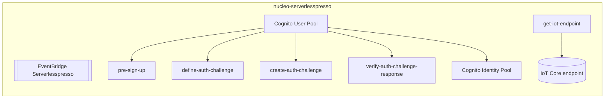

# nucleo-serverlesspresso
Pilha fundacional (`00-baseCore`): cria o barramento de eventos, o fluxo de autenticação sem senha do Cognito (login por SMS com código de 6 dígitos) e descobre o endpoint do AWS IoT Core usado pelo `publisher-service`.

| Campo | Valor |
|---|---|
| Subdomínio | Núcleo e identidade |
| Dono | Não identificado |
| Stack | AWS SAM (CloudFormation), Node.js 14.x para as lambdas |
| Repositório | `00-baseCore/` |
| Criticidade | Máxima — todos os outros sistemas dependem do bus e/ou do User Pool desta pilha (via SSM Parameter Store) |

## Contêineres

## Expõe
- `ServerlesspressoEventBus` (EventBridge) — usado por todos os sistemas do domínio para publicar/consumir eventos
- User Pool / Identity Pool (Cognito) — autenticação usada por todas as APIs do domínio
- Endpoint do IoT Core — usado pelo `publisher-service`

## Consome
Nenhuma dependência de outro sistema do domínio.

## Dados
Nenhum banco de dados próprio (apenas um `LogGroupForEvents` para depurar eventos do bus).

## Estados
N/A.

## Qualidade
- Autenticação: MFA desligada, política de senha mínima (o "segredo" real é o código de 6 dígitos enviado por SMS via SNS)
- `GetIoTEndpointFunction` é um Custom Resource do CloudFormation — roda uma vez por deploy, não a cada requisição
- Outputs desta pilha (User Pool ID, ARN do bus, endpoint IoT) são publicados em **AWS Systems Manager Parameter Store**, e é assim que `01-appCore` e os módulos standalone (`8-order-journey`, `9-validator`, `7-metrics-service`) os descobrem — ver `infraestrutura/ambientes/`
