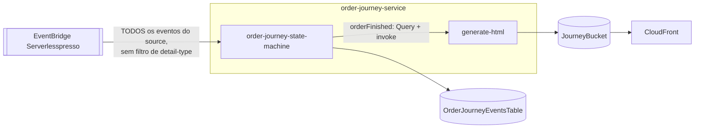

# order-journey-service
Grava **todos** os eventos do domínio (não só os do pedido) em uma tabela própria e, quando um pedido termina, monta uma página HTML com a linha do tempo do pedido e a publica em S3/CloudFront.

| Campo | Valor |
|---|---|
| Subdomínio | Pedido |
| Dono | Não identificado |
| Stack | Step Functions + Lambda (Node.js 14.x) + S3 + CloudFront |
| Repositório | `backends/8-order-journey/`; recursos em `01-appCore/template.yaml` |
| Criticidade | Baixa — funcionalidade de "recibo"/compartilhamento, não bloqueia o fluxo do pedido |

## Contêineres


## Expõe
Página estática em `JourneyBucket`, servida via `JourneyCloudFront` (sem contrato de API formal).

## Consome
| Sistema | Contrato | Tipo |
|---|---|---|
| validator-service, order-processing-service, order-manager-service, config-service | Todos os eventos do bus (`source: awsserverlessda.serverlesspresso`, sem filtro de `detail-type`) | Evento (EventBridge) |

## Dados
```mermaid
erDiagram
  JOURNEY_EVENT {
    string PK "orderId"
    string SK "timestamp do evento"
    string detailType
    string orderDetails "JSON serializado"
    string userId
  }
```
Tabela `OrderJourneyEventsTable` (nome gerado pelo CloudFormation).

## Estados
N/A (tabela de log de eventos, não de entidade com ciclo de vida).

## Qualidade
- `Generate HTML`: retry de 6 tentativas, backoff x2, 2 s inicial
- A regra do EventBridge (`EventRuleStartOrderJourneySFN`) filtra só por `source`, **não por `detail-type`** — a state machine é iniciada para 100% dos eventos do domínio, inclusive os que não têm `orderId` (tratados no state `Not a user event`)
- URLs de CSS/JS/imagens estão **hardcoded** no código da lambda `generate-html` (bucket de uma conta/região específicas) — ver `RELATORIO.md`
