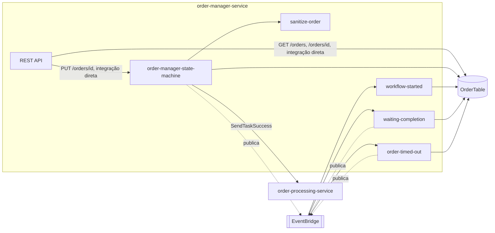
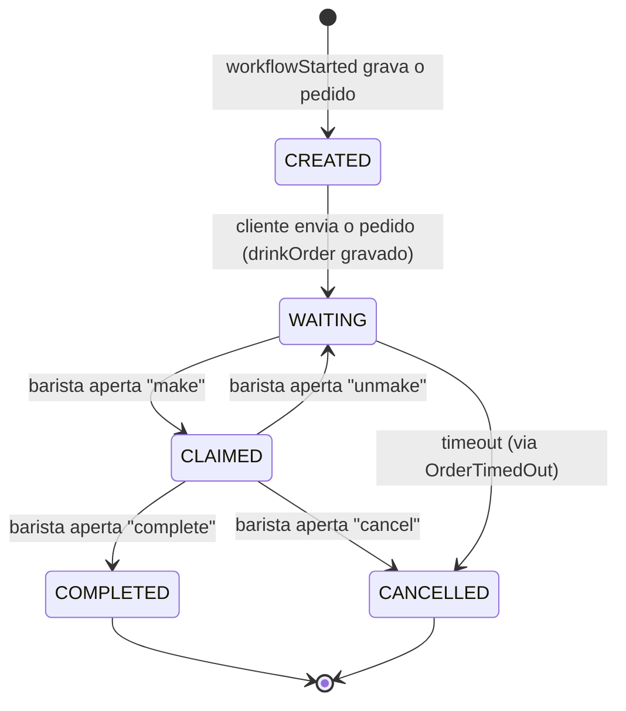

# order-manager-service
Guarda o estado de cada pedido (`serverlesspresso-order-table`) e expõe a API que o app do cliente e o app do barista usam para montar, reivindicar, concluir e cancelar pedidos. Também escuta 3 eventos do `order-processing-service` para armazenar o Task Token de cada etapa.

| Campo | Valor |
|---|---|
| Subdomínio | Pedido |
| Dono | Não identificado |
| Stack | Node.js 14.x (Lambda) + Step Functions + API Gateway (integrações diretas) |
| Repositório | `backends/5-order-manager/`; recursos em `01-appCore/template.yaml` |
| Criticidade | Alta — única escrita do estado do pedido e única API usada pelos apps de cliente/barista |

## Contêineres


## Expõe
| Contrato | Tipo | Detalhe |
|---|---|---|
| `GET /orders`, `GET /orders/{id}`, `PUT /orders/{id}` | REST API (Cognito User Pools, integração direta API Gateway → DynamoDB/Step Functions, sem lambda) | [rest-api-orders](./componentes/rest-api-orders.md) |
| `OrderManager.WaitingCompletion` | Evento | [contrato](./contratos/order-manager-waiting-completion.md) |
| `OrderManager.Order{state}-COMPLETED`/`-CANCELLED` | Evento | [contrato](./contratos/order-manager-order-state-changed.md) |
| `OrderManager.MakeOrder` | Evento | [contrato](./contratos/order-manager-make-order.md) |

## Consome
| Sistema | Contrato | Tipo |
|---|---|---|
| order-processing-service | `OrderProcessor.WorkflowStarted`, `OrderProcessor.WaitingCompletion`, `OrderProcessor.OrderTimeOut` | Evento (EventBridge) |
| config-service | Leitura direta de `ConfigTable` (cardápio) dentro do `om.asl.json` | DynamoDB GetItem |

## Dados
```mermaid
erDiagram
  ORDER {
    string PK "orders"
    string SK "orderId"
    string USERID
    string ORDERSTATE "eventId-CREATED|...-COMPLETED|...-CANCELLED"
    string TaskToken
    string orderNumber
    string drinkOrder "JSON serializado"
    string baristaUserId
    boolean robot
    number TS
  }
```
Tabela `serverlesspresso-order-table`, com GSIs `GSI-status` (por `ORDERSTATE`) e `GSI-userId` (por `USERID`), e LSI `LSI-timestamp`. Fonte: `01-appCore/template.yaml#L647-L709`.

## Estados

`ORDERSTATE` é sempre prefixado por `eventId` (ex.: `ABC-CREATED`); estados inferidos a partir do ASL `om.asl.json` — não há um enum central documentado.

## Qualidade
- `Sanitize order`: retry de 6 tentativas, backoff x2 a partir de 2 s, em caso de erro de serviço da Lambda
- `Update order` usa `ConditionExpression` (`USERID` bate e `TaskToken` existe) — protege contra sobrescrever pedido de outro usuário
- Timeouts das lambdas: 15–20 s
