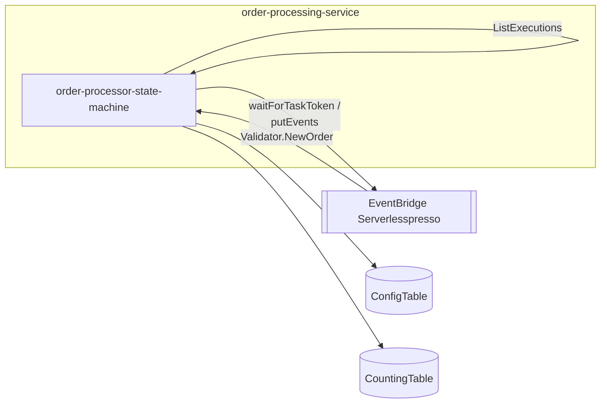
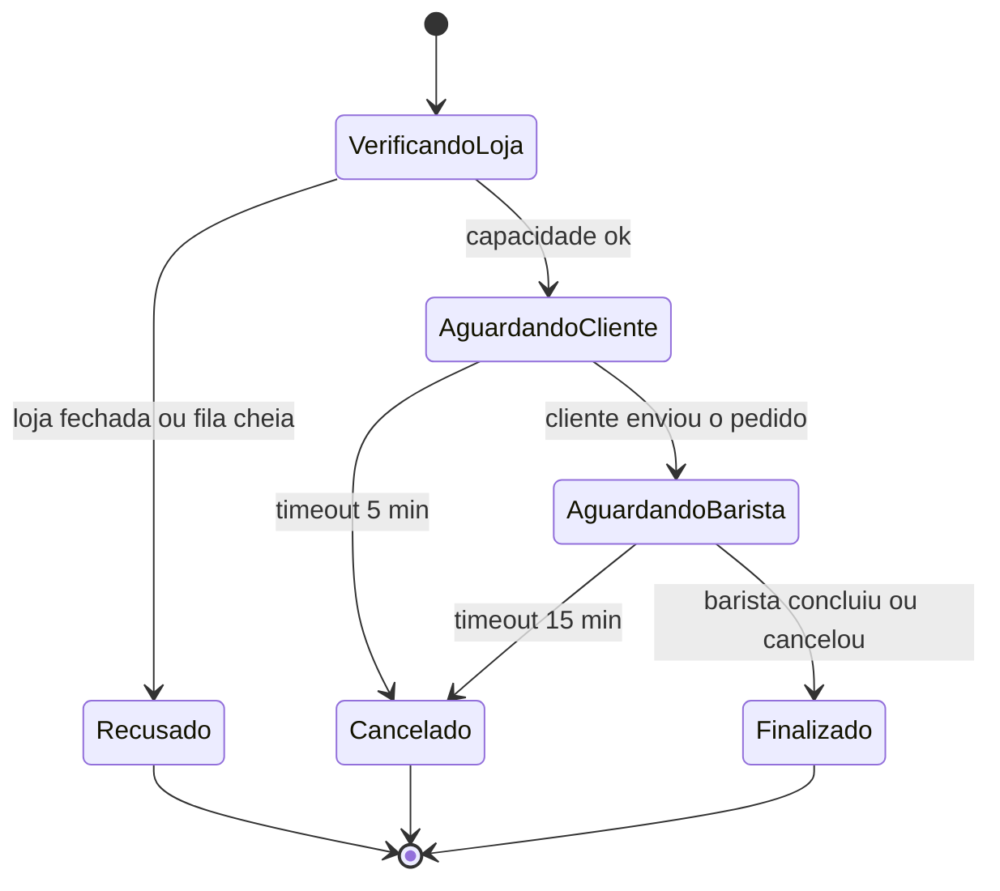

# order-processing-service
Orquestra o pedido do lado do cliente: confere se a loja está aberta e se há capacidade, aguarda o cliente montar o pedido, gera o número do pedido e aguarda o barista concluir — tudo em uma única execução de Step Functions por pedido, usando Task Tokens para pausar/retomar.

| Campo | Valor |
|---|---|
| Subdomínio | Pedido |
| Dono | Não identificado |
| Stack | AWS Step Functions (Amazon States Language), sem lambdas próprias na versão consolidada |
| Repositório | `backends/4-order-processing/` (definição do ASL); recursos declarados em `01-appCore/template.yaml` |
| Criticidade | Alta — é o orquestrador central do pedido |

## Contêineres

## Expõe
| Contrato | Tipo | Detalhe |
|---|---|---|
| `OrderProcessor.WorkflowStarted` | Evento | [contrato](./contratos/order-processor-workflow-started.md) |
| `OrderProcessor.WaitingCompletion` | Evento | [contrato](./contratos/order-processor-waiting-completion.md) |
| `OrderProcessor.OrderTimeOut` | Evento | [contrato](./contratos/order-processor-order-timeout.md) |
| `OrderProcessor.ShopUnavailable` | Evento | sem contrato dedicado — payload simples `{userId, eventId}`, sem consumidor identificado |
| `OrderProcessor.orderFinished` | Evento | [contrato](./contratos/order-processor-order-finished.md) |

## Consome
| Sistema | Contrato | Tipo |
|---|---|---|
| validator-service | `Validator.NewOrder` | Evento (EventBridge, aciona a state machine diretamente) |
| config-service | Leitura direta de `ConfigTable` (`storeOpen`) | DynamoDB GetItem |
| order-manager-service | `SendTaskSuccess` (retoma a execução pausada) | Chamada direta à API do Step Functions |

## Dados
Não tem tabela própria; lê `ConfigTable` e escreve em `CountingTable` (ver `sistemas/counting-service`).

## Estados

(Estados inferidos a partir dos nomes dos states do ASL; não existe uma máquina de estados de negócio nomeada assim no código.)

## Qualidade
- Capacidade máxima da fila: **20 execuções `RUNNING` simultâneas**, hardcoded em `$.isCapacityAvailable[20]` no ASL (não é uma variável de ambiente) — ver [regra](../../regras-de-negocio/capacidade-maxima-concorrente.md)
- Timeout de espera do cliente: 5 min (`HeartbeatSeconds: 300`)
- Timeout de espera do barista: 15 min (`HeartbeatSeconds: 900`)
- `Sanitize order` (lambda externa, no order-manager) tem retry de 6 tentativas / backoff x2 a partir de 2 s
