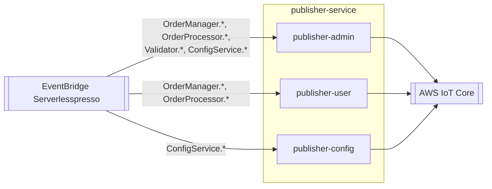

# publisher-service
Ponte entre o EventBridge e o AWS IoT Core: republica os eventos de negócio como mensagens MQTT em tópicos que os três apps (cliente, barista, admin) assinam para atualização em tempo real.

| Campo | Valor |
|---|---|
| Subdomínio | Pedido |
| Dono | Não identificado |
| Stack | Node.js 14.x (Lambda) |
| Repositório | `backends/6-publisher-service/`; recursos em `01-appCore/template.yaml` |
| Criticidade | Média — afeta só a experiência em tempo real; o estado real do pedido já está gravado antes desta lambda rodar |

## Contêineres

## Expõe
Nenhum contrato de API; publica em tópicos MQTT (não modelados como "contrato" formal por não terem schema declarado):
- `serverlesspresso-admin-{eventId}` (publisher-admin)
- `serverlesspresso-user-{userId}` (publisher-user)
- `serverlesspresso-config-{eventId}` (publisher-config)

## Consome
| Sistema | Contrato | Tipo |
|---|---|---|
| validator-service | `Validator.*` | Evento |
| order-processing-service | `OrderProcessor.*` | Evento |
| order-manager-service | `OrderManager.*` | Evento |
| config-service | `ConfigService.*` | Evento |

## Dados
Sem banco próprio; é um encaminhador stateless.

## Estados
N/A.

## Qualidade
- Timeout: 3 s em todas as 3 funções
- `publisher-admin` escuta 4 prefixos de evento numa única regra; `publisher-user` escuta 2 prefixos em duas regras separadas; `publisher-config` escuta 1 prefixo — assimetria não documentada, ver `RELATORIO.md`
