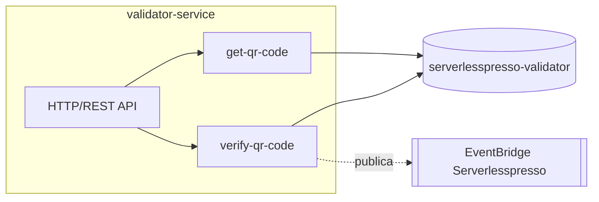

# validator-service
Emite o token de acesso (QR code) por janela de tempo e valida o token escaneado pelo cliente no balcão, iniciando o pedido.

| Campo | Valor |
|---|---|
| Subdomínio | Pedido |
| Dono | Não identificado (sample AWS) |
| Stack | Node.js 14.x (AWS Lambda), AWS SAM |
| Repositório | `backends/9-validator/` (implantado dentro da pilha consolidada `01-appCore`; há também um `template.yaml` próprio standalone — ver `infraestrutura/ambientes/modulos-standalone-backends.md`) |
| Criticidade | Alta — é o único ponto de entrada do pedido (a confirmar com o tech lead) |

## Contêineres


## Expõe
| Contrato | Tipo | Detalhe |
|---|---|---|
| `GET /qr-code` | API (Cognito JWT, requer grupo `admin`) | [get-qr-code](./componentes/get-qr-code.md) |
| `POST /qr-code` | API (Cognito JWT) | [verify-qr-code](./componentes/verify-qr-code.md) |
| `Validator.NewOrder` | Evento (EventBridge) | [validator-new-order](./contratos/validator-new-order.md) |

## Consome
| Sistema | Contrato | Tipo |
|---|---|---|
| config-service | Leitura direta de `ConfigTable` (`drinksPerBarcode`) | DynamoDB Query |

## Dados
```mermaid
erDiagram
  TOKEN_BUCKET {
    string PK "eventId-timeBucketId"
    string last_code
    number availableTokens
    number start_ts
    number end_ts
  }
```
Fonte: `backends/9-validator/code/ddb.js`, `getCode.js`. Tabela `serverlesspresso-validator` (nome real na pilha consolidada) / `ApplicationTable` (nome no template standalone).

## Estados
Não há máquina de estados própria; o "token" é criado, decrementado e expira implicitamente ao virar a janela de tempo (5 minutos, `TIME_INTERVAL`).

## Qualidade
- Timeout das lambdas: 3 s (`getCode`) e 3–15 s conforme o template usado (ver componentes)
- Existem **dois templates divergentes** para este sistema (standalone com HTTP API + Cognito JWT authorizer próprio, e consolidado com REST API + Cognito User Pools authorizer) — ver `RELATORIO.md`
