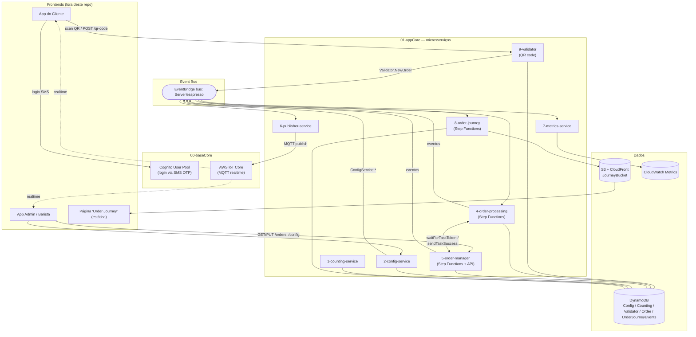

# Serverlesspresso — Visão Geral da Documentação

> Documentação técnica gerada a partir da leitura direta do código-fonte em
> `fixtures/serverless-coffee` (repositório `aws-samples/serverless-coffee`, também
> conhecido como **Serverlesspresso**). Não foi executado nenhum deploy nem chamada de API —
> tudo abaixo é derivado dos templates SAM (`template.yaml`), das definições de state machine
> (`*.asl.json`), do código dos handlers Lambda e dos `README.md` do próprio repositório.

## O que é este sistema

Serverlesspresso é o backend de um **carrinho de café pop-up** (usado como demo/workshop da AWS
em eventos como o re:Invent). Um cliente escaneia um QR code exibido no balcão, faz login por SMS,
escolhe uma bebida no app, e acompanha o pedido em tempo real até o barista prepará-lo. Todo o
back-end é serverless: **Lambda + Step Functions + EventBridge + DynamoDB + API Gateway + IoT
Core + Cognito**, sem nenhum servidor ou container de longa duração.

Não há um "monólito": o sistema é um conjunto de **9 microsserviços numerados** (mais duas pilhas
de infraestrutura de base e um punhado de extensões opcionais), todos conectados por um único
**event bus do EventBridge** chamado `Serverlesspresso`. Cada serviço publica e consome eventos
nesse barramento; poucos serviços chamam uns aos outros diretamente.

## Como navegar nesta documentação (de baixo para cima)

| Camada | Arquivo | Conteúdo |
|---|---|---|
| 1. Infraestrutura | [`01-infraestrutura.md`](./01-infraestrutura.md) | As duas pilhas de fundação (`00-baseCore`, `01-appCore`): event bus, Cognito, IoT Core, tabelas DynamoDB, API Gateways, S3/CloudFront, papéis IAM. |
| 2. Componentes (Lambdas) | [`02-lambdas.md`](./02-lambdas.md) | Catálogo de todas as **25 funções Lambda** do repositório: gatilho, entrada, saída, efeitos colaterais. |
| 3. Sistemas (microsserviços) | [`03-sistemas.md`](./03-sistemas.md) | Os 9 microsserviços + as 3 state machines + as extensões opcionais, com diagramas de cada fluxo interno. |
| 4. Fluxo de negócio | [`04-fluxo-pedido-sequencia.md`](./04-fluxo-pedido-sequencia.md) | O ciclo de vida completo de **um pedido de café**, do QR code ao "order journey" final, com diagrama de sequência. |

## Mapa de alto nível (C4 — nível de contexto/contêiner)

## Duas formas de deploy encontradas no repositório

Isso é importante para não se confundir ao ler o código:

1. **Pilha consolidada** (`00-baseCore/template.yaml` + `01-appCore/template.yaml`) — é o
   caminho de instalação documentado no `README.md` raiz (`sam deploy --guided` em cada pasta).
   `01-appCore` **reimplementa inline** a maior parte da lógica dos serviços 1, 2, 4, 5, 6, 8 e 9,
   referenciando o código-fonte de `backends/*` por `CodeUri` relativo, mas com sua **própria**
   definição de recursos (tabelas, filas de eventos, state machines). É o que roda de fato quando
   se segue o README.
2. **Pastas `backends/<n>-<nome>`** — cada uma tem (quase) seu próprio `template.yaml`/`api.yaml`
   independente, no estilo dos módulos do workshop `workshop.serverlesscoffee.com`, pensados para
   deploy isolado durante o aprendizado. Algumas contêm código que **não é usado** pela pilha
   consolidada (ex.: `4-order-processing/functions/capacity/isCapacityAvailable.js` e
   `functions/resumeWF/app.js` — na pilha consolidada essas responsabilidades foram embutidas
   diretamente na Amazon States Language, ver [`03-sistemas.md`](./03-sistemas.md)).

Isso é sinalizado item a item nos capítulos seguintes.

## Convenções usadas nesta documentação

- Nomes de recursos são citados exatamente como aparecem no template (`PascalCase` do
  CloudFormation).
- "Evento" sempre se refere a um evento do EventBridge (`detail-type` + `source` +
  `detail`), nunca a um evento de UI.
- Todos os diagramas são Mermaid e podem ser renderizados em qualquer visualizador compatível
  (GitHub, VS Code, mermaid.live).
- Onde o código tem bugs ou inconsistências visíveis (nome de variável, TODO, chave de config
  esquecida), isso é anotado com **⚠️ Nota**.
