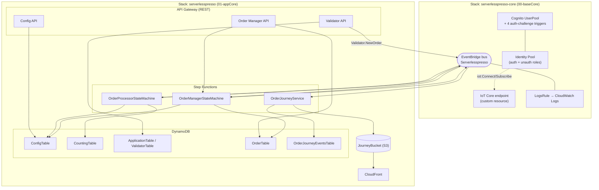

# 1. Infraestrutura

Esta camada documenta os recursos de fundação declarados nos templates SAM/CloudFormation.
Existem duas pilhas de infraestrutura "core", instaladas nesta ordem (conforme o `README.md`
raiz):

1. `00-baseCore/template.yaml` → stack **`serverlesspresso-core`**
2. `01-appCore/template.yaml` → stack **`serverlesspresso`**

## 1.1 Stack `serverlesspresso-core` (`00-baseCore`)

Responsável pelo **event bus**, **autenticação** e **realtime (IoT)** — os três alicerces que
todos os outros serviços consomem via parâmetros do SSM Parameter Store.

### Event Bus

| Recurso | Tipo | Detalhe |
|---|---|---|
| `ServerlesspressoEventBus` | `AWS::Events::EventBus` | Bus custom chamado **`Serverlesspresso`**. Todo o sistema publica/consome eventos aqui usando `Source = awsserverlessda.serverlesspresso`. |
| `LogsRule` + `LogGroupForEvents` | `AWS::Events::Rule` / `AWS::Logs::LogGroup` | Regra "catch-all" (`source: awsserverlessda.serverlesspresso`) que espelha **todo** evento do bus para o log group `/aws/serverlesspresso-event-bus` — usado só para depuração/auditoria. |

### Autenticação (Cognito com login via SMS, sem senha)

| Recurso | Tipo | Detalhe |
|---|---|---|
| `UserPool` | `AWS::Cognito::UserPool` | Usuário identificado por `phone_number`. MFA desligado; usa fluxo de **autenticação customizada** (custom auth challenge) em vez de senha. |
| `DefineAuthChallenge`, `CreateAuthChallenge`, `VerifyAuthChallengeResponse`, `PreSignUp` | `AWS::Serverless::Function` | 4 Lambda triggers do Cognito que implementam o fluxo de OTP por SMS (detalhado em [`02-lambdas.md`](./02-lambdas.md)). |
| `UserPoolClient` | `AWS::Cognito::UserPoolClient` | Client público, sem secret (`GenerateSecret: false`) — para SPA/mobile. |
| `IdentityPool` | `AWS::Cognito::IdentityPool` | Federated Identity Pool, **permite usuários não autenticados** (`AllowUnauthenticatedIdentities: true`) — provavelmente para permitir conexão IoT antes do login. |
| `CognitoAuthorizedRole` / `CognitoUnAuthorizedRole` | `AWS::IAM::Role` | Ambos os papéis dão a mesma permissão de `iot:Connect` / `iot:Subscribe` / `iot:Receive` restrita a `client/serverlesspresso-*`, ou seja, tanto visitante anônimo quanto cliente logado podem abrir uma conexão MQTT para receber updates em tempo real. |

### Realtime (IoT Core)

| Recurso | Tipo | Detalhe |
|---|---|---|
| `ServerlesspressoRealtime` | `AWS::IoT::Thing` | Thing nomeada `serverlesspresso-realtime-workshop` — usada apenas como âncora simbólica; o realtime de fato acontece via MQTT pub/sub, não via Device Shadow. |
| `GetIoTEndpointFunction` + `IotEndpoint` | Lambda + `Custom::IotEndpoint` | **Custom Resource** do CloudFormation: a Lambda chama `iot:DescribeEndpoint` na hora do deploy e devolve a URL do endpoint IoT da conta/região, exposta como output `IotEndpointAddress` (consumida pelos frontends para abrir a conexão MQTT). |

### Outputs (consumidos pelas pilhas seguintes via SSM Parameter Store)

`UserPoolID`, `UserPoolWebClientId`, `CoreEventBusARN`, `IoTRealtimeName`, `IotEndpointAddress`,
`UserPoolARNParameter` — o `README.md` raiz explica que esses outputs também são gravados no
**AWS Systems Manager Parameter Store** (`/Serverlesspresso/core/...`), de onde os templates dos
outros serviços os leem via parâmetros `AWS::SSM::Parameter::Value<String>` (visto em
`backends/9-validator/template.yaml`, por exemplo).

---

## 1.2 Stack `serverlesspresso` (`01-appCore`)

É a pilha "guarda-chuva" que declara (quase) todos os recursos de dados e execução dos 9
microsserviços de negócio. Ela referencia código-fonte fora da própria pasta
(`CodeUri: ../backends/...`), então **o código vive em `backends/`, mas os recursos de nuvem são
declarados aqui**.

### Armazenamento (DynamoDB)

| Tabela | Chave | Usada por | Observações |
|---|---|---|---|
| `ConfigTable` (`serverlesspresso-config-table`) | `PK` (string) | Config service, Validator, Order Manager (SFN `get menu`), Order Processor (SFN `Shop Open?`) | Guarda config por evento (`config-<eventId>`): cardápio, `storeOpen` (bool), `drinksPerBarcode`. Tem **DynamoDB Stream** ligado ao `ConfigChangedFunction`. |
| `CountingTable` (`serverlesspresso-counting-table`) | `PK` (string) | Order Processor (SFN `Generate Order Number`) | Contador atômico de número de pedido por evento (`orderID-<eventId>`), incrementado via `UpdateExpression` direto na ASL (sem Lambda). |
| `ApplicationTable` / `ValidatorTable` (`serverlesspresso-validator`) | `PK` | Validator service | Guarda os "buckets" de token QR code rotativos (janelas de 5 min) e contagem de tokens restantes. |
| `OrderTable` (`serverlesspresso-order-table`) | `PK`+`SK`, GSIs `GSI-status` (`ORDERSTATE`+`SK`) e `GSI-userId` (`USERID`+`SK`), LSI `LSI-timestamp` | Order Manager | O "registro mestre" de cada pedido: task tokens, estado (`<eventId>-CREATED/COMPLETED/CANCELLED`), drink order, barista designado. As APIs REST (`GET /orders`, `GET /myOrders`) fazem `Query` direto nos GSIs via integração de API Gateway com DynamoDB (sem Lambda no caminho de leitura). |
| `OrderJourneyEventsTable` | `PK`+`SK` | Order Journey service | Guarda uma linha por evento do pedido (histórico completo), usada para montar a página HTML final. |

### API Gateways (REST, integração direta com AWS services quando possível)

| API | Stack/pasta | Endpoints | Padrão de integração |
|---|---|---|---|
| `RESTApiConfigService` | `2-config-service/RestAPIs/api.yaml` | `GET /config`, `GET /admin-config`, `PUT /store` | **Integração direta API Gateway → DynamoDB** (`GetItem`/`UpdateItem`), sem Lambda no meio. `/admin-config` e `/store` exigem Cognito; `/config` é público. |
| `RESTApiForOrderManager` | `5-order-manager/RestAPIs/api.yaml` | `GET /orders`, `GET /orders/{id}`, `PUT /orders/{id}`, `GET /myOrders` | `GET`s = integração direta com **DynamoDB Query/GetItem**; `PUT /orders/{id}` = integração direta **API Gateway → Step Functions `StartExecution`** (inicia a Order Manager State Machine passando `action`, `eventId`, `body`, `orderId`, `baristaUserId` extraído do JWT). Todos exigem Cognito. |
| `RESTApiValidatorService` | `9-validator/template.yaml` (versão standalone) / `01-appCore` (versão consolidada) | `GET /qr-code`, `POST /qr-code` | Essas sim passam por Lambda (`GetQRcodeFunction`, `VerifyQRcodeFunction`). Autenticação Cognito. |
| `4-order-processing/api.yaml` | standalone apenas | `POST /order` | Integração **API Gateway HTTP API → EventBridge PutEvents** direta (`OrderProcessor.OrderStarted`) — não aparece usada na pilha consolidada (o caminho real de entrada é `VerifyQRcodeFunction` emitindo `Validator.NewOrder`). |

⚠️ **Nota**: o padrão recorrente aqui é "API Gateway sem Lambda" (Velocity Templates + IAM role
dedicada por API, ex. `ConfigRESTApiRole`, `RESTApiRole`) — reduz custo/latência para leituras e
para iniciar workflows, e só usa Lambda quando há lógica de negócio real (Validator) ou
efeitos colaterais (Config Streams).

### Entrega em tempo real (S3 + CloudFront)

| Recurso | Detalhe |
|---|---|
| `JourneyBucket` (`serverlesspresso-order-journey-<region>-<account>`) | Bucket S3 onde a Lambda `GenerateHtml` grava a página HTML final do pedido (`<orderId>.html`, ACL `public-read`). |
| `JourneyCloudFront` + `OriginAccessIdentity` | Distribuição CloudFront na frente do bucket (cache curto, `DefaultTTL: 5`s) — serve a "order journey page" compartilhável publicamente. |

### Execução assíncrona (Step Functions)

Três state machines vivem nesta pilha — cada uma detalhada em [`03-sistemas.md`](./03-sistemas.md):

- `OrderProcessorStateMachine` (`backends/4-order-processing/statemachine/op.asl.json`) — usa um
  **papel IAM próprio** (`OrderProcessorRole`), não o padrão de policies do SAM, com permissões
  explícitas para `events:PutEvents`, `dynamodb:GetItem/UpdateItem` (Config e Counting tables) e
  `states:ListExecutions`.
- `OrderManagerStateMachine` (`backends/5-order-manager/statemachine/om.asl.json`).
- `OrderJourneyService` (`backends/8-order-journey/statemachine/StepFunction.asl.json`).

### Bootstrap de dados

`FillDatabasesCustomResource` (Lambda) + `DeploymentCustomResourcePrefil`
(`AWS::CloudFormation::CustomResource`) rodam automaticamente em **Create/Update** da stack para
popular `ConfigTable` e `CountingTable` com o cardápio inicial e os contadores zerados —
ver [`02-lambdas.md`](./02-lambdas.md#25-fillDatabasesCustomResource).

---

## 1.3 Diagrama de infraestrutura (deploy view)

