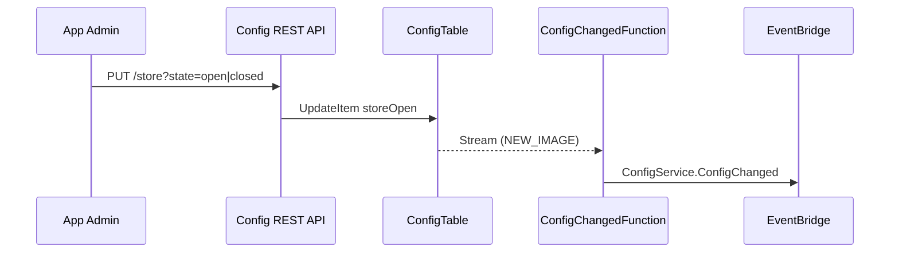
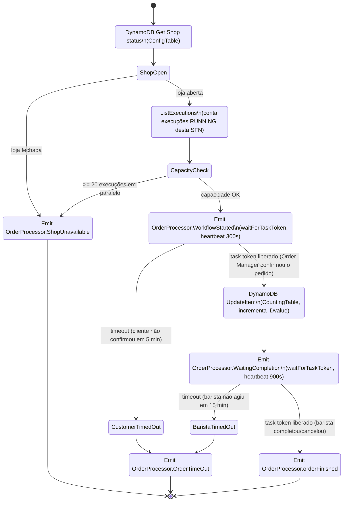
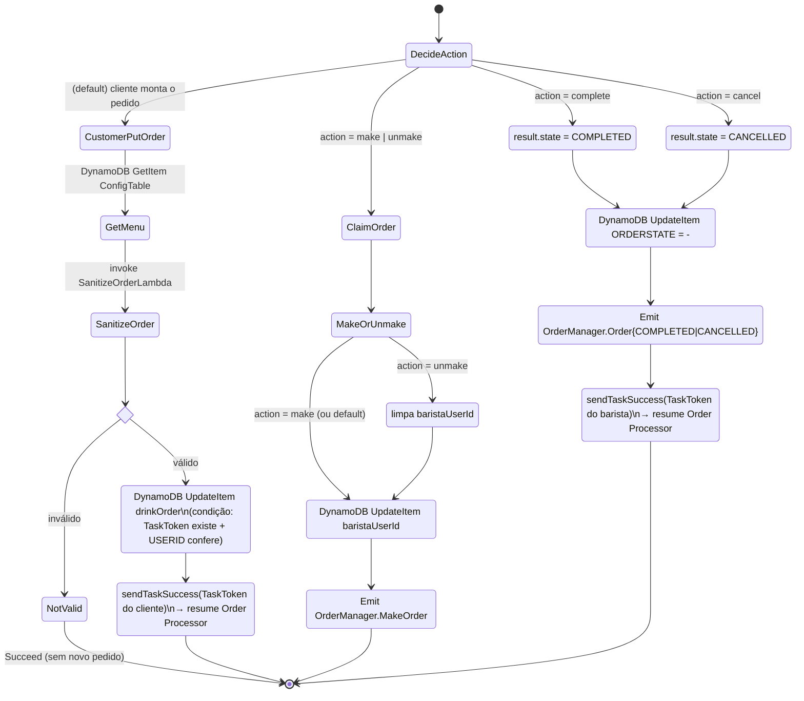
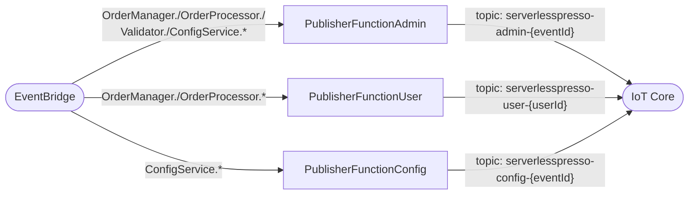
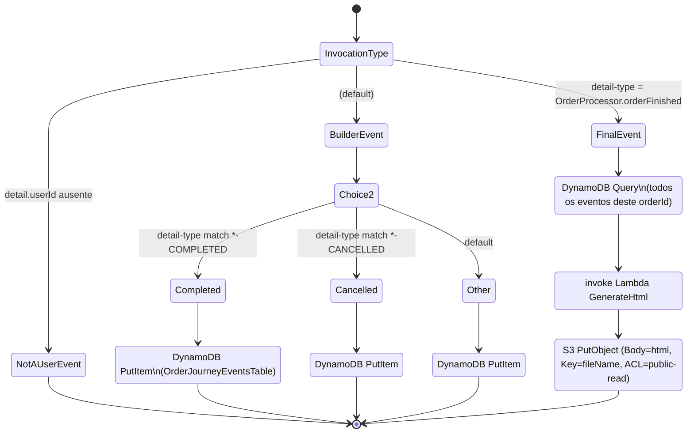

# 3. Sistemas (microsserviços)

O repositório organiza o domínio em microsserviços numerados dentro de `backends/`. O número "3"
não existe no repositório (não há `backends/3-*`) — não foi encontrada nenhuma referência a um
serviço removido ou renomeado, então é tratado aqui como uma lacuna na numeração original do
workshop, não como um serviço faltando na documentação.

Cada seção traz: responsabilidade, recursos de dados, eventos publicados/consumidos e (quando
aplicável) o diagrama da state machine.

---

## 1 — `1-counting-service`

**Responsabilidade original**: gerar o número sequencial do pedido (o "senha nº 42" que aparece no
copo). **Status na stack consolidada**: a lógica foi absorvida como um state inline
(`Generate Order Number`) dentro do `OrderProcessorStateMachine` — ver seção 4. O código Lambda
(`getOrderId.js`, `resetOrderId.js`) permanece no repo como referência/utilitário standalone, sem
`template.yaml` próprio.

- **Dados**: `CountingTable` (`serverlesspresso-counting-table`), chave `PK`.
- **Eventos**: nenhum (a versão consolidada não publica eventos aqui; o incremento acontece
  como um passo interno do Order Processor).

---

## 2 — `2-config-service`

**Responsabilidade**: fonte da verdade sobre a configuração de cada "evento" (sessão do carrinho
de café): cardápio, se a loja está aberta (`storeOpen`), quantos drinks cada QR code libera
(`drinksPerBarcode`).

- **Dados**: `ConfigTable` (`serverlesspresso-config-table`), chave `PK = config-<eventId>`, com
  **DynamoDB Streams** habilitado.
- **API**: `GET /config` (público), `GET /admin-config` (Cognito), `PUT /store` (Cognito) — todas
  via integração direta API Gateway↔DynamoDB, sem Lambda.
- **Lambda**: `ConfigChangedFunction` (única função do serviço) — reage ao Stream e publica
  `ConfigService.ConfigChanged`.
- **Consumido por**: `PublisherFunctionConfig` (replica para IoT), Order Processor (`Shop Open?`),
  Order Manager (`get menu`), Validator (`getConfig` para `drinksPerBarcode`).

---

## 4 — `4-order-processing` (Step Functions: `op.asl.json`)

**Responsabilidade**: orquestrar o ciclo de vida "macro" de um pedido — desde a validação do
QR code até o pedido estar pronto — usando o padrão **task token** (`waitForTaskToken`) para
pausar a execução enquanto espera ações humanas (cliente escolher bebida, barista concluir).

- **Disparo**: regra EventBridge no `detail-type = Validator.NewOrder` — 1 execução por pedido.
- **Papel IAM próprio** (`OrderProcessorRole`), não policies padrão do SAM.
- **Não usa nenhuma Lambda na versão consolidada** — todo passo é uma integração nativa de
  serviço (`dynamodb:getItem/updateItem`, `events:putEvents[.waitForTaskToken]`,
  `states:listExecutions`).

### Diagrama de estados

⚠️ **Nota de leitura do código**: o número mágico "20" no state `Is capacity available?`
(`$.isCapacityAvailable[20]`) é uma forma indireta de checar `len(executions) > 20`: o `Choice`
testa se o **índice 20** existe no array de resultados do `ListExecutions` (`MaxResults: 100`).
Ou seja, a capacidade máxima de pedidos simultâneos é **20**, hardcoded na ASL (não é parâmetro).

---

## 5 — `5-order-manager` (Step Functions: `om.asl.json` + API REST)

**Responsabilidade**: é a "camada humana" do sistema — expõe as ações que o **cliente** (montar o
pedido) e o **barista** (make/unmake/complete/cancel) disparam via `PUT /orders/{id}?action=...`,
e é quem efetivamente **resume** o Order Processor (via `sendTaskSuccess`) nos dois pontos de
espera dele.

- **Disparo**: `PUT /orders/{id}` na API REST inicia esta SFN via `StartExecution` direto (sem
  Lambda), passando `action` (`make` | `unmake` | `complete` | `cancel` | ausente = fluxo do
  cliente), `eventId`, `body` (o pedido) e `baristaUserId` (extraído do JWT do barista).
- **Dados**: lê/escreve `OrderTable`; lê `ConfigTable` (cardápio).
- Também escuta o bus via 3 Lambdas fora da própria SFN (`WorkFlowStarted`, `WaitingCompletion`,
  `OrderTimedOut` — documentadas em [`02-lambdas.md`](./02-lambdas.md)) que mantêm o registro do
  pedido em `OrderTable` sincronizado com o progresso do Order Processor.

### Diagrama de estados (ramos por `action`)

⚠️ **Nota**: apesar do nome, o state `Unmake Order` **não** reverte o `ORDERSTATE`; ele apenas
zera `baristaUserId` e reemite `OrderManager.MakeOrder` — ou seja, "unmake" devolve o pedido para
a fila de "a fazer" sem mudar seu status de completado/cancelado.

---

## 6 — `6-publisher-service`

**Responsabilidade**: única ponte entre o EventBridge (backend) e o **IoT Core** (realtime para os
frontends). Não tem estado próprio — puro "fan-out" de eventos para tópicos MQTT. As 3 Lambdas
(`Admin`, `User`, `Config`) estão detalhadas em [`02-lambdas.md`](./02-lambdas.md).

---

## 7 — `7-metrics-service`

**Responsabilidade**: observabilidade de negócio — 4 Lambdas independentes, cada uma escutando um
`detail-type`, publicando pontos no CloudWatch (namespace `<AppName>-dev`). Ver
[`02-lambdas.md`](./02-lambdas.md) para o detalhe de cada métrica. É a stack mais simples do
repositório: sem tabela própria, sem API, só `CloudWatchPutMetricPolicy`.

---

## 8 — `8-order-journey` (Step Functions: `StepFunction.asl.json`)

**Responsabilidade**: montar o "recibo emocional" do pedido — uma página HTML pública com a linha
do tempo de todos os eventos daquele pedido, hospedada em S3/CloudFront, para o cliente
compartilhar nas redes sociais.

- **Disparo**: regra com `EventPattern` **muito ampla** (`source: awsserverlessda.serverlesspresso`,
  sem filtro de `detail-type`) — ou seja, **toda** publicação no bus dispara uma execução desta
  SFN. Isso é intencional: cada execução decide o que fazer olhando o `detail-type` recebido.

### Diagrama de estados

Ou seja: a cada evento do domínio, esta SFN **grava uma linha** na `OrderJourneyEventsTable`
(histórico incremental); só quando chega o evento terminal `OrderProcessor.orderFinished` ela
**lê tudo de volta**, gera o HTML e publica no S3.

---

## 9 — `9-validator`

**Responsabilidade**: converte a posse física de um QR code + login válido em um novo pedido no
sistema. É o **único ponto de entrada** de um novo pedido no domínio (a origem de
`Validator.NewOrder`). Detalhes das 2 Lambdas em [`02-lambdas.md`](./02-lambdas.md).

- **Dados**: `ValidatorTable`/`ApplicationTable`, chave `PK = <eventId>-<janela de 5 min>`.
- **Padrão de token rotativo**: o QR code exibido fisicamente no balcão muda a cada 5 minutos
  (`TIME_INTERVAL`), e cada janela carrega um contador de tokens restantes
  (`availableTokens`, copiado de `drinksPerBarcode` do Config Service) — isso limita quantos
  pedidos podem ser iniciados por janela de tempo, funcionando como um controle de vazão
  independente do controle de capacidade do Order Processor (que limita concorrência, não vazão).

---

## Visão consolidada dos eventos do domínio

| `detail-type` | Produtor | Consumidores |
|---|---|---|
| `Validator.NewOrder` | 9-validator | 4-order-processing (inicia SFN), 7-metrics-service, 6-publisher-service (admin) |
| `OrderProcessor.ShopUnavailable` | 4-order-processing | 6-publisher-service (admin/user via prefixo `OrderProcessor.`) |
| `OrderProcessor.WorkflowStarted` | 4-order-processing | 5-order-manager (`WorkFlowStarted`), 6-publisher-service |
| `OrderProcessor.OrderTimeOut` | 4-order-processing | 5-order-manager (`OrderTimedOut`), 7-metrics-service, 6-publisher-service |
| `OrderProcessor.WaitingCompletion` | 4-order-processing | 5-order-manager (`WaitingCompletion`), 6-publisher-service |
| `OrderProcessor.orderFinished` | 4-order-processing | 8-order-journey (dispara geração do HTML), 6-publisher-service |
| `OrderManager.MakeOrder` | 5-order-manager (SFN) | 6-publisher-service |
| `OrderManager.WaitingCompletion` | 5-order-manager (Lambda) | 7-metrics-service, 6-publisher-service |
| `OrderManager.OrderCOMPLETED` / `OrderManager.OrderCANCELLED` | 5-order-manager (SFN) | 6-publisher-service, 7-metrics-service (`OrderCancelled`), 8-order-journey |
| `ConfigService.ConfigChanged` | 2-config-service | 6-publisher-service (config) |

Todos os eventos, independentemente do `detail-type`, também alimentam **8-order-journey** (regra
sem filtro) e a **`LogsRule`** de `00-baseCore` (log bruto de auditoria).

---

## 5 — Extensões opcionais (`extensions/`)

Módulos desacoplados, cada um com sua própria regra de EventBridge no mesmo bus
`Serverlesspresso` — pensados para serem plugados/removidos sem tocar no core. Não fazem parte da
instalação padrão descrita no `README.md` raiz.

| Extensão | O que faz | Como se liga ao core |
|---|---|---|
| **EventPlayer** | Step Functions que reproduz um array fixo de eventos "realistas" (`events.json`), emitindo 1 a cada ~5s por ~5 min — usado para gerar tráfego de teste ao desenvolver outras extensões. | Publica no bus como se fosse o próprio sistema. |
| **OrderRobotExtension** | Duas state machines (`orderBot.asl.json`, `baristaBot.asl.json`) que simulam clientes fazendo pedidos e baristas atendendo, em volume (`{ orders: 150, eventId: "ABC" }`) — usado para testes de carga/demo. | Idem, gera eventos como um cliente/barista real fariam. |
| **PersistOrderMetricsToDynamoDB** | Lambda (`publishMetric`) + fila + tabela DynamoDB própria: persiste eventos `OrderManager.WaitingCompletion` de forma durável para análises posteriores (fora do CloudWatch). | Regra própria de EventBridge, sem tocar nos recursos do core. |
| **WaitTimes** (CDK, não SAM) | State machine que escuta eventos de pedido "submetido" e "concluído", calcula o **tempo médio de espera por bebida** e publica o resultado de volta no bus. | Lê do bus `Serverlesspresso`, publica um novo `detail-type` de volta nele. |

Regra comum a todas: **não têm permissão para tocar em recursos do core** — só leem eventos do bus
e, no máximo, publicam eventos novos nele.
