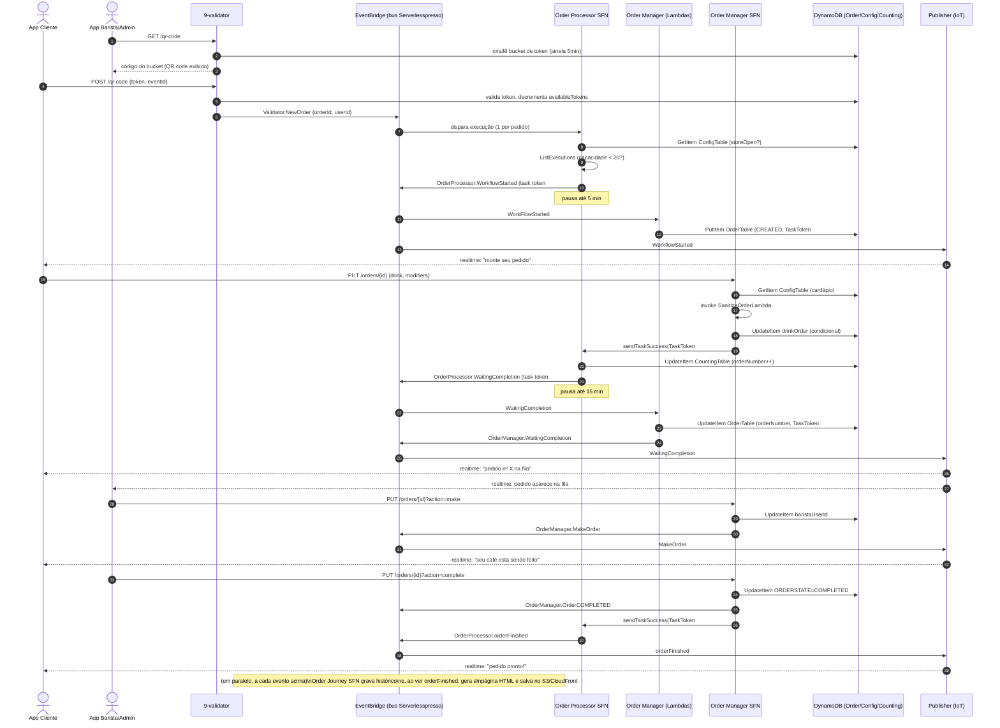
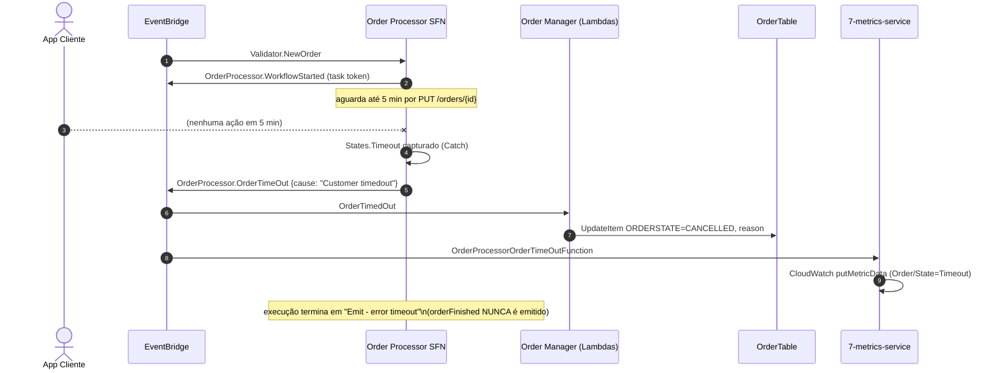

# 4. Fluxo de negócio: do QR code ao café pronto

Este capítulo junta tudo dos anteriores num único fluxo ponta a ponta: **o ciclo de vida completo
de um pedido de café**, incluindo os dois pontos de espera por ação humana (padrão *task token* do
Step Functions) e os dois caminhos de erro (timeout do cliente / timeout do barista).

## Pré-condição: o cliente já está autenticado

Antes deste fluxo, o app do cliente já completou o login sem senha via Cognito
(`PreSignUp` → `CreateAuthChallenge` envia OTP por SMS via SNS → `VerifyAuthChallengeResponse`
confere o código → `DefineAuthChallenge` decide emitir os tokens), documentado em
[`02-lambdas.md`](./02-lambdas.md#00-baseCore--autenticação-e-bootstrap-de-infra). O JWT resultante
é usado em todas as chamadas de API abaixo.

## Passo a passo

1. **Setup do balcão**: o app admin chama `GET /qr-code` (`GetQRcodeFunction`) periodicamente; a
   cada janela de 5 minutos um novo *bucket* de token é criado em `ValidatorTable` e exibido como
   QR code físico no local.
2. **Cliente escaneia o QR code** → app chama `POST /qr-code` (`VerifyQRcodeFunction`) com o token
   lido e o `eventId`. Se o token bate com o bucket da janela atual e ainda há
   `availableTokens`, a função decrementa o contador, gera um `orderId` novo e publica
   **`Validator.NewOrder`** no bus — este é o gatilho de tudo o que segue.
3. O evento dispara uma nova execução do **Order Processor** (`op.asl.json`), que:
   - confere `storeOpen` no `ConfigTable`;
   - se a loja estiver aberta, confere se há menos de 20 execuções `RUNNING` da própria state
     machine (controle de capacidade/fila);
   - se as duas checagens passarem, emite **`OrderProcessor.WorkflowStarted`** com um **task
     token** e **pausa** (até 5 minutos, aguardando o cliente montar o pedido).
   - se qualquer checagem falhar, emite `OrderProcessor.ShopUnavailable` e encerra — o cliente é
     avisado em tempo real (via publisher → IoT) que não pode pedir agora.
4. Em paralelo, dois consumidores reagem a `OrderProcessor.WorkflowStarted`:
   - `WorkFlowStarted` (Order Manager) grava o registro inicial do pedido em `OrderTable`
     (estado `CREATED`, guardando o task token);
   - `PublisherFunctionAdmin`/`PublisherFunctionUser` replicam o evento para os tópicos IoT —
     o app do cliente libera a tela de "monte seu pedido".
5. **Cliente escolhe a bebida + modificadores** e confirma → app chama
   `PUT /orders/{orderId}` (sem `action`, ou seja, o ramo "cliente" da state machine) na API do
   Order Manager, que **inicia uma nova execução** do `OrderManagerStateMachine` (`om.asl.json`):
   - busca o cardápio (`ConfigTable`);
   - invoca `SanitizeOrderLambda` para validar a bebida/modificadores contra o cardápio;
   - se inválido → `Succeed` (fim silencioso, nenhum evento é emitido, o pedido não avança);
   - se válido → grava `drinkOrder` em `OrderTable` (condicionado a existir um task token
     pendente para aquele `orderId`+`userId`) e chama **`sendTaskSuccess`** com o task token do
     cliente, **resumindo** a execução pausada do Order Processor.
6. O **Order Processor** retoma de onde parou:
   - incrementa o contador atômico em `CountingTable` → gera o **número do pedido**;
   - emite **`OrderProcessor.WaitingCompletion`** com um **novo task token** e **pausa de novo**
     (até 15 minutos, aguardando o barista agir).
7. `WaitingCompletion` (Order Manager) grava o número do pedido + novo task token em `OrderTable`
   e emite `OrderManager.WaitingCompletion` — o publisher espalha isso via IoT (cliente vê
   "seu pedido é o nº X, aguardando"; admin vê o pedido entrar na fila) e o serviço de métricas
   registra um ponto `Order/State=Started`.
8. **Barista vê a fila** (`GET /orders?state=WaitingCompletion&eventId=...`, leitura direta
   API Gateway↔DynamoDB no `GSI-status`) e clica **"Fazer"** →
   `PUT /orders/{orderId}?action=make` → nova execução do Order Manager SFN (ramo "Claim Order"):
   grava `baristaUserId` em `OrderTable` e emite `OrderManager.MakeOrder` (o barista pode também
   `action=unmake` para devolver o pedido à fila sem alterar seu status de conclusão).
9. **Barista finaliza** (ou cancela) → `PUT /orders/{orderId}?action=complete|cancel` → Order
   Manager SFN (ramo "Complete/Cancel Order"): atualiza `ORDERSTATE` para
   `<eventId>-COMPLETED`/`CANCELLED`, emite `OrderManager.Order{ESTADO}` e chama
   **`sendTaskSuccess`** com o task token **do barista**, resumindo o Order Processor pela segunda
   e última vez.
10. O **Order Processor** retoma e emite **`OrderProcessor.orderFinished`** — fim da execução.
11. O evento terminal dispara a última peça: a **Order Journey SFN**, que já vinha gravando (a
    cada evento do pedido, desde o passo 3) uma linha em `OrderJourneyEventsTable`; ao ver
    `orderFinished`, ela consulta todo o histórico daquele `orderId`, chama `GenerateHtml` para
    montar a página de linha do tempo e grava o HTML no S3 (servido via CloudFront) — o cliente
    recebe um link para compartilhar o "order journey" do seu café.

### Caminhos de erro (timeout)

- **Cliente não confirma o pedido em 5 minutos** (depois do passo 4): o `Emit - Workflow Started
  TT` do Order Processor estoura o `HeartbeatSeconds: 300`, cai no `Catch` →
  `OrderProcessor.OrderTimeOut` (`cause = "Customer timedout"`) → `OrderTimedOut` (Order Manager)
  marca o pedido `CANCELLED`; métricas registram `Order/State=Timeout`.
- **Barista não conclui em 15 minutos** (depois do passo 7): o `Emit - Awaiting Completion TT`
  estoura `HeartbeatSeconds: 900` → mesmo tratamento (`cause = "Barista timedout"`).
- Em ambos os casos a execução do Order Processor termina em `Emit - error timeout`
  (`OrderProcessor.OrderTimeOut`) **sem** passar por `orderFinished` — ou seja, a Order Journey
  page **não é gerada automaticamente** para pedidos que deram timeout (ela só reage a
  `OrderProcessor.orderFinished`; um timeout não emite esse evento). A página só existe para
  pedidos completados **ou** cancelados pelo barista (via `OrderManager.Order{STATE}`, que também
  acaba levando a `orderFinished` quando o Order Processor é resumido no passo 9).

## Diagrama de sequência (caminho feliz)

## Diagrama de sequência (timeout do cliente — caminho de erro)

