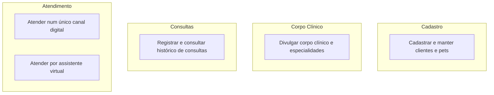
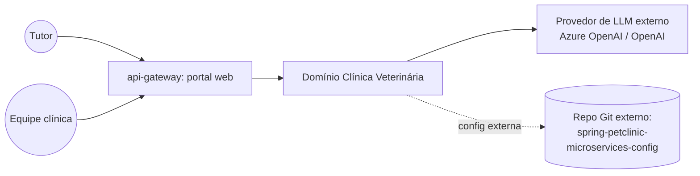

# Domínio Clínica Veterinária
Gerir o cadastro de tutores e pets, o corpo clínico de veterinários e o histórico de consultas de uma clínica veterinária, oferecendo atendimento tanto por uma tela web quanto por um assistente virtual com IA generativa. Documentação gerada a partir do código-fonte de `spring-petclinic-microservices` (branch/commit `aefaf7f`, 2026-09-23); não houve documento de arquitetura, ADR ou brief de negócio para consultar além do `README.md` técnico do repositório.

## Visão de capacidades (camada 1, inferido a partir do código)

Ver cada capacidade em [`capacidades/`](capacidades/) e os fluxos macro em [`fluxos/`](fluxos/).

## Fronteiras
- **Dentro:** cadastro de tutores e pets, cadastro/consulta de veterinários e especialidades, registro e consulta de visitas (consultas veterinárias), o portal web de atendimento e o assistente virtual de IA generativa.
- **Fora:** qualquer processo de agendamento de horários, faturamento/cobrança, prontuário clínico detalhado (exames, prescrições), autenticação/autorização de usuários — nenhuma dessas capacidades foi encontrada no código. **Não presuma que elas existem só porque seria natural para uma clínica veterinária real** — isso é uma lacuna a confirmar com o PM, não um fato extraído.

## Dono
Não informado — não há `CODEOWNERS` nem seção de donos no repositório. **A confirmar.**

## Subdomínios
| Subdomínio | Responsabilidade | Sistemas |
|---|---|---|
| [Cadastro de Clientes e Pets](subdominios/sub-cadastro.md) | Cadastro mestre de tutores e pets | `customers-service` |
| [Corpo Clínico](subdominios/sub-corpo-clinico.md) | Catálogo de veterinários e especialidades | `vets-service` |
| [Consultas](subdominios/sub-consultas.md) | Histórico de visitas por pet | `visits-service` |
| [Atendimento Digital](subdominios/sub-atendimento-digital.md) | Canais de acesso: portal web e assistente virtual | `api-gateway`, `genai-service` |
| [Plataforma](subdominios/sub-plataforma.md) | Configuração, service discovery, observabilidade | `config-server`, `discovery-server`, `admin-server` |

## Contexto

Não foram encontrados outros domínios internos (de outro time/produto) que este domínio consuma ou publique eventos para — o único sistema externo real é o provedor de LLM e o repositório de configuração externo. **Inferido**: isso pode significar que este é um domínio isolado, ou que integrações reais existem apenas na configuração externa não lida aqui.

## Eventos de domínio
| Evento | Produtor | Consumidores | Contrato |
|---|---|---|---|
| — | — | — | — |

Nenhum evento assíncrono (fila, tópico, webhook) foi encontrado no código deste repositório — toda comunicação entre sistemas é síncrona via HTTP/REST, resolvida por service discovery (Eureka). Isso é um fato `extracted` (ausência de qualquer dependência de mensageria nos `pom.xml` e nenhum `@KafkaListener`/`sqs`/`@RabbitListener` no código-fonte).
