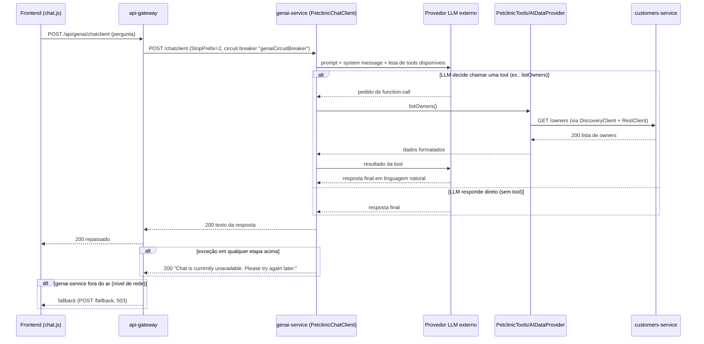

# Atendimento via assistente virtual: sequência técnica
Realiza as etapas do [fluxo macro](./flow-atendimento-assistente-virtual.md).

## Diagrama

## Passos
### Passo 1
O frontend envia a pergunta como corpo de texto puro para `POST /chatclient`, roteado pelo `api-gateway` (`/api/genai/**`, com circuit breaker nomeado `genaiCircuitBreaker` além do padrão — sinal de que este caminho é considerado mais instável, por depender de um provedor de LLM externo).

### Passo 2
`PetclinicChatClient` monta o prompt com um system message fixo (persona do assistente da Spring Petclinic) e disponibiliza as 4 tools de `PetclinicTools` ao LLM (`listOwners`, `addOwnerToPetclinic`, `listVets`, `addPetToOwner`). Se o LLM decidir invocar uma tool, `AIDataProvider` executa a chamada real ao `customers-service` (resolvido via `DiscoveryClient`, não via Gateway) ou busca no `VectorStore` local (para `listVets`).

### Passo 3
O resultado da tool volta ao LLM, que compõe a resposta final em linguagem natural, devolvida ao usuário.

### Caminho de erro
- Qualquer exceção dentro de `PetclinicChatClient.exchange` (falha do LLM, falha de rede ao chamar `customers-service`, etc.) é capturada e vira a resposta fixa "Chat is currently unavailable. Please try again later." — **o usuário recebe HTTP 200 com uma mensagem de erro em texto**, não um HTTP 5xx (comportamento notável para quem for tratar erros no frontend).
- Se o próprio `genai-service` estiver fora do ar (não apenas uma exceção interna, mas indisponibilidade de rede), o circuit breaker do `api-gateway` intercepta e devolve o fallback genérico (`POST /fallback`, `503`).
