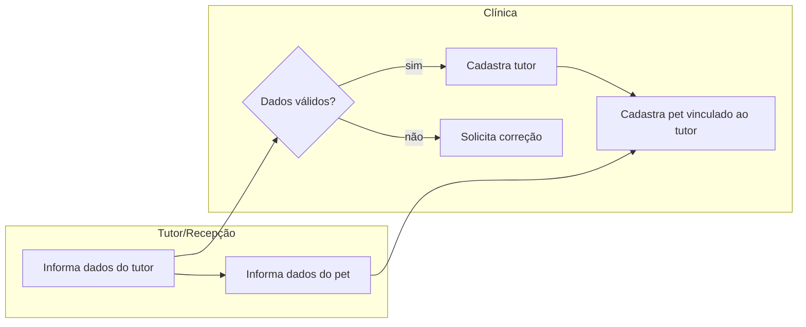

# Cadastro de tutor e pet
Permitir que um novo tutor se cadastre na clínica e registre seus pets, para que a clínica possa atendê-lo e manter o histórico de consultas.

## Atores
- **Tutor / recepção** — informa os dados do tutor e do pet (inferido: o frontend não distingue autoatendimento de cadastro feito pela recepção)
- **Sistema (clínica veterinária)** — valida e armazena o cadastro

## Etapas
| # | Etapa | Ator | Decisão ou resultado | Técnica |
|---|---|---|---|---|
| 1 | Tutor informa nome, endereço, cidade e telefone | Tutor/recepção | dados validados (campos obrigatórios, telefone numérico) | [passo 1](./flow-cadastro-tutor-pet.sequencia.md#passo-1) |
| 2 | Sistema cria o cadastro do tutor | Sistema | tutor cadastrado com sucesso ou erro de validação | [passo 1](./flow-cadastro-tutor-pet.sequencia.md#passo-1) |
| 3 | Tutor informa dados do pet (nome, data de nascimento, tipo) | Tutor/recepção | tipo de pet deve ser um dos cadastrados (cat, dog, lizard, snake, bird, hamster) | [passo 2](./flow-cadastro-tutor-pet.sequencia.md#passo-2) |
| 4 | Sistema associa o pet ao tutor | Sistema | pet cadastrado e vinculado ao tutor | [passo 2](./flow-cadastro-tutor-pet.sequencia.md#passo-2) |

## Diagrama

## Indicadores
- Tempo médio de cadastro, taxa de abandono no formulário — não encontrados no código; **a confirmar com o PM**.

## Regras que governam
- [Telefone com até 12 dígitos, sem formatação](../regras-de-negocio/reg-telefone-formato.md)
- [Tipos de pet permitidos](../regras-de-negocio/reg-tipos-de-pet.md)
