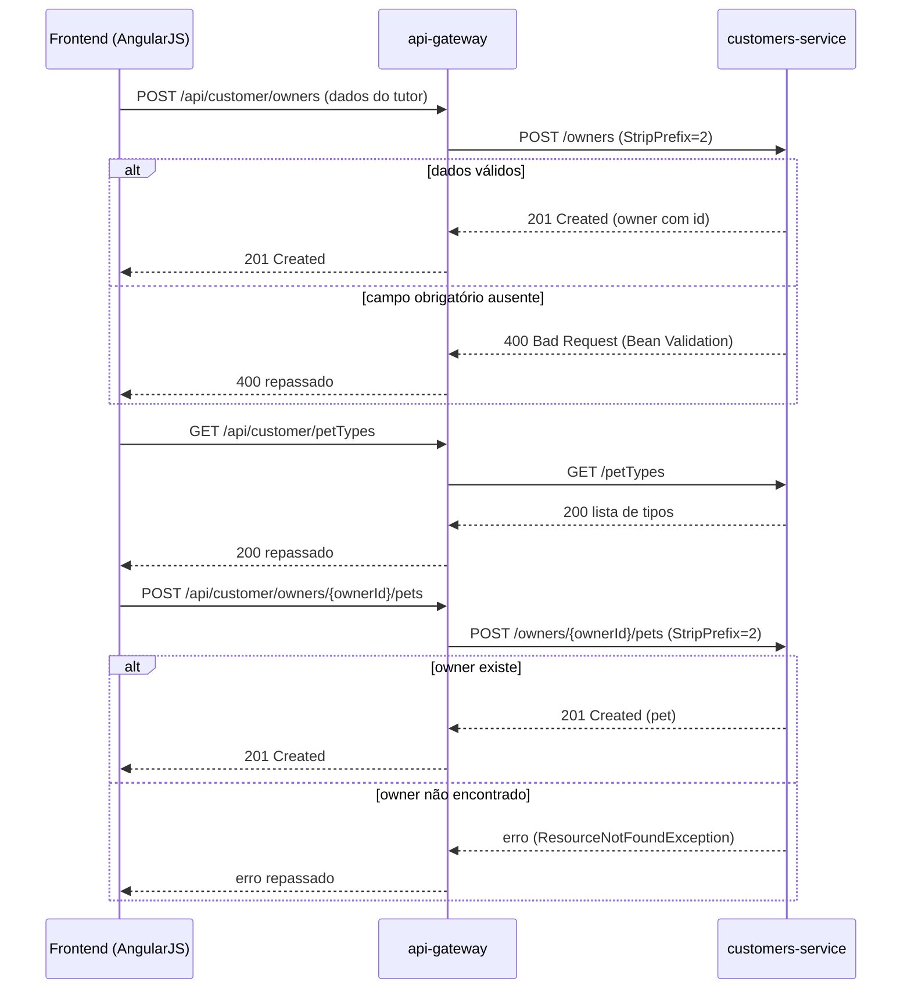

# Cadastro de tutor e pet: sequência técnica
Realiza as etapas do [fluxo macro](./flow-cadastro-tutor-pet.md).

## Diagrama

## Passos
### Passo 1
`api-gateway` recebe a requisição do frontend na rota `/api/customer/**` e a repassa, via Eureka (`lb://customers-service`) e `StripPrefix=2`, para `POST /owners` no `customers-service`. Ver contrato [ctr-customers-post-owners](../sistemas/customers-service/contratos/ctr-customers-post-owners.md).

### Passo 2
Antes de cadastrar o pet, o frontend consulta `GET /petTypes` para popular a lista de tipos válidos (ver [ctr-customers-get-pettypes](../sistemas/customers-service/contratos/ctr-customers-get-pettypes.md)). Em seguida, envia `POST /owners/{ownerId}/pets` (ver [ctr-customers-post-pet](../sistemas/customers-service/contratos/ctr-customers-post-pet.md)).

### Caminho de erro
- Se o `ownerId` informado não existir, `customers-service` lança `ResourceNotFoundException` — o `api-gateway` não trata esse erro de forma especial nesta rota (ele não passa pelo `ApiGatewayController` de agregação, é uma rota simples do Spring Cloud Gateway), então o erro é repassado como está ao frontend. **Inferido**: o formato exato do corpo de erro não foi confirmado nas fontes lidas.
- Falha de validação (`@NotBlank`, `@Digits`) resulta em `400` do handler padrão do Spring, antes mesmo de chegar à lógica de negócio.
