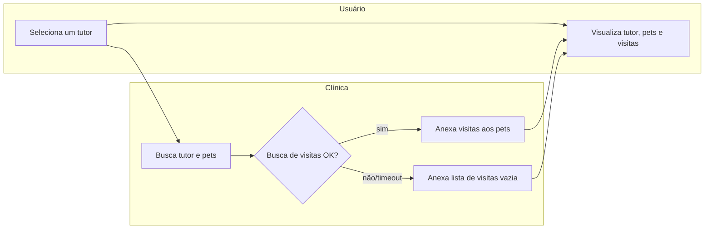

# Consulta de histórico do tutor
Permitir que a clínica veja, numa única tela, o tutor, seus pets e o histórico de visitas de cada pet — sem precisar navegar por telas separadas para cada informação.

## Atores
- **Tutor / equipe clínica** — consulta os dados de um tutor específico
- **Sistema (clínica veterinária)** — agrega os dados vindos de Cadastro e Consultas

## Etapas
| # | Etapa | Ator | Decisão ou resultado | Técnica |
|---|---|---|---|---|
| 1 | Usuário seleciona um tutor | Tutor/equipe | dispara a consulta agregada | [passo 1](./flow-consulta-historico-tutor.sequencia.md#passo-1) |
| 2 | Sistema busca o tutor e seus pets | Sistema | dados do tutor e lista de pets | [passo 1](./flow-consulta-historico-tutor.sequencia.md#passo-1) |
| 3 | Sistema busca as visitas de todos os pets do tutor | Sistema | histórico de visitas por pet, **ou lista vazia se a busca falhar** | [passo 2](./flow-consulta-historico-tutor.sequencia.md#passo-2) |
| 4 | Sistema devolve tutor + pets + visitas numa única resposta | Sistema | tela exibida ao usuário | [passo 2](./flow-consulta-historico-tutor.sequencia.md#passo-2) |

## Diagrama

## Indicadores
- Latência da consulta agregada, taxa de degradação (quantas vezes o histórico de visitas veio vazio por falha) — não encontrados no código; **a confirmar com o PM**.

## Regras que governam
- [Degradação graciosa quando o histórico de visitas falha](../regras-de-negocio/reg-degradacao-visitas.md)
