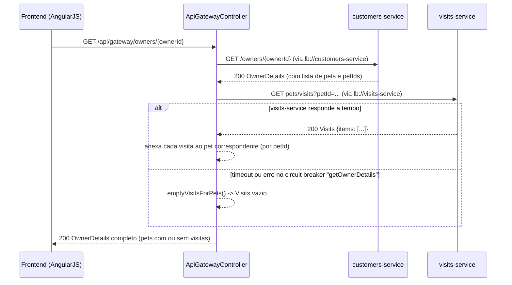

# Consulta de histórico do tutor: sequência técnica
Realiza as etapas do [fluxo macro](./flow-consulta-historico-tutor.md). Esta é a única sequência do domínio com um agregador de dados explícito no código (`ApiGatewayController`) e com um caminho de erro tratado deliberadamente (circuit breaker com fallback funcional, não apenas um erro genérico).

## Diagrama

## Passos
### Passo 1
`api-gateway` chama `customers-service` diretamente via `WebClient` (`CustomersServiceClient.getOwner`), não através de uma rota do Spring Cloud Gateway — é uma chamada de aplicação, resolvida também por `lb://customers-service` via Eureka. Ver [ctr-customers-get-owner](../sistemas/customers-service/contratos/ctr-customers-get-owner.md).

### Passo 2
Com os `petIds` do owner em mãos, `api-gateway` chama `visits-service` em lote (`VisitsServiceClient.getVisitsForPets`, uma única requisição com todos os ids) e, com `ReactiveCircuitBreakerFactory`, protege essa chamada especificamente. Ver [ctr-visits-get-visits-batch](../sistemas/visits-service/contratos/ctr-visits-get-visits-batch.md) e o contrato do próprio agregador [ctr-gateway-get-owner-details](../sistemas/api-gateway/contratos/ctr-gateway-get-owner-details.md).

### Caminho de erro
Se a chamada a `visits-service` falhar (erro ou timeout — o timeout exato do circuit breaker Resilience4j não foi encontrado nas fontes lidas, **a confirmar**), o circuit breaker `getOwnerDetails` intercepta e devolve uma lista de visitas vazia, em vez de propagar o erro ao usuário. O tutor e seus pets continuam sendo exibidos — apenas sem o histórico de visitas. Se a chamada a `customers-service` falhar, **não há fallback específico neste método**; o comportamento observado pelo usuário final não foi confirmado nas fontes lidas (provavelmente erro 5xx propagado).
