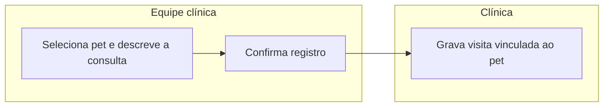

# Registro de consulta veterinária
Permitir que a equipe da clínica registre a consulta realizada em um pet, formando o histórico clínico que poderá ser consultado depois pelo tutor ou pelo próprio veterinário.

## Atores
- **Equipe clínica / veterinário** — registra a consulta realizada (inferido: o código não distingue papéis de usuário, qualquer chamador do frontend pode registrar)
- **Sistema (clínica veterinária)** — grava e disponibiliza a visita

## Etapas
| # | Etapa | Ator | Decisão ou resultado | Técnica |
|---|---|---|---|---|
| 1 | Equipe seleciona o pet e descreve a consulta realizada | Equipe clínica | descrição limitada a 8192 caracteres | [passo 1](./flow-registro-consulta.sequencia.md#passo-1) |
| 2 | Sistema grava a visita vinculada ao pet | Sistema | visita registrada com data e descrição | [passo 1](./flow-registro-consulta.sequencia.md#passo-1) |

## Diagrama

## Indicadores
- Número de consultas por período, tempo médio entre consultas — não encontrados no código; **a confirmar com o PM**.

## Regras que governam
- [Descrição da consulta limitada a 8192 caracteres](../regras-de-negocio/reg-limite-descricao-visita.md)
