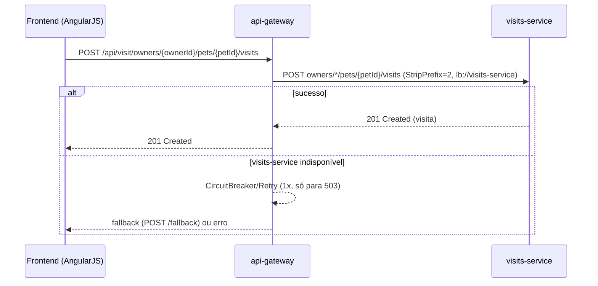

# Registro de consulta veterinária: sequência técnica
Realiza as etapas do [fluxo macro](./flow-registro-consulta.md).

## Diagrama

## Passos
### Passo 1
`api-gateway` roteia `/api/visit/**` para `visits-service` via Eureka. `VisitResource.create` ignora o `petId` do corpo e usa o do path (`visit.setPetId(petId)`), garantindo consistência do vínculo. Ver [ctr-visits-post-visit](../sistemas/visits-service/contratos/ctr-visits-post-visit.md).

### Caminho de erro
- Se `visits-service` estiver fora do ar, o filtro padrão do Gateway (`CircuitBreaker` + `Retry` para `POST`/`503`) tenta 1 vez antes de cair no fallback genérico (`/fallback`, sempre `503`).
- `visits-service` **não valida** se o `petId` existe de fato em `customers-service` antes de gravar — uma visita pode ser registrada para um `petId` inexistente sem erro (ver nota em [sys-visits-service](../sistemas/visits-service/ficha.md)). **A confirmar com o arquiteto** se isso é aceitável ou se falta uma validação.
