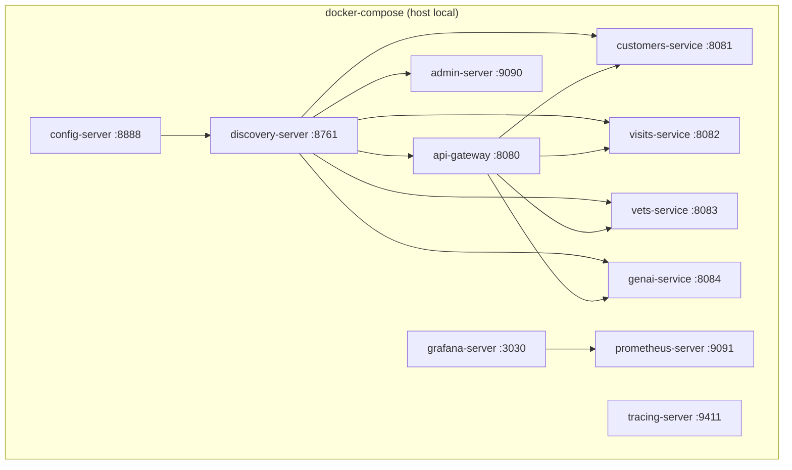

# Ambiente local via Docker Compose
Sobe toda a stack (serviços de negócio + plataforma + observabilidade) em containers na mesma máquina, para desenvolvimento e demonstração. Não há evidência neste repositório de um ambiente de homologação ou produção real (nuvem, Kubernetes, Terraform) — apenas este compose local. **A confirmar com o time de infraestrutura.**

## Implantação

Ordem de subida (via `depends_on` + `condition: service_healthy`): `config-server` → `discovery-server` → demais serviços. Cada serviço de negócio expõe uma porta fixa mapeada no host: `customers-service` 8081, `visits-service` 8082, `vets-service` 8083, `genai-service` 8084, `api-gateway` 8080, `admin-server` 9090, `discovery-server` 8761, `config-server` 8888. Todos os containers têm limite de memória de 512M (256M para Grafana/Prometheus).
